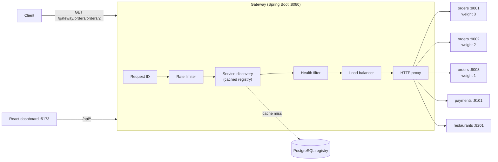
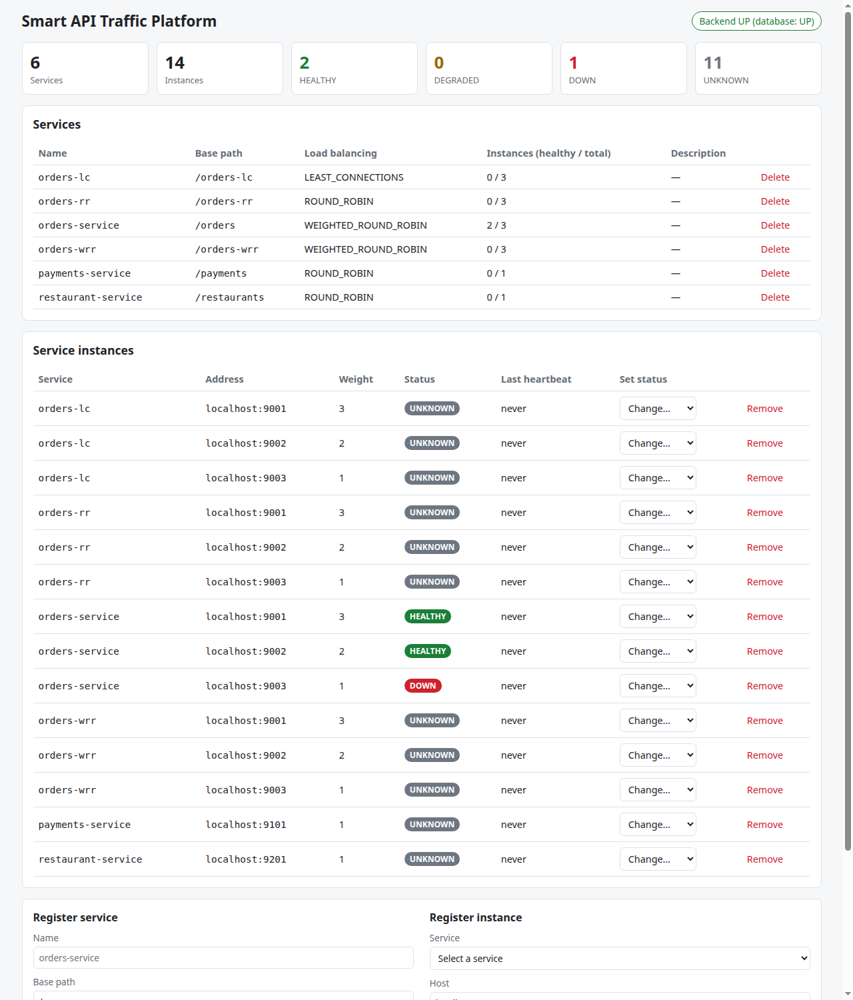

# Smart API Traffic & Failure Management Platform

An API gateway that manages traffic to backend services: service registry, rate limiting, load
balancing, failure handling, and later circuit breaking, retries, health monitoring and metrics. It is
built in four phases as a learning project, and **this README only describes what is implemented so
far**. Anything marked *Planned* does not exist yet. The complete README is written at the end of
Phase 4.

## Status

| Phase | Scope | Status |
|---|---|---|
| 1. Foundation & core backend | Service registry (PostgreSQL), REST APIs, health endpoint, React dashboard | **Implemented** |
| 2. Intelligent traffic management | Gateway proxy, 3 rate limiters, 3 load balancers, health filtering, failure handling, request IDs, demo services | **Implemented** |
| 3. Distributed features & monitoring | Circuit breaker, retry engine (backoff + jitter), Redis-backed rate limits, automatic health checks, persisted request logs, Prometheus/Grafana, dashboard pages | Planned |
| 4. Productionisation | Testcontainers, failure-simulation demo, Docker for all components, CI/CD, k6 load tests, JWT security | Planned |

## What works today

**Phase 1: registry**
- Register **services** (e.g. `orders-service` at `/orders`, with a load-balancing strategy) and their
  **instances** (`host:port`, weight) through a REST API backed by PostgreSQL.
- Validation with per-field error messages; consistent RFC 9457 `problem+json` errors.
- `GET /api/health` reports database status (503 when the database is down).
- A React dashboard listing services and instances, with forms to register them.

**Phase 2: gateway** (details below)
- `ANY /gateway/{service-path}/**` is proxied to a healthy instance of the matching service.
- Rate limiting with **fixed window, sliding window or token bucket** (our own implementations), keyed
  by IP, user and/or endpoint, returning 429 + `Retry-After`.
- Load balancing with **round robin, smooth weighted round robin or least connections**, per service.
- Health filtering (DOWN instances never receive traffic) and failover when a connection is refused.
- Gateway error codes: 400, 404, 429, 502, 503, 504; backend responses (including 500) passed through.
- `X-Request-ID` on every request, forwarded to backends, and one structured access-log line per request.
- Demo orders / payments / restaurant services with failure injection, plus a load-test tool.
- **115 automated tests** (108 backend + 7 demo-service), including concurrency tests.

## Phase 2: Intelligent Traffic Management

### Architecture



### Features

| Feature | Implementation | Where |
|---|---|---|
| Gateway routing | `/gateway/{basePath}/{rest}` → instance `/{rest}`, all HTTP methods, query string and body forwarded | `routing/GatewayService`, `routing/RouteResolver` |
| Service discovery | Registry lookup with a 5 s TTL cache, invalidated on registry changes after commit | `routing/ServiceDiscovery` |
| Health filtering | `DOWN` excluded; `HEALTHY`, `DEGRADED`, `UNKNOWN` routable. Manual override: `PATCH /api/service-instances/{id}/status` | `routing/HealthFilter` |
| Rate limiting | `RateLimiter` interface; fixed window, sliding window log, token bucket; chosen by config | `ratelimit/` |
| Rate-limit keys | `IP`, `USER` (`X-User-Id`, unverified until Phase 4), `ENDPOINT`, or combinations | `ratelimit/RateLimitKeyResolver` |
| Load balancing | `LoadBalancingStrategy` interface; round robin, smooth weighted RR, least connections | `loadbalancer/` |
| Proxying | Spring `RestClient` on the JDK `HttpClient`; 1 s connect / 5 s response timeouts | `routing/ProxyClient` |
| Failover | Connection refused → next instance (up to 3); timeouts are **not** retried | `routing/GatewayService` |
| Request IDs | `X-Request-ID` reused if safe, else a UUID; in every log line (MDC), forwarded, returned | `web/RequestIdFilter` |
| Access log | One `key=value` line per request: id, client, user, service, instance, attempts, status, latency, rate-limit result | `routing/GatewayAccessLog` |
| Demo services | One Spring Boot app run as orders ×3, payments, restaurants; `/_chaos` failure injection | `services/demo-service` |

### Request lifecycle

1. **RequestIdFilter** assigns `X-Request-ID` and puts it in the logging context.
2. **RouteResolver** splits `/gateway/orders/orders/2` into service `/orders` and path `/orders/2`
   (400 if malformed or it contains `..`).
3. **RateLimiter** checks the client's budget (429 + `Retry-After` if exceeded). This runs before any
   lookup, so rejected floods cost almost nothing.
4. **ServiceDiscovery** finds the service and its instances (404 if no service owns the path).
5. **HealthFilter** removes `DOWN` instances (503 if none remain).
6. **LoadBalancer** picks one instance using the service's configured strategy.
7. **ProxyClient** forwards the request. A refused connection tries another instance (503 if all
   fail); no response within 5 s gives 504; a broken response gives 502. Otherwise the backend's
   response, **including its own 4xx/5xx**, is returned unchanged.
8. **GatewayAccessLog** writes one structured line, whatever the outcome.

### Rate limiters compared

| | Fixed window | Sliding window (log) | Token bucket (default) |
|---|---|---|---|
| Idea | N per aligned window, counter resets | N in any rolling window, timestamp queue | bucket of N tokens refilling at N/window |
| Time / request | O(1) | amortised O(1) | O(1) |
| Memory per key | 1 counter | up to N timestamps | 2 numbers |
| Weakness | up to 2N at a window boundary (tested) | memory grows with N | allows a burst of N by design |

### Load balancers compared (measured, 600 requests, weights 3/2/1)

| Strategy | Sequential | 20 concurrent, instance 9003 slowed to 100 ms |
|---|---|---|
| Round robin | 200 / 200 / 200 | 200 / 200 / 200 |
| Weighted round robin (smooth) | 300 / 200 / 100 | 300 / 200 / 100 |
| Least connections | 200 / 200 / 200 | **283 / 254 / 63** |

### API examples

```bash
# Route through the gateway (service /orders, backend path /orders/2)
curl -i localhost:8080/gateway/orders/orders/2 -H 'X-Request-ID: demo-trace-0001'
# -> 200, X-Request-ID: demo-trace-0001
# {"service":"orders-service","instance":"orders-9001","message":"Request handled successfully",
#  "requestId":"demo-trace-0001","data":{"id":2,"item":"Paneer Tikka",...}}

curl -X POST localhost:8080/gateway/payments/payments -H 'Content-Type: application/json' \
     -d '{"orderId":2,"amount":349.0}'                     # -> 201 from payments-9101

# Take an instance out of rotation (and back)
curl -X PATCH localhost:8080/api/service-instances/3/status -H 'Content-Type: application/json' \
     -d '{"status":"DOWN"}'

# Errors are problem+json with the request id
curl localhost:8080/gateway/unknown/x
# -> 404 {"title":"Route not found","detail":"No service is registered for path '/unknown'","requestId":"..."}
```

### Configuration (`backend/src/main/resources/application.yml`)

```yaml
gateway:
  proxy:
    connect-timeout: 1s
    response-timeout: 5s
    max-connect-attempts: 3
  discovery:
    cache-ttl: 5s              # 0 disables the cache
  rate-limit:
    enabled: true
    algorithm: TOKEN_BUCKET    # FIXED_WINDOW | SLIDING_WINDOW | TOKEN_BUCKET
    limit: 100
    window: 1m
    key-by: IP                 # IP, USER, ENDPOINT or e.g. USER,ENDPOINT
    trust-forwarded-for: false
```

Any value can be overridden at startup, e.g. `--gateway.rate-limit.limit=5`.

### Demo

Prerequisites: PostgreSQL running and the gateway started (see Quick start).

```bash
scripts/start-demo-services.sh          # orders :9001-9003, payments :9101, restaurants :9201
scripts/register-demo-services.sh       # orders = WEIGHTED_ROUND_ROBIN with weights 3/2/1
```

| Demo | Steps | Expected (measured) result |
|---|---|---|
| 1. Routing | `curl localhost:8080/gateway/orders/orders/2` | 200 from an orders instance, request id echoed |
| 2. Load balancing | `java tests/load/LoadTest.java --url http://localhost:8080/gateway/orders/orders --requests 60 --concurrency 1` | `served by: orders-9001=30, orders-9002=20, orders-9003=10` |
| 3. Rate limiting | restart the gateway with `--gateway.rate-limit.algorithm=SLIDING_WINDOW --gateway.rate-limit.limit=5 --gateway.rate-limit.window=10s`, then send 6 requests | requests 1–5 → 200 (remaining 4…0), request 6 → **429, `Retry-After: 10`** |
| 4. Instance failure | `scripts/stop-demo-services.sh 9003`, send 60 requests; then `PATCH` 9003 `DOWN`, send 60 more | all 60 succeed (11 refusals failed over); after DOWN, 0 attempts to 9003 |
| 5. Strategies | start the gateway with `--gateway.rate-limit.enabled=false`, run `tests/load/compare-strategies.sh` | the table above |
| Backend 500 | `curl -X POST 'localhost:9002/_chaos?mode=ERROR'` | 1 in 3 requests (9002's weight share) returns the backend's 500 |
| Timeout | `curl -X POST 'localhost:9001/_chaos?mode=SLOW&delayMs=6000'` | 504 after ~5 s |

Stop with `scripts/stop-demo-services.sh`. Full walk-through and outputs: [Phase 2 guide](docs/phase-2-guide.md#18-measured-results).

### Measured results

Measured on one laptop (Intel i5-1035G1, 4 cores / 8 threads, 7.6 GB) running the gateway, five demo
JVMs, PostgreSQL and the load generator together. **These numbers compare configurations on this
machine; they are not a capacity claim.** Single runs varied by up to ~30%. Raw output:
[`docs/results/phase-2`](docs/results/phase-2).

| Measurement | Result |
|---|---|
| 1000 requests, concurrency 20, via gateway | 1000/1000 succeeded, 361.9 req/s, avg 54.8 ms, p95 103.8 ms, p99 267.4 ms |
| Same, direct to one backend (no gateway) | 1084.8 req/s, avg 18.2 ms, p95 28.4 ms |
| Profiling (Java Flight Recorder) | 65% of gateway CPU was per-request registry queries, 1.3% after adding the discovery cache |
| Discovery cache off → on (3000 requests, 2 runs each) | 352–396 → 574–639 req/s; gateway CPU per request 10.8–12.4 → 5.9–6.5 ms |
| Rate limiting, default 100/min token bucket, 1000 requests | 103 allowed (100 burst + refill), 897 × 429, 0.18 ms average per rejection |
| Backend timeout (6 s backend, 5 s limit) | 504 after 5.009 s |

### Screenshots

| | |
|---|---|
| Dashboard with one instance marked DOWN and the new status control |  |
| *To add:* terminal showing Demo 3 (requests 1–5 → 200, 6 → 429) | `docs/images/phase2-rate-limit.png` |
| *To add:* terminal showing the `LoadTest` distribution 30/20/10 | `docs/images/phase2-distribution.png` |

## Quick start

**Prerequisites:** JDK 21, Node.js ≥ 20.19, and PostgreSQL 16+ (installed locally or via Docker).
Maven is **not** required; the repo includes the Maven Wrapper (`./mvnw`).

```bash
git clone <your-repo-url> smart-api-traffic-platform
cd smart-api-traffic-platform
cp .env.example .env              # then edit DB_PASSWORD
```

**1. Start PostgreSQL**, either with Docker:

```bash
docker compose up -d postgres
```

or natively (Ubuntu/Mint), using the password you put in `.env`:

```bash
sudo apt install postgresql
sudo -u postgres psql -c "CREATE ROLE smart_api LOGIN PASSWORD 'your-password';"
sudo -u postgres psql -c "CREATE DATABASE smart_api OWNER smart_api;"
```

**2. Start the backend** (Flyway creates the tables on first start):

```bash
cd backend
set -a; source ../.env; set +a    # export the variables from .env
./mvnw spring-boot:run
```

**3. Start the dashboard** in another terminal:

```bash
cd frontend
npm install
npm run dev                       # open http://localhost:5173
```

**4. Try the API:**

```bash
curl -X POST localhost:8080/api/services -H 'Content-Type: application/json' \
     -d '{"name":"orders-service","basePath":"/orders","loadBalancingStrategy":"WEIGHTED_ROUND_ROBIN"}'
curl -X POST localhost:8080/api/service-instances -H 'Content-Type: application/json' \
     -d '{"serviceId":1,"host":"localhost","port":9001,"weight":3}'
curl localhost:8080/api/service-instances
curl localhost:8080/api/health
```

Then follow the [Demo](#demo) section to run backends and route traffic through the gateway.

## Tests

```bash
cd backend && ./mvnw verify                    # 108 tests: unit, concurrency, web, integration (embedded PostgreSQL)
cd services/demo-service && ./mvnw verify      # 7 tests
cd frontend && npm run build                   # type-check and production build
```

The gateway integration tests start the real gateway on a random port and route to real HTTP stub
servers that can be healthy, return 500, be slow, or refuse connections. Time-based logic is tested
with an injected `Clock`, so no test depends on `Thread.sleep`.

## API

| Method | Path | Description | Phase |
|---|---|---|---|
| POST | `/api/services` | Register a service → 201 + `Location` | 1 |
| GET | `/api/services` | List services | 1 |
| GET | `/api/services/{id}` | Get one service | 1 |
| DELETE | `/api/services/{id}` | Delete a service and its instances → 204 | 1 |
| POST | `/api/service-instances` | Register an instance → 201 + `Location` | 1 |
| GET | `/api/service-instances?serviceId=` | List instances (optionally for one service) | 1 |
| GET | `/api/service-instances/{id}` | Get one instance | 1 |
| PATCH | `/api/service-instances/{id}/status` | Set `HEALTHY` / `DEGRADED` / `DOWN` → 200 | 2 |
| DELETE | `/api/service-instances/{id}` | Remove an instance → 204 | 1 |
| GET | `/api/health` | Backend + database health (200 / 503) | 1 |
| ANY | `/gateway/{service-path}/**` | Proxied to an instance; 400 / 404 / 429 / 502 / 503 / 504 on gateway errors | 2 |

## Known limitations

Not a production system. The most important gaps (full list: [Phase 2 review](docs/phase-2-guide.md#20-strict-code-review)):
- **No authentication yet** (Phase 4). Anyone can register instances, and the gateway would proxy to them.
- `X-User-Id` is not verified, so per-user limits can be evaded; the default key is the client IP.
- Rate-limit state lives in each gateway process: several gateways would each allow the full limit (Redis in Phase 3).
- Instance health is set manually; automatic health checks are Phase 3.
- Request and response bodies are buffered in memory with no size limit yet.

## Documentation

- [Architecture](docs/architecture.md): target design, what's built, layer responsibilities
- [Database design](database/README.md): ER diagram, keys, indexes, normalisation
- [Phase 1 guide](docs/phase-1-guide.md): registry concepts, bugs found, interview questions
- [Phase 2 guide](docs/phase-2-guide.md): gateway, rate limiting, load balancing, concurrency, measured results, code review, interview questions
- [Phase 2 raw results](docs/results/phase-2): every measurement quoted above

## Project structure

```
backend/                 Spring Boot gateway + registry (Java 21, Spring Boot 3.5)
  .../controller/        REST controllers (registry API, gateway entry point)
  .../routing/           gateway pipeline: route resolution, discovery, health filter, proxy
  .../ratelimit/         RateLimiter interface + 3 algorithms
  .../loadbalancer/      LoadBalancingStrategy interface + 3 algorithms, connection tracker
  .../web/               request-id filter, client IP resolution
  .../service, repository, entity, dto, exception, config   (Phase 1 layers)
services/demo-service/   demo orders / payments / restaurant backends
frontend/                React 19 + TypeScript dashboard (Vite)
scripts/                 start / stop / register the demo services
tests/load/              LoadTest.java and the strategy-comparison script
database/                schema documentation and ER diagram
docs/                    architecture, phase guides, measured results, images
monitoring/              Prometheus + Grafana config (Phase 3)
docker/                  Dockerfiles (Phase 4)
```

`scripts/` is new in Phase 2: it holds demo automation that is neither application code nor a test.

## License

[MIT](LICENSE)
