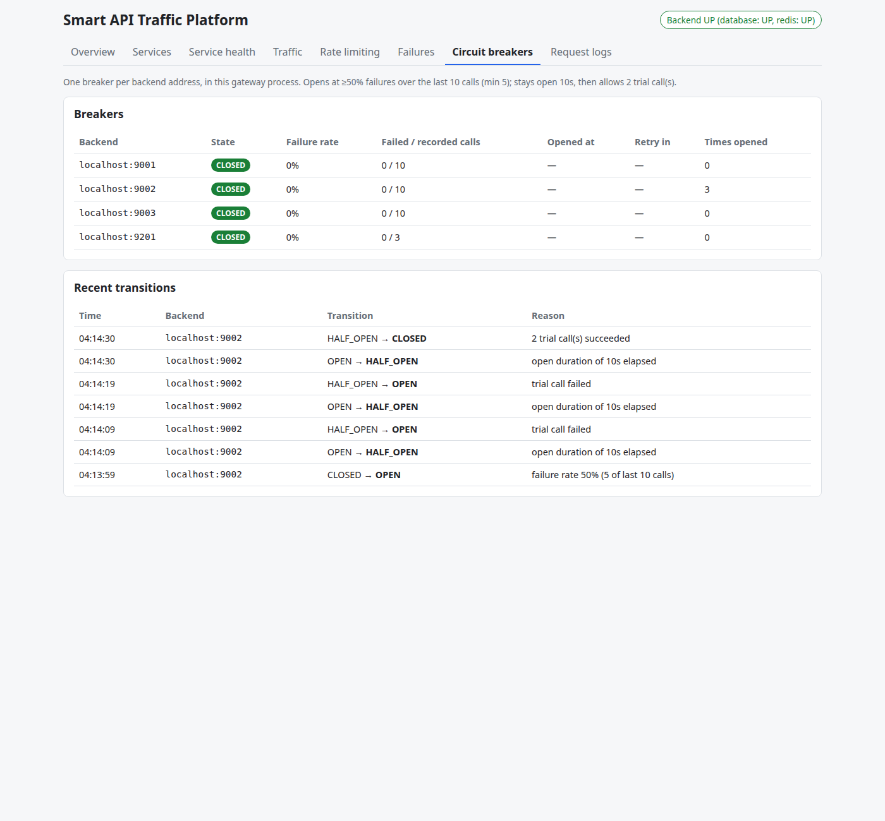
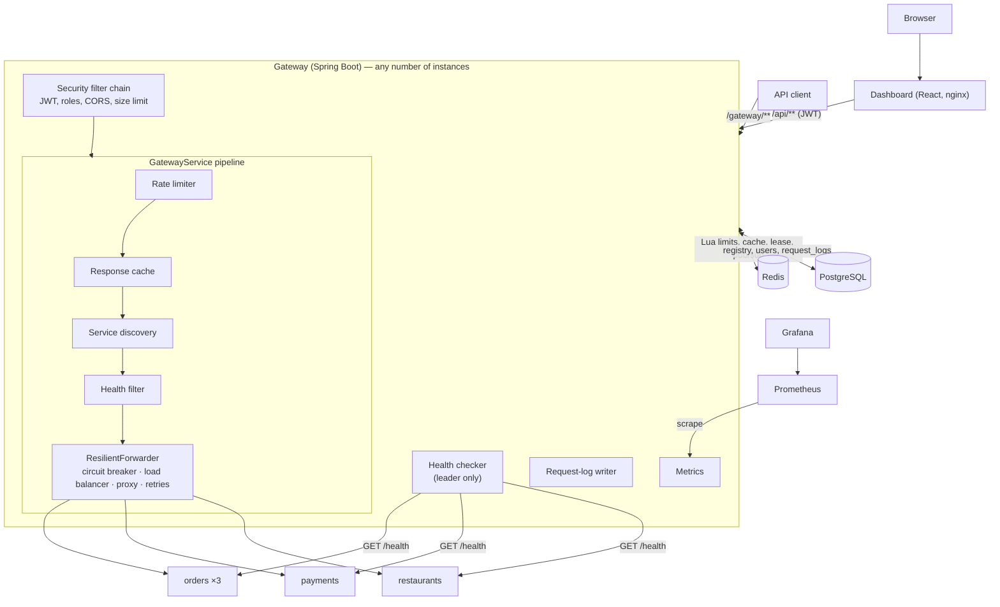
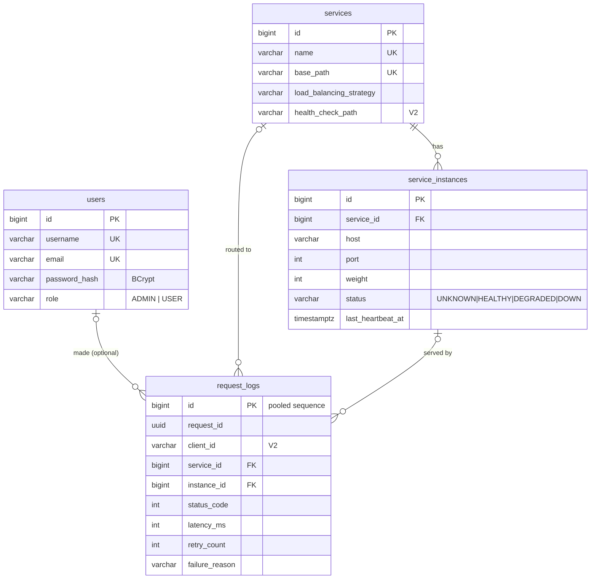
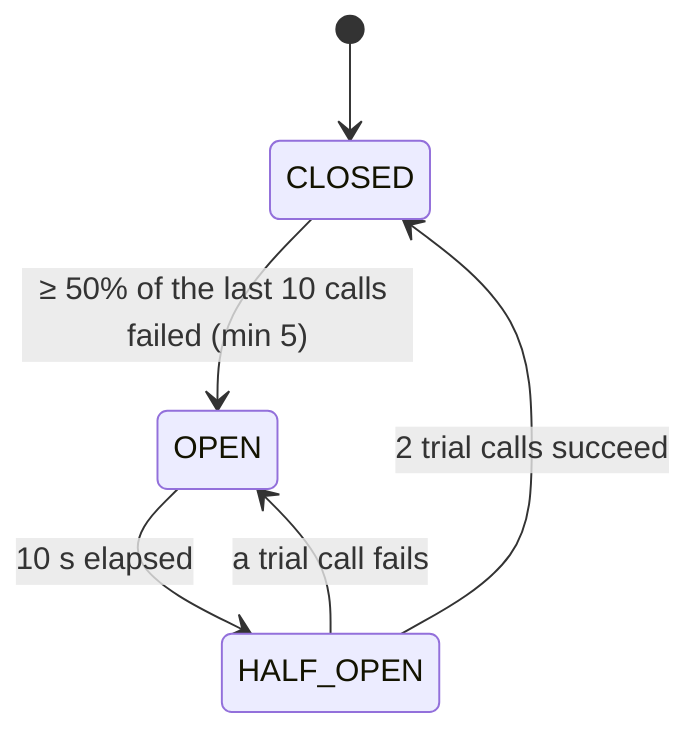

# Smart API Traffic & Failure Management Platform

An **API gateway**, written from scratch in Java / Spring Boot, that sits between clients and backend
services and decides, for every request, **whether** it may proceed (authentication, rate limiting),
**where** it should go (service discovery, health, load balancing) and **what to do when things fail**
(circuit breakers, retries, timeouts). Everything it does is visible in a React dashboard and in
Prometheus/Grafana.

It is a learning project built in four phases, and **everything in this README describes what is
actually implemented and was actually run**. Measurements come from one laptop and are labelled as
such. Nothing is claimed about production traffic, because there has been none.



---

## Contents

1. [Overview](#1-overview) · 2. [The real-world problem](#2-the-real-world-problem) ·
3. [Features](#3-features) · 4. [Architecture](#4-architecture) ·
5. [Request lifecycle](#5-request-lifecycle) · 6. [Project structure](#6-project-structure) ·
7. [Technology stack](#7-technology-stack) · 8. [Database design](#8-database-design) ·
9. [API documentation](#9-api-documentation) · 10. [Rate limiting](#10-rate-limiting) ·
11. [Load balancing](#11-load-balancing) · 12. [Circuit breaker](#12-circuit-breaker) ·
13. [Retry mechanism](#13-retry-mechanism) · 14. [Redis](#14-redis) ·
15. [Concurrency](#15-concurrency) · 16. [Monitoring](#16-monitoring) ·
17. [Security](#17-security) · 18. [Failure simulation](#18-failure-simulation) ·
19. [Testing](#19-testing) · 20. [Performance results](#20-performance-results) ·
21. [Docker setup](#21-docker-setup) · 22. [Local setup without Docker](#22-local-setup-without-docker) ·
23. [Configuration](#23-configuration) · 24. [Demo walkthrough](#24-demo-walkthrough) ·
25. [Screenshots](#25-screenshots) · 26. [Design decisions](#26-design-decisions) ·
27. [Trade-offs and limitations](#27-trade-offs-and-limitations) ·
28. [Future improvements](#28-future-improvements) · 29. [Learning outcomes](#29-learning-outcomes) ·
30. [Interview questions](#30-interview-questions) · 31. [Resume section](#31-resume-section) ·
32. [Further documentation](#32-further-documentation)

---

## 1. Overview

**In simple terms.** A food-delivery app calls an *orders* service, a *payments* service and a
*restaurants* service, each running as several copies. Something must stand in front of them and:
let only legitimate, not-too-greedy clients in; send each request to a working copy; stop sending
traffic to a copy that is failing; retry sensibly when a failure is temporary; and show operators
what is happening. That "something" is an API gateway, and this project builds one.

**Technically.** A Spring Boot 3.5 / Java 21 gateway with:
- a PostgreSQL **service registry**;
- a per-request pipeline of **JWT authentication → rate limiting (3 algorithms, Redis-backed) →
  response cache → service discovery → health filter → circuit breaker → load balancing (3
  algorithms) → HTTP proxy with retries**;
- **active health checks** with leader election;
- asynchronous **request logging**;
- **Prometheus** metrics.

Around it: five demo backend services with failure injection, a React/TypeScript dashboard, a
provisioned Grafana dashboard, Docker Compose for the whole stack, and a GitHub Actions pipeline.

**Who would use it.** A platform or backend team running several internal services behind one
entry point: the same role that NGINX, Kong, Envoy or Spring Cloud Gateway play in real systems. The
point of this project is to implement and understand those mechanisms, not to replace them.

---

## 2. The real-world problem

An application depends on several backend services. Then:

- one service becomes **slow**: every request to it holds a thread until it times out;
- another starts returning **errors**;
- traffic **spikes**, or one client floods the API;
- clients **retry** everything, multiplying load at the worst moment.

Without traffic management, threads pile up waiting on the slow service, and healthy services start
failing too (a **cascading failure**). Retries turn a partial outage into a full one (a **retry
storm**), and nobody can see which component is actually at fault.

How this project answers each problem, with the measured evidence:

| Problem | Mechanism | Evidence |
|---|---|---|
| One client floods the API | Rate limiting per IP / user / endpoint, shared by all gateways (Redis) | 2 gateways × 1000 concurrent requests → exactly the limit allowed ([§14](#14-redis)) |
| A backend copy dies | Active health checks → DOWN → no traffic; refused connections fail over | [failure timeline](docs/results/phase-4/failure-simulation.txt) |
| A backend is alive but failing or slow | Circuit breaker opens → fail fast (503 + Retry-After) → trial calls → close | circuit ON vs OFF with a slow instance ([§20](#20-performance-results)) |
| Transient errors | Retries with exponential backoff + jitter, only when safe (idempotent) | integration tests, `X-Retry-Count` |
| Retries amplify an outage | Retry budget (≤ ~20% extra load) | 1000 failing requests → 200 retries (unit test) |
| Repeated reads of static data | Shared response cache that obeys `Cache-Control` | cache ON vs OFF ([§20](#20-performance-results)) |
| "What is happening?" | Request logs, traffic statistics, Prometheus + Grafana, dashboard | [screenshots](#25-screenshots) |

---

## 3. Features

| Feature | Summary |
|---|---|
| **API gateway** | `ANY /gateway/{service-path}/**` → a chosen backend instance; method, query string, body and headers forwarded; hop-by-hop headers stripped; `X-Forwarded-*` added |
| **Service registry** | Services (name, base path, LB strategy, health path) and instances (host, port, weight, status) in PostgreSQL; REST CRUD |
| **Rate limiting** | Fixed window, sliding window log, token bucket, implemented by hand; keyed by IP, user and/or endpoint; in memory or **Redis (atomic Lua)** with local fallback; 429 + `Retry-After` + `X-RateLimit-*` |
| **Load balancing** | Round robin, smooth weighted round robin, least connections, behind a `LoadBalancingStrategy` interface (Strategy pattern) |
| **Circuit breaker** | Hand-written CLOSED / OPEN / HALF_OPEN state machine per backend, ring-buffer failure rate |
| **Retry engine** | Exponential backoff + jitter, transient vs permanent failures, idempotency (incl. `Idempotency-Key`), lock-free retry budget |
| **Redis** | Shared rate limits, shared response cache, pub/sub cache invalidation across gateways, leader lease for health checks; everything degrades gracefully when Redis is down |
| **Health monitoring** | Active probes every 5 s on a thread pool; HEALTHY / DEGRADED / DOWN with hysteresis; latency, availability, uptime, heartbeat |
| **Request logging** | Every request persisted asynchronously (bounded queue → batch insert); search by filters or request id; traffic stats with p50/p95/p99 |
| **Authentication & authorization** | JWT (HS256), BCrypt passwords, ADMIN vs USER roles, login brute-force limit, CORS, security headers, request/response size limits, SSRF guard |
| **Failure simulation** | Admin API + dashboard controls: make a backend return 500s, become slow, time out, or become unavailable, and recover |
| **PostgreSQL** | Flyway migrations (V1, V2), constraints, indexes chosen from queries, batch-friendly sequence for logs |
| **React dashboard** | Sign-in, Overview, Services, Service health (with failure simulation), Traffic, Rate limiting, Failures, Circuit breakers, Request logs |
| **Prometheus & Grafana** | Micrometer metrics at `/actuator/prometheus`; a provisioned 16-panel dashboard |
| **Docker** | Multi-stage non-root images; Compose with 12 containers (gateway, dashboard, 5 backends, one-shot setup, PostgreSQL, Redis, Prometheus, Grafana) |
| **CI/CD** | GitHub Actions: lint (javac `-Xlint -Werror`, ESLint, shellcheck) → tests (Testcontainers) → Docker build → full-stack smoke test |
| **Testing** | 187 backend tests + 10 demo-service tests, including concurrency and failure tests; load-test tool and suite |

---

## 4. Architecture



| Component | Responsibility |
|---|---|
| **Security filter chain** | Verifies Bearer JWTs, enforces roles on `/api/**`, CORS, security headers, rejects oversized bodies |
| **Rate limiter** | One budget per key (IP / user / endpoint); Redis Lua scripts shared by all gateways; local fallback |
| **Response cache** | Serves backend-approved GET responses from Redis |
| **Service discovery** | Resolves `/orders` → service + instances from the registry, through a TTL cache invalidated by events and Redis pub/sub |
| **Health filter** | Drops DOWN instances |
| **ResilientForwarder** | For each attempt: circuit breaker permission → load-balancing strategy → HTTP proxy; retries per policy and budget |
| **Health checker** | Probes all instances in parallel; writes status changes; one gateway at a time (Redis lease) |
| **Request-log writer** | Bounded queue → batched inserts into `request_logs` |
| **Metrics** | Prometheus metrics for traffic, latency, resilience and backend health |
| **Demo services** | One Spring Boot app run as orders ×3, payments and restaurants, with failure injection |

More detail: [docs/architecture.md](docs/architecture.md).

---

## 5. Request lifecycle

`GET /gateway/orders/orders/2` with a valid token:

1. **Request ID.** `RequestIdFilter` reuses a safe client `X-Request-ID` or generates a UUID, and puts
   it in the logging context and the response.
2. **Size limit.** Bodies over 1 MiB → **413**, before anything reads them.
3. **Authentication.** A present token must verify (signature, expiry, issuer) or it's **401**.
   Anonymous traffic is allowed on `/gateway/**` by default and is limited per IP.
4. **Route resolution.** `/gateway/orders/orders/2` → service `/orders`, backend path `/orders/2`
   (**400** for malformed paths or `..`).
5. **Rate limiting.** The key is built from the token's subject, the IP or the endpoint. Redis runs
   the configured algorithm atomically. Over the limit → **429** + `Retry-After`. This runs *before*
   any lookup, so rejected floods cost almost nothing.
6. **Response cache.** A cacheable GET that's already cached → returned with `X-Cache: HIT`, no backend call.
7. **Service discovery.** Find the service and its instances (cached). Unknown → **404**.
8. **Health filter.** Drop DOWN instances. None left → **503**.
9. **Circuit breaker.** Drop instances whose circuit is OPEN. All open → **503** + `Retry-After`.
10. **Load balancer.** The service's strategy picks one instance.
11. **Proxy.** Forward over HTTP with a 1 s connect and 5 s response timeout.
    - success, or any 4xx → recorded as a success; response returned unchanged;
    - refused / timeout / 502 / 5xx → recorded as a failure on that instance's circuit;
    - transient + safe to repeat + budget left → back off (100 → 200 ms, ±20%) and go to step 9,
      preferring another instance.
12. **Result.** The backend's response (even its own 500), or **502** (broken or oversized response),
    **503** (nothing reachable) or **504** (timeout). Headers `X-Retry-Count` and `X-RateLimit-*`.
13. **Logging & metrics.** One structured access-log line, a `request_logs` row queued for the batch
    writer, Prometheus counters and the latency histogram updated.

---

## 6. Project structure

```
backend/                          Gateway + control plane (Spring Boot, Java 21)
  src/main/java/com/smartapi/gateway/
    controller/   REST controllers: registry, gateway entry point, auth, logs, health, simulations
    service/      registry business rules; RegistryChangedEvent; backend host policy (SSRF)
    repository/   Spring Data JPA repositories
    entity/ dto/  JPA entities (never returned directly) and request/response records
    exception/    domain + gateway exceptions, GlobalExceptionHandler (RFC 9457 problem+json)
    config/       GatewayProperties (typed, validated config), HTTP client, rate-limiter factory, Clock
    routing/      pipeline: route resolver, discovery (+cache), health filter, forwarder, proxy client
    ratelimit/    RateLimiter interface; fixed/sliding/token-bucket (memory + Redis); key resolver
    loadbalancer/ LoadBalancingStrategy interface; round robin, weighted RR, least connections
    resilience/   circuit breaker, retry policy / budget / decider
    redis/        RedisGuard, pub/sub invalidation, leader lock
    cache/        response cache + HTTP caching rules
    health/       active health checks, status rules, reporting
    logging/      request-log writer, queries, traffic statistics, retention
    metrics/      Prometheus metrics
    security/     Spring Security config, JWT service, auth service, admin bootstrap, size filter
    simulation/   failure injection for demo backends
    web/          request-id filter, client IP resolution
  src/main/resources/
    db/migration/ Flyway V1 (schema), V2 (health path, client id, index)
    redis/        Lua scripts for the three distributed rate limiters
  src/test/java/  187 tests: unit, concurrency, web slice, integration (PostgreSQL + Redis), failure
  Dockerfile
services/demo-service/   demo backends (orders / payments / restaurants) with /_chaos, Dockerfile
frontend/                React 19 + TypeScript dashboard (Vite), nginx.conf, Dockerfile
monitoring/              Prometheus scrape configs; Grafana provisioning + dashboard (+ generator)
scripts/                 start/stop/register demo services, failure-scenario demo, CI smoke test
tests/load/              LoadTest.java (load generator), strategy comparison, performance suite
database/                schema documentation and ER diagram
docs/                    architecture, phase guides, system design, interview guide, results, images
docker/                  Docker notes (networking, image design)
legacy/                  pre-rewrite copies of replaced files (not built; rollback/comparison)
.github/workflows/ci.yml CI pipeline
docker-compose.yml       the full stack
.env.example             configuration template (placeholders only)
```

---

## 7. Technology stack

| Technology | Purpose | Why used |
|---|---|---|
| **Java 21** | Language | Records, switch expressions, strong concurrency library; LTS; the dominant backend language for SDE roles |
| **Spring Boot 3.5** | Web, DI, JPA, security, actuator | Mature and well documented; the gateway logic itself is hand-written on top |
| **Maven** (wrapper) | Build | Standard for Spring; `./mvnw` means no local Maven install |
| **PostgreSQL 17** | Registry, users, request logs | Relational constraints (unique, FK), `percentile_cont`, reliable transactions |
| **Flyway** | Schema migrations | Versioned, repeatable schema in every environment |
| **Redis 7** (8.1 locally) | Shared rate-limit state, cache, pub/sub, leases | Atomic Lua scripts, TTLs, sub-millisecond operations |
| **Spring Security + Nimbus JOSE** | JWT authentication, roles | Standard, audited crypto; we never hand-roll cryptography |
| **Micrometer + Prometheus** | Metrics | Pull-based metrics, histogram percentiles, the standard pairing with Grafana |
| **Grafana** | Dashboards | Provisioned as code |
| **React 19 + TypeScript + Vite** | Dashboard | Type-checked API models; fast builds; only `react-router-dom` added |
| **JUnit 5, Mockito, AssertJ** | Tests | Standard Java testing stack |
| **Testcontainers** | PostgreSQL/Redis in tests (CI) | Real dependencies, disposable; local fallback to embedded binaries |
| **embedded-postgres** | PostgreSQL in tests without Docker | Real PostgreSQL 17 binaries on the development machine |
| **Docker / Compose** | Packaging, full stack | One command for 12 containers |
| **GitHub Actions** | CI | Build, lint, tests, Docker smoke test on every push |
| **ESLint, shellcheck, javac -Xlint** | Static checks | Catch bugs before tests do |

---

## 8. Database design



- **Primary keys:** surrogate `BIGINT` everywhere. `request_logs` uses a sequence with `INCREMENT
  BY 50` so Hibernate can batch inserts (IDENTITY would force one round-trip per row).
- **Foreign keys:** instances → services `ON DELETE CASCADE`; logs → users/services/instances
  `ON DELETE SET NULL` (history survives deletions).
- **Constraints:** unique service name, base path, `(service_id, host, port)`, username, email;
  CHECK constraints on status, role, weight (1–100), port.
- **Indexes (chosen from queries):** `(service_id, host, port)` also serves "instances of a service"
  (leftmost prefix); `request_logs (created_at)`, `(service_id, created_at)`,
  `(status_code, created_at)`, `(request_id)`.
- **Normalisation:** 3NF for the registry. Logs deliberately copy path/method: a log records what
  happened at that time.

Full reasoning: [database/README.md](database/README.md).

---

## 9. API documentation

All errors use RFC 9457 **problem+json**: `{"type","title","status","detail","instance","requestId", …}`,
plus `errors: {field: message}` for validation failures.

### Authentication

| Method | Path | Access | Request | Response | Status codes |
|---|---|---|---|---|---|
| POST | `/api/auth/register` | public | `{"username","email","password"}` (password 12–72 chars) | user (role USER) | 201, 400, 409 |
| POST | `/api/auth/login` | public (10/min per IP) | `{"username","password"}` | `{"accessToken","tokenType":"Bearer","expiresAt","username","role"}` | 200, 400, 401, 429 |
| GET | `/api/auth/me` | any user | — | current user | 200, 401 |

### Registry

| Method | Path | Access | Purpose | Status codes |
|---|---|---|---|---|
| POST | `/api/services` | ADMIN | Register `{"name","basePath","description?","loadBalancingStrategy?","healthCheckPath?"}` | 201 + Location, 400, 409 |
| GET | `/api/services`, `/api/services/{id}` | any user | List / get | 200, 404 |
| DELETE | `/api/services/{id}` | ADMIN | Delete service + instances | 204, 404 |
| POST | `/api/service-instances` | ADMIN | Register `{"serviceId","host","port","weight?"}` | 201, 400 (unknown service, blocked host), 409 |
| GET | `/api/service-instances?serviceId=` | any user | List | 200 |
| PATCH | `/api/service-instances/{id}/status` | ADMIN | Manual status `{"status":"DOWN"}` (overwritten by health checks when enabled) | 200, 400, 404 |
| DELETE | `/api/service-instances/{id}` | ADMIN | Remove | 204, 404 |

### Gateway

| Method | Path | Access | Behaviour |
|---|---|---|---|
| ANY | `/gateway/{base-path}/**` | anonymous or Bearer token | Proxied to an instance. Responses carry `X-Request-ID`, `X-Retry-Count`, `X-RateLimit-Limit/Remaining`, `X-Cache`. Gateway errors: 400, 401 (bad token), 404, 413, 429, 502, 503, 504 |

Example:

```bash
curl -i localhost:8080/gateway/orders/orders/2
# HTTP/1.1 200
# X-Request-ID: 2f6c…   X-Retry-Count: 0   X-RateLimit-Limit: 100   X-RateLimit-Remaining: 99
# {"service":"orders-service","instance":"orders-9001","message":"Request handled successfully",
#  "requestId":"2f6c…","data":{"id":2,"item":"Paneer Tikka","quantity":1,"status":"PREPARING"}}
```

### Operations (any signed-in user unless noted)

| Method | Path | Purpose |
|---|---|---|
| GET | `/api/health` | public. `{"status":"UP|DEGRADED|DOWN","components":{"database","redis"}}`: 200, or 503 only when the database is down |
| GET | `/api/health/instances` | per instance: status, circuit, probe latency, availability, uptime, failures, connections, heartbeat |
| POST | `/api/health/instances/check` | ADMIN: run one health-check cycle now |
| GET | `/api/circuit-breakers` | breaker states and recent transitions |
| GET | `/api/request-logs?serviceId=&status=&statusClass=&clientId=&page=&size=` | paginated request logs |
| GET | `/api/request-logs/{requestId}` | everything logged for one request id |
| GET | `/api/traffic/summary?minutes=` | totals, error / 429 / retry counts, p50/p95/p99, per minute, per service |
| GET | `/api/traffic/failures?minutes=` | failures grouped by service, status and reason |
| GET | `/api/gateway/settings` | effective rate-limit, Redis, circuit-breaker, retry and cache settings |
| GET/POST | `/api/simulations` | GET: scenarios; POST (ADMIN): `{"instanceId","scenario":"ERROR|SLOW|TIMEOUT|UNAVAILABLE|RECOVER"}` |
| GET | `/actuator/prometheus` | public, for the scraper (restrict at network level) |

---

## 10. Rate limiting

All three algorithms are implemented by hand, in memory (`ratelimit/*RateLimiter.java`) and in
Redis (`resources/redis/*.lua`).

| | Fixed window | Sliding window log | Token bucket (**default**) |
|---|---|---|---|
| Idea | N requests per aligned window; the counter resets | N requests in any rolling window; a queue of timestamps | a bucket of N tokens refilling at N per window; 1 token per request |
| Data structure | map key → (windowStart, count) | map key → deque of timestamps (Redis: sorted set) | map key → (tokens, lastRefill) (Redis: hash) |
| Time / request | O(1) | amortised O(1) | O(1) |
| Memory per key | O(1) | **O(N)** | O(1) |
| Weakness | up to **2N** across a window boundary (tested) | memory grows with N | permits a burst of N by design |

**Example, 100 per minute (fixed window).** Request 1 → allowed, 99 left. Request 50 → 50 left.
Request 100 → allowed, 0 left. Request 101 in the same minute → **429**, `Retry-After` = seconds
until the window ends. A token bucket instead refills continuously (100 / 60 s ≈ 1.67 tokens per
second). Measured: 1000 requests in ~2 s from one IP gave 100 burst + ~3 refilled allowed.

**Keys.** `IP` (TCP peer address; `X-Forwarded-For` only if explicitly trusted), `USER` (the verified
JWT subject; anonymous falls back to IP), `ENDPOINT` (method + service route, never the raw path), or
combinations such as `USER,ENDPOINT`.

**Why token bucket is the default:** O(1) memory per key, tolerant of normal client bursts, and an
exact long-run rate. It's configurable per deployment (`gateway.rate-limit.algorithm`).

**Concurrency.** In memory, check-and-update happens inside `ConcurrentHashMap.compute` (atomic per
key). In Redis, the whole check is one Lua script, atomic across all gateways. Tested: 1000 concurrent
requests → exactly the limit, for every algorithm, in memory and in Redis.

---

## 11. Load balancing

`LoadBalancingStrategy` (Strategy pattern); each service chooses its strategy in the registry.

| Strategy | Algorithm | Cost | Concurrency | Measured (600 requests, weights 3/2/1) |
|---|---|---|---|---|
| Round robin | `candidates[ticket mod n]` | O(1) | `AtomicInteger` ticket | 200 / 200 / 200 |
| Weighted round robin | **smooth WRR** (the NGINX algorithm): add weights, pick the max, subtract the total, giving A A B A for 3:1 | O(n) | per-service lock | 300 / 200 / 100 |
| Least connections | fewest in-flight requests; rotating start to spread ties | O(n) | atomic counters; benign pick race | 200/200/200 sequential; **63** of 600 to an instance slowed to 100 ms (RR sent it 200) |

In-flight counts are incremented before forwarding and decremented in `finally`. Tested: the counts
return to exactly 0 after 1000 concurrent acquire/release pairs.

---

## 12. Circuit breaker



One breaker per backend address, in each gateway process. A *failure* is a refused connection, a
timeout, a 502, or a backend 500/502/503/504; a 4xx is a success (the backend is responsive). A **ring
buffer** keeps the last 10 outcomes, so the failure rate costs O(1) per call.

**Why it matters (cascading failures):** without a breaker, every request to a failing backend waits
for its timeout, threads pile up, and healthy routes suffer. An open circuit fails fast (503 +
`Retry-After`) and gives the backend room to recover. HALF_OPEN lets only 2 trial calls through, so a
just-recovered backend isn't flattened. A breaker also catches what health checks can't: a backend
whose `/health` is fine but whose real endpoints fail.

---

## 13. Retry mechanism

| Failure | Transient? | Retried |
|---|---|---|
| connection refused / connect timeout | yes | always (the backend never received the request) |
| response timeout, 502, 503, 504 | yes | only for idempotent methods (GET, HEAD, OPTIONS, PUT, DELETE) or with `Idempotency-Key` |
| 500 | no (usually a bug) | never |
| 4xx | no (client error) | never |

- **Exponential backoff:** 100 ms, 200 ms, 400 ms … capped at 1 s.
- **Jitter:** each wait × random [0.8, 1.2], so clients that failed together don't retry together.
- **Idempotency:** a POST that timed out may have succeeded (e.g. charged a card), so it's never
  replayed unless the client sends an `Idempotency-Key` (the backend must honour it).
- **Retry storms:** a **retry budget** (a lock-free `AtomicLong` CAS loop) lets retries add at most
  ~20% load. Tested: 1000 failing requests → 200 retries.
- Max 3 attempts; retries prefer an instance not yet tried; every attempt goes through the circuit
  breaker. `X-Retry-Count` tells the client.

---

## 14. Redis

**Why it's needed.** Rate-limit state in each gateway's memory means N gateways allow N × the limit.
Measured with two real gateway processes and a "30 per 10 s" limit:

| State | 60 requests alternating between the gateways | 1000 concurrent requests across both |
|---|---|---|
| in memory | 60 allowed | 60 allowed |
| **Redis** | **30** allowed | **30** allowed |

| Key | Type | TTL | Use |
|---|---|---|---|
| `rl:{algorithm}:{key}` | counter / sorted set / hash | window / refill time | rate limits (atomic Lua) |
| `rc:{path}?{query}` | JSON string | backend's `max-age` (≤ 5 min) | response cache |
| `gateway:leader:health-checker` | string | 3 × check interval | leader lease (`SET NX PX` + Lua renew) |
| channel `gateway:registry-changes` | pub/sub | — | discovery-cache invalidation on every gateway |

**Atomicity.** Redis runs a Lua script without interleaving, so "read, compare, write" can't race
between gateways. **TTLs** make idle keys clean themselves up. **When Redis is down**, `RedisGuard` (our
own circuit breaker) stops calling it: limits fall back to local, the cache is skipped, every gateway
probes health, `/api/health` says `DEGRADED`, and the gateway keeps serving (tested, including
starting without Redis).

---

## 15. Concurrency

| Tool | Where |
|---|---|
| `ConcurrentHashMap.compute` | in-memory rate limiters, per-key atomic state |
| `AtomicInteger` / `AtomicLong` (CAS) | round-robin tickets, active connections, retry budget, cache generation |
| `synchronized` (one lock per breaker / service / instance) | circuit breaker, smooth WRR, instance health |
| `ArrayBlockingQueue` producer/consumer | request logging (non-blocking `offer`, batch `drainTo`) |
| `ExecutorService` fixed pool + `Future.get(timeout)` | parallel health probes |
| `volatile` | leader flag, demo chaos settings |
| Redis Lua | atomicity across processes |

**Race conditions** found and handled: lost updates (measured: plain `int++` from 8 threads lost up to
87%); check-then-act in rate limiters; stale discovery-cache writes after invalidation (generation
counter); duplicate registrations (DB unique constraint). There's no global lock on the request path
and never two locks held at once, so there's no deadlock by construction.

---

## 16. Monitoring

Prometheus scrapes `/actuator/prometheus` every 5 s; Grafana shows the provisioned
"Smart API Gateway" dashboard ([monitoring/](monitoring/README.md)).

| Metric | Meaning |
|---|---|
| `gateway_requests_seconds{service,method,status}` | histogram: requests/s (`rate(_count)`), average, **p95/p99** (`histogram_quantile`), error rate |
| `gateway_rate_limit_rejections_total` | 429s |
| `gateway_retries_total{service,reason}` | retries |
| `gateway_circuit_breaker_transitions_total{upstream,to}` / `_state{upstream}` | openings; state 0/1/2 |
| `gateway_instance_up` / `_uptime_seconds` / `_active_connections` / `_probe_latency_seconds` `{service,upstream}` | backend health |
| `gateway_cache_requests_total{result}` | cache HIT / MISS |
| `gateway_redis_available`, `gateway_redis_failures_total`, `gateway_rate_limit_local_fallback_decisions_total` | Redis health and fallbacks |
| `gateway_request_log_dropped_total`, `gateway_retry_budget_tokens` | pipeline health |

Label values are bounded: the service label is a registered name or `unresolved`, never a raw path.

---

## 17. Security

| Control | Implementation |
|---|---|
| Authentication | JWT (HS256) via Spring Security's resource server; `POST /api/auth/login`; 1 h tokens; expiry checked against the injected clock |
| Passwords | BCrypt; 12–72 characters (BCrypt ignores bytes after 72); same error and similar timing for unknown user and wrong password |
| Authorization | Public: health, login/register, metrics scrape. Any user: dashboard reads. **ADMIN:** every change (registry, status, health-check trigger, failure simulation) |
| Admin account | Created at startup from `ADMIN_USERNAME` / `ADMIN_PASSWORD` environment variables; there are no default credentials |
| Identity for limits | The verified token subject. `X-User-Id` is ignored unless `TRUST_USER_ID_HEADER=true` (tests/demos) |
| Brute force | Login limited to 10 attempts per minute per IP (reuses the fixed-window limiter) |
| Input validation | Bean Validation on every request DTO; path traversal (`..`, `%2e%2e`) rejected |
| Size limits | Requests > 1 MiB → 413; backend responses > 10 MiB → 502 |
| CORS | Only the dashboard origin; exposed headers listed explicitly |
| Headers | `X-Content-Type-Options`, `X-Frame-Options: DENY`, `Content-Security-Policy: default-src 'none'`, `Referrer-Policy: no-referrer` on the API |
| CSRF | Disabled deliberately: stateless Bearer tokens are never attached by browsers automatically |
| SSRF | Only ADMINs register backends; link-local / metadata hosts (169.254.x.x …) rejected |
| Secrets | Only from environment variables; `.env` is git-ignored; `.env.example` has placeholders |

---

## 18. Failure simulation

The centre of the demo: make "Service B" (orders instance :9002) fail and recover while traffic
flows, and watch the gateway react.

**From the dashboard:** Service health page (as ADMIN) → "Simulate failure" on an instance →
*HTTP 500 errors* / *High latency* / *Timeouts* / *Unavailable* / *Recover*.

**From the API:** `POST /api/simulations {"instanceId": 2, "scenario": "UNAVAILABLE"}`.

**Scripted:** `ADMIN_USERNAME=… ADMIN_PASSWORD=… scripts/demo-failure-scenario.sh` prints this
(actual run, [raw](docs/results/phase-4/failure-simulation.txt)):

| t | Event | Health of :9002 | Circuit of :9002 |
|---|---|---|---|
| 0–10 s | normal traffic | HEALTHY | CLOSED |
| 10 s | **UNAVAILABLE** (503 everywhere, health probes too) | HEALTHY | **OPEN** by 12 s |
| 14 s | | **DEGRADED** (1 failed probe) | OPEN; a trial call fails → OPEN again |
| 24 s | | **DOWN** (3 in a row): no traffic | OPEN |
| 44 s | **RECOVER** | DOWN (1 good probe is not enough) | OPEN |
| 54 s | | **HEALTHY** (2 good probes) | HALF_OPEN → **CLOSED** (2 trial calls succeeded) |

| Scenario | What it shows |
|---|---|
| `ERROR` | circuit opens even though health probes stay green (alive but broken) |
| `SLOW` | slow probes → DEGRADED (2 in a row) |
| `TIMEOUT` | 504s, retries for GETs, circuit opens |
| `UNAVAILABLE` | the full HEALTHY → DEGRADED → DOWN path plus the circuit |
| killing a process | `scripts/stop-demo-services.sh 9002`: refused connections fail over instantly |

---

## 19. Testing

```bash
cd backend && ./mvnw verify                 # 187 tests (lint: javac -Xlint:all -Werror)
cd services/demo-service && ./mvnw verify   # 10 tests
cd frontend && npm run lint && npm run typecheck && npm run build
```

Actual result of the last full run: **backend 187 passed, 0 failed, 0 skipped; demo service 10
passed, 0 failed.** There are no frontend unit tests; the frontend is checked by ESLint, the
TypeScript compiler and the build.

| Category | Examples |
|---|---|
| Unit | every rate-limit algorithm (boundaries, refill, eviction), every LB strategy (exact sequences), circuit-breaker transitions, retry policy/budget/decider, health status rules, cache policy, route parsing |
| Concurrency | 1000 requests / 50 threads → exactly the limit (all algorithms, memory and Redis); RR/WRR exact under contention; connection counts back to 0; breaker opens once under 1000 concurrent failures; half-open admits exactly N; retry budget never overspends; request-log writer with 1000 producers |
| Integration (real HTTP, PostgreSQL, Redis) | routing, request ids, POST bodies, 500 passthrough, 404/400/503/504, DOWN filtering, failover, circuit OPEN/HALF_OPEN/CLOSED with a controllable clock, retries and idempotency, Redis limits, response cache, pub/sub invalidation, leader lease, health checks, request logs and statistics, Prometheus scrape, security (401/403, BCrypt, forged and expired tokens, CORS, headers, 413, brute force, SSRF), failure simulation |
| Failure | database stopped mid-test (503, routing continues); Redis unreachable (fallbacks, gateway still starts); backend crash (refused), timeout, 500; malformed requests; oversized bodies |
| Load | `tests/load/perf-suite.sh` ([§20](#20-performance-results)) |

**Where PostgreSQL and Redis come from in tests:** Testcontainers (`postgres:17-alpine`,
`redis:7-alpine`) when Docker is available, which is the case in CI. Otherwise embedded PostgreSQL 17
binaries and a local `redis-server` (`REDIS_SERVER_BIN=…`). Without either, the Redis tests are
reported as skipped. **Testcontainers itself was not executed on the development machine** (no
Docker); every test above ran there against the fallbacks.

---

## 20. Performance results

All numbers below were measured with [`tests/load/perf-suite.sh`](tests/load/perf-suite.sh) on
**one laptop** (Intel i5-1035G1, 4 cores / 8 threads, 7.6 GB RAM). That machine was also running the
gateway, five demo JVMs, PostgreSQL, Redis and the load generator (plus a desktop session), so the
load generator competes with what it measures. **Use them to compare configurations, not as a capacity
claim.** Raw output: [docs/results/phase-4/performance.txt](docs/results/phase-4/performance.txt).
Closed-loop load: each "user" sends its next request when the previous one returns.

**A. Concurrency scale:** `GET /gateway/orders/orders` (weighted round robin over 3 instances), rate
limiting and cache off, after a 3000-request warm-up.

| Concurrent users | Requests | Errors | Throughput | Avg | p50 | p95 | p99 | Gateway CPU (avg cores) | Gateway peak RSS |
|---|---|---|---|---|---|---|---|---|---|
| 100 | 5 000 | 0 | 660 req/s | 150 ms | 128 ms | 319 ms | 437 ms | 4.54 | 626 MB |
| 500 | 5 000 | 0 | 844 req/s | 560 ms | 523 ms | 972 ms | 1 241 ms | 4.67 | 792 MB |
| 1 000 | 5 000 | 0 | 984 req/s | 867 ms | 792 ms | 1 630 ms | 2 169 ms | 4.29 | 788 MB |
| 5 000 | 25 000 | 0 | 1 145 req/s | 3 816 ms | 3 453 ms | 6 391 ms | 7 156 ms | 3.44 | 1 020 MB |

Throughput plateaus around 1 000 req/s while latency grows roughly with concurrency: the requests are
**queueing**, not failing (0 errors at every level). The gateway is CPU-bound, using most of the
4 physical cores that the backends and the load generator also need. The weighted split stayed exact
(12 500 / 8 333 / 4 167 at 5 000 users).

**B. Rate limiting OFF vs ON:** 100 users, 5 000 requests from one client IP, token bucket
100/minute per IP in Redis; both runs start from a fresh gateway.

| | Throughput | 200 / 429 | Requests reaching backends | p95 |
|---|---|---|---|---|
| OFF | 526 req/s | 5 000 / 0 | 5 000 | 479 ms |
| ON | 526 req/s | **115** / 4 885 | **115** | 375 ms |

115 allowed = 100 burst + 9.5 s × 1.67 tokens/s: exactly the configured rate. The first run of this
scenario allowed **415**, which exposed a real bug (out-of-order timestamps double-counted token
refill). It's fixed, with regression tests
([before-fix output](docs/results/phase-4/performance-B-before-token-bucket-fix.txt)).

**C. Response cache OFF vs ON:** 100 users, 5 000 requests to `/restaurants`, which the backend marks
`max-age=30`.

| | Throughput | Avg | p95 | p99 | Gateway CPU per request |
|---|---|---|---|---|---|
| OFF | 545 req/s | 182 ms | 366 ms | 533 ms | 8.2 ms |
| ON | **903 req/s** | 109 ms | 229 ms | 314 ms | 5.5 ms |

6 950 cache hits and 50 misses across warm-up plus run.

**D. Circuit breaker OFF vs ON:** orders instance :9003 answers after 8 s (gateway timeout 5 s);
50 users, 1 500 requests, retries on in both.

| | Throughput | Errors | p50 | p95 | p99 |
|---|---|---|---|---|---|
| OFF | 48.5 req/s | 30 × 504 (2.0%) | 13 ms | 5 124 ms | 5 191 ms |
| ON | **195 req/s** | **0** | 75 ms | **383 ms** | 5 208 ms |

Without a breaker, every request routed to the slow instance waits the full 5 s timeout, then retries.
With it, the instance is excluded after a few failures; the remaining 5 s p99 is those first
requests plus half-open trial calls.

**Not measured:** the Docker Compose stack (no Docker on the test machine), multi-machine setups,
and anything above 5 000 concurrent users. The first 5 000-user attempt hung because the load
generator itself hit the OS thread limit; it now uses virtual threads
([partial first attempt](docs/results/phase-4/performance-attempt-1-partial.txt)).

---

## 21. Docker setup

```bash
git clone <this repository> smart-api-traffic-platform
cd smart-api-traffic-platform
cp .env.example .env         # set DB_PASSWORD, JWT_SECRET (≥ 32 chars), ADMIN_USERNAME, ADMIN_PASSWORD, GRAFANA_ADMIN_PASSWORD
docker compose up -d --build
```

What happens:
1. The images are built: the gateway and demo service (multi-stage Maven → JRE, non-root) and the
   dashboard (Vite build → nginx).
2. PostgreSQL and Redis start. The gateway waits until both are healthy, runs the Flyway migrations
   and creates the admin from `.env`.
3. Five demo backends start. The one-shot `demo-setup` container logs in as admin, registers them,
   and exits.
4. The health checker marks the instances HEALTHY; Prometheus starts scraping; Grafana provisions its
   dashboard.

| URL | |
|---|---|
| http://localhost:5173 | dashboard (sign in with the admin from `.env`) |
| http://localhost:8080/gateway/orders/orders | the gateway |
| http://localhost:3000 | Grafana (anonymous read-only) |
| http://localhost:9090 | Prometheus |

Containers reach each other by service name on one private network; PostgreSQL, Redis and the
backends are not published to the host ([docker/README.md](docker/README.md)).

**Verification status:** this Compose stack is built and smoke-tested by CI
(`scripts/ci-smoke-test.sh`). It was **not run on the development machine**, which has no Docker. The
same components were run there as native processes (§22).

---

## 22. Local setup without Docker

Prerequisites: **JDK 21**, **Node.js ≥ 20.19**, **PostgreSQL ≥ 16**, **Redis ≥ 7** (optional: without it
the gateway uses local fallbacks).

```bash
cp .env.example .env && $EDITOR .env           # real values; never commit .env
set -a; source .env; set +a

# 1. PostgreSQL: create the role and database named in .env, e.g. (Ubuntu)
sudo -u postgres psql -c "CREATE ROLE smart_api LOGIN PASSWORD '$DB_PASSWORD';"
sudo -u postgres psql -c "CREATE DATABASE smart_api OWNER smart_api;"
# 2. Redis
redis-server --port 6379 --daemonize yes

# 3. Demo backends (builds the jar on first run)
scripts/start-demo-services.sh

# 4. Gateway (Flyway migrates on start; the admin is created from ADMIN_USERNAME/ADMIN_PASSWORD)
cd backend && ./mvnw -q package -DskipTests && cp target/gateway-*.jar /tmp/gateway.jar && java -jar /tmp/gateway.jar &
cd ..
#    (run from a copy: rebuilding the jar a running JVM loads classes from breaks it)

# 5. Register the demo services
scripts/register-demo-services.sh

# 6. Dashboard
cd frontend && npm ci && npm run dev             # http://localhost:5173 (proxies /api to :8080)
```

Stop: `scripts/stop-demo-services.sh`, then stop the gateway, Redis and PostgreSQL.
Prometheus/Grafana without Docker: [monitoring/README.md](monitoring/README.md).

---

## 23. Configuration

Secrets and deployment values come **only from environment variables** (`.env` locally, the
environment in containers). Everything else is in `backend/src/main/resources/application.yml`
(typed and validated at startup by `GatewayProperties` / `SecurityProperties`: an invalid value stops
the application).

| Variable | Required | Meaning |
|---|---|---|
| `DB_URL`, `DB_USERNAME`, `DB_PASSWORD` | yes | PostgreSQL connection |
| `REDIS_URL` | no (default `redis://localhost:6379`) | Redis; the gateway works without it (degraded) |
| `JWT_SECRET` | yes (≥ 32 chars) | HMAC key for tokens: `openssl rand -base64 48` |
| `ADMIN_USERNAME`, `ADMIN_PASSWORD` | for the first admin | created on startup if missing (password ≥ 12 chars) |
| `CORS_ALLOWED_ORIGINS` | no | dashboard origin(s) |
| `RATE_LIMIT_STORE` | no (`REDIS`) | `REDIS` or `LOCAL` |
| `GATEWAY_REQUIRE_AUTH` | no (`false`) | require a token for `/gateway/**` |
| `TRUST_USER_ID_HEADER` | no (`false`) | demos/tests only: accept unverified `X-User-Id` |
| `GRAFANA_ADMIN_PASSWORD` | Compose | Grafana admin |

Main tunables (`gateway.*`): rate limit (algorithm, limit, window, key-by, store), proxy timeouts
(1 s / 5 s), circuit breaker (window 10, min 5, 50%, 10 s, 2 trials), retry (3 attempts, 100 ms, ×2,
≤ 1 s, ±20%, budget 20%), discovery cache TTL (5 s), health checks (5 s, degraded > 500 ms, DOWN after 3,
back after 2), response cache (≤ 5 min, ≤ 256 KiB), request log (queue 10 000, batch 500, 7-day
retention). Any value can be overridden on the command line, e.g. `--gateway.rate-limit.limit=5`.

---

## 24. Demo walkthrough

1. **Start** the stack (§21 or §22). Open http://localhost:5173 and **sign in** as the admin.
2. **Services:** three services, five instances (orders ×3 with weights 3/2/1).
3. **Service health:** every instance HEALTHY; probe latency, availability, uptime; circuits CLOSED.
4. **Generate traffic:**
   `java tests/load/LoadTest.java --url http://localhost:8080/gateway/orders/orders --requests 600 --concurrency 10`.
   The output shows **load balancing**: `served by: orders-9001=300, orders-9002=200, orders-9003=100`.
5. **Rate limiting:** `curl` the gateway 101 times quickly from one machine (default 100/min per IP):
   the last one is **429** with `Retry-After`. The *Rate limiting* page shows it.
6. **Simulate a failure:** *Service health* → orders :9002 → *Unavailable* (or run
   `scripts/demo-failure-scenario.sh`).
7. **Health monitor:** :9002 goes HEALTHY → DEGRADED → DOWN within ~15 s.
8. **Circuit breaker:** *Circuit breakers* shows :9002 OPEN, with the transition reasons.
9. **Retries:** *Failures* shows `RETRYABLE_STATUS@…:9002` for requests that were retried on another
   instance (`X-Retry-Count: 1`).
10. **Recover:** *Simulate failure* → *Recover*.
11. **Recovery:** DOWN → HEALTHY after two good probes; circuit HALF_OPEN → CLOSED.
12. **Redis state:** `redis-cli --scan --pattern 'rl:*'` shows the rate-limit keys, and
    `curl -i …/gateway/restaurants/restaurants` twice shows `X-Cache: MISS` then `HIT`.
13. **Request logs:** *Request logs* → search by an `X-Request-ID` copied from a response.
14. **Metrics:** http://localhost:9090 (`gateway_requests_seconds_count`), and Grafana → *Smart API
    Gateway*: RPS, p95/p99, 429s, retries, circuit state, backend health.

---

## 25. Screenshots

Captured from real runs (in [docs/images](docs/images)):

| Screenshot | File |
|---|---|
| Overview | [phase3-overview.png](docs/images/phase3-overview.png) |
| Service health | [phase3-service-health.png](docs/images/phase3-service-health.png) |
| Circuit breakers (with transitions) | [phase3-circuit-breakers.png](docs/images/phase3-circuit-breakers.png) |
| Traffic | [phase3-traffic.png](docs/images/phase3-traffic.png) |
| Request logs | [phase3-request-logs.png](docs/images/phase3-request-logs.png) |
| Grafana dashboard | [phase3-grafana.png](docs/images/phase3-grafana.png) |
| Registry page (Phase 2) | [phase2-dashboard.png](docs/images/phase2-dashboard.png) |
| Sign-in page (Phase 4) | [phase4-sign-in.png](docs/images/phase4-sign-in.png) |
| Service health, signed in as ADMIN (Phase 4) | [phase4-service-health-admin.png](docs/images/phase4-service-health-admin.png) |

The Phase 3 dashboard screenshots were taken before sign-in was added, so the header doesn't yet show the user; the Phase 4 ones show it (`admin (ADMIN)`, `Sign out`).

Still to capture (they need a running Docker host or a manual session):
- the Service health page with the "Simulate failure" menu open;
- `docker compose ps` with all containers healthy;
- a terminal running `scripts/demo-failure-scenario.sh`;
- a `curl -i` showing `429` + `Retry-After`;
- the GitHub Actions run with all jobs green.

---

## 26. Design decisions

| Decision | Why | Alternatives considered |
|---|---|---|
| **Java + Spring Boot** | Strong concurrency primitives; Spring for plumbing (DI, JPA, security) while the gateway logic is hand-written | Go (simpler concurrency model, less familiar); Spring Cloud Gateway (would hide the algorithms this project is about) |
| **Servlet stack + blocking `RestClient`** | One thread per request is easy to reason about and debug | WebFlux/reactive: more throughput per thread, much harder to follow; virtual threads are the planned middle ground |
| **PostgreSQL** | Constraints make races on registration impossible; `percentile_cont` for statistics; transactional status changes | MongoDB (no need for schemaless data); an in-memory registry (lost on restart, not shared) |
| **Redis** | Atomic scripts + TTLs + pub/sub in one component, sub-millisecond | Hazelcast (embedded, heavier); the database for limits (too slow per request) |
| **Hand-written algorithms** | To understand, test and explain them | Resilience4j, Bucket4j (production-proven; the right choice at work) |
| **JWT (HS256) via Spring Security** | Stateless; verified without a database; standard library | Sessions (need shared session storage); API keys (per-client secrets to manage); RS256 + JWKS (better at scale, see §28) |
| **React + TypeScript** | Typed API models catch contract drift at build time | Server-rendered pages (fewer moving parts, less interactive) |
| **Docker Compose** | One command for 12 containers; matches CI | Kubernetes (overkill for one machine; discussed in [system-design.md](docs/system-design.md)) |
| **Local fallbacks for Redis** | A cache/limiter outage should not be a gateway outage | Fail closed (safer for strict quotas), fail open (no protection) |

---

## 27. Trade-offs and limitations

**Advantages:** every mechanism is small, readable and tested, including under concurrency and
failure. Behaviour is observable through logs, statistics, metrics and dashboards. The gateway keeps
working when Redis or PostgreSQL fails, and state that must be shared is shared.

**Limitations (honest list):**
- Measured on one laptop only; **not load-tested at production scale**, and not run in Docker locally
  (CI covers Docker).
- Retries sleep on the request thread; long backend timeouts × retries hold Tomcat threads.
- Bodies are buffered in memory (capped at 1 MiB in / 10 MiB out); no streaming, no WebSockets.
- Circuit breakers and connection counts are per gateway process.
- One Redis and one PostgreSQL, with no replication. Request logs live in the OLTP database and are
  dropped under overload (counted).
- Traffic statistics compute percentiles over raw logs on each dashboard refresh.
- Cache hits and pre-routing rejections are logged without a service id; no cache stampede protection.
- The JWT secret is shared (HS256) with no key rotation. `/actuator/prometheus` is unauthenticated
  and must be network-restricted.
- The SSRF guard checks literal hosts only (a hostname resolving to a blocked address isn't caught).
- There are no frontend unit tests.

Full reviews with severity, fix and trade-off: Phase 2 guide §20, Phase 3 guide §17.

---

## 28. Future improvements

Kafka for request events (logs out of PostgreSQL) · Kubernetes deployment with platform service
discovery and readiness probes · OpenTelemetry distributed tracing · virtual threads / non-blocking
proxy · Redis replication or Cluster (scripts are already single-key) · PostgreSQL read replicas and
time-partitioned logs · RS256 JWTs with a JWKS endpoint and key rotation · per-route policies (limits,
timeouts, retries per service) · SLO alerts in Prometheus · streaming proxy with per-route body limits
· multi-region deployment. See [docs/system-design.md](docs/system-design.md).

---

## 29. Learning outcomes

- **DSA:** hash maps, deques, sorted sets, ring buffers, token buckets; complexity of each rate limiter and balancer; smooth weighted round robin.
- **OOP:** Strategy, Null Object and factory patterns; interfaces for dependency inversion; immutable value objects.
- **Backend:** layered architecture, DTOs vs entities, validation, problem+json errors, HTTP proxy semantics (hop-by-hop headers, 502/503/504).
- **Databases:** schema design, constraints vs application checks, indexes from queries, Flyway, batch inserts, percentiles in SQL.
- **Concurrency:** atomics and CAS, `ConcurrentHashMap.compute`, locks scoped per object, producer/consumer queues, thread pools, race conditions found and fixed.
- **Distributed systems:** shared state in Redis, atomic Lua, leader election with leases, cache invalidation, eventual consistency, fail-soft behaviour.
- **System design:** horizontal scaling, CAP trade-offs per data type, what changes at production scale.
- **DevOps:** Docker multi-stage images, Compose networking, CI with static checks and smoke tests, Prometheus/Grafana.
- **Testing:** deterministic time, concurrency tests with exact assertions, Testcontainers, failure injection, honest load testing.

---

## 30. Interview questions

45 questions across Java, OOP, DSA, DBMS, OS, networking, Spring Boot, Redis, concurrency, system
design, Docker, testing and monitoring, plus 10 trap questions, each with *what is tested*, a strong
answer, a follow-up and a common mistake: **[docs/interview-guide.md](docs/interview-guide.md)**.
Each phase guide ends with more.

---

## 31. Resume section

**Smart API Traffic & Failure Management Platform** · Java 21, Spring Boot, PostgreSQL, Redis, React,
TypeScript, Docker, Prometheus, Grafana, GitHub Actions

*An API gateway with hand-written rate limiting, load balancing, circuit breaking and retries,
distributed state in Redis, health monitoring and observability.*

- Built an API gateway in Java 21 / Spring Boot with hand-written rate limiting (fixed window, sliding
  window, token bucket; atomic Redis Lua scripts shared across gateway instances), load balancing
  (round robin, smooth weighted round robin, least connections) and a circuit breaker with retry
  backoff, jitter and a retry budget; verified with 1,000-request concurrency tests allowing exactly
  the configured limit.
- Added resilience and observability: leader-elected health checks (HEALTHY/DEGRADED/DOWN), an
  asynchronous batched request log, Prometheus metrics with p95/p99 and a Grafana dashboard. In
  load tests on a laptop, the circuit breaker raised throughput from 48.5 to 195 req/s and removed
  all 504s with one backend timing out; the response cache raised throughput from 545 to 903 req/s.
- Secured and shipped it: JWT authentication with role-based access, BCrypt, CORS and size limits;
  197 automated tests (unit, concurrency, Testcontainers integration, failure injection); Docker
  Compose for 12 containers; a GitHub Actions pipeline with static analysis and a full-stack smoke
  test. Found and fixed bugs via profiling and load tests (e.g. per-request DB lookups using 65% of
  CPU; a token-bucket race under load).

---

## 32. Further documentation

| Document | Contents |
|---|---|
| [docs/architecture.md](docs/architecture.md) | components per phase, packages, shared vs per-process state |
| [database/README.md](database/README.md) | ER diagram, keys, indexes, normalisation |
| [docs/phase-1-guide.md](docs/phase-1-guide.md) | Spring, JPA, REST, validation, testing |
| [docs/phase-2-guide.md](docs/phase-2-guide.md) | gateway, rate limiting, load balancing, proxying, concurrency |
| [docs/phase-3-guide.md](docs/phase-3-guide.md) | circuit breaker, retries, Redis, health checks, logging, metrics |
| [docs/system-design.md](docs/system-design.md) | scaling, CAP, Kafka, Kubernetes, observability |
| [docs/interview-guide.md](docs/interview-guide.md) | pitches and question bank |
| [docs/results/](docs/results) | raw output of every measurement quoted anywhere |
| [monitoring/README.md](monitoring/README.md), [docker/README.md](docker/README.md) | operations |

License: [MIT](LICENSE).
