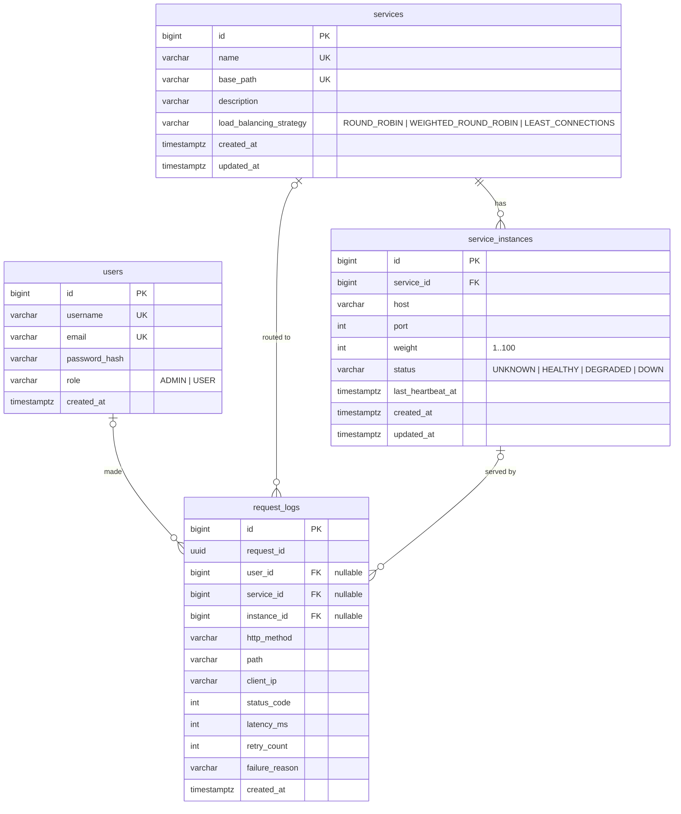

# Database design

The schema is defined by Flyway migrations in
[`backend/src/main/resources/db/migration`](../backend/src/main/resources/db/migration). The backend applies
them automatically on startup. This folder documents the design; the migrations are the source of truth.

## ER diagram

## Tables

| Table | One row represents | Key constraints |
|---|---|---|
| `users` | A person who uses the dashboard or calls APIs | `username` and `email` unique; `role` restricted by CHECK |
| `services` | A logical backend service, e.g. `orders-service` mounted at `/orders` | `name` and `base_path` unique; strategy restricted by CHECK |
| `service_instances` | One running copy of a service at `host:port` | FK to `services` with `ON DELETE CASCADE`; `(service_id, host, port)` unique; port, weight and status CHECKs |
| `request_logs` | One client request that passed through the gateway | Nullable FKs with `ON DELETE SET NULL`; indexes for time-ordered queries |

## Design decisions

**Surrogate `BIGINT` primary keys.** Names can be renamed; ids never change, so foreign keys stay valid.
`BIGINT` because `request_logs` can outgrow the 2.1 billion limit of `INT`.

**`ON DELETE CASCADE` for instances, `SET NULL` for logs.** An instance cannot exist without its service,
so deleting the service deletes its instances. A log is a historical fact: deleting a service should not
erase the record that a request happened, so the reference just becomes NULL.

**Unique constraints enforce the rules, not just the application.** The service layer checks
"does this name exist?" before inserting, but two concurrent requests can both pass that check. Only a
database constraint is race-free. The application check exists to give a friendlier error message.

**Indexes are chosen from queries.**
- `uq_instance_endpoint (service_id, host, port)` also serves "all instances of service X" because
  `service_id` is its leading column, so no separate `service_id` index is needed.
- `request_logs (created_at DESC)` serves "latest N requests".
- `request_logs (service_id, created_at DESC)` serves "latest N requests for service X".
- `request_logs (request_id)` serves "find the request with this X-Request-Id".

Every index speeds up reads and slows down writes (each INSERT updates every index), so `request_logs`
gets only the three indexes a query actually needs.

**`VARCHAR` + `CHECK` instead of PostgreSQL `ENUM` types.** Adding a value to a CHECK constraint is a simple
migration; altering a Postgres enum type has more restrictions. The Java side uses `@Enumerated(STRING)`
so the stored value is readable (`'HEALTHY'`), not an ordinal (`1`) that breaks if the enum is reordered.

**Normalisation (3NF).** Each fact is stored once: a service's name lives only in `services`, and instances
reference it by id. `request_logs` deliberately keeps a denormalised copy of `path` and `http_method`
because a log must record what happened at that moment, even if the service is later changed.

**`request_logs` uses a sequence with `INCREMENT BY 50`.** With `IDENTITY` columns, Hibernate must run each
INSERT immediately to learn the generated id, which prevents JDBC batching. With a pooled sequence it
reserves 50 ids in one round-trip and can batch the inserts, which matters for the highest-volume table.

**`TIMESTAMPTZ` everywhere.** Stored as UTC instants; no ambiguity across time zones or DST changes.
