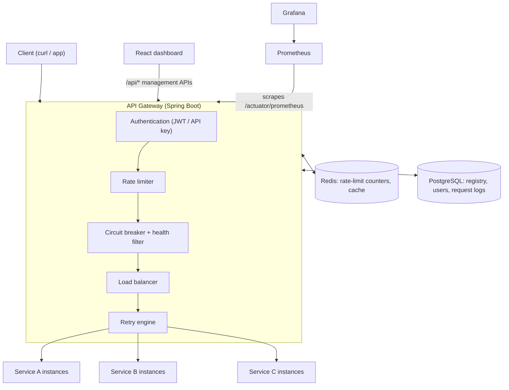
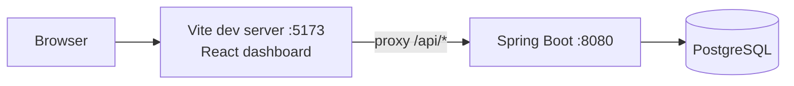
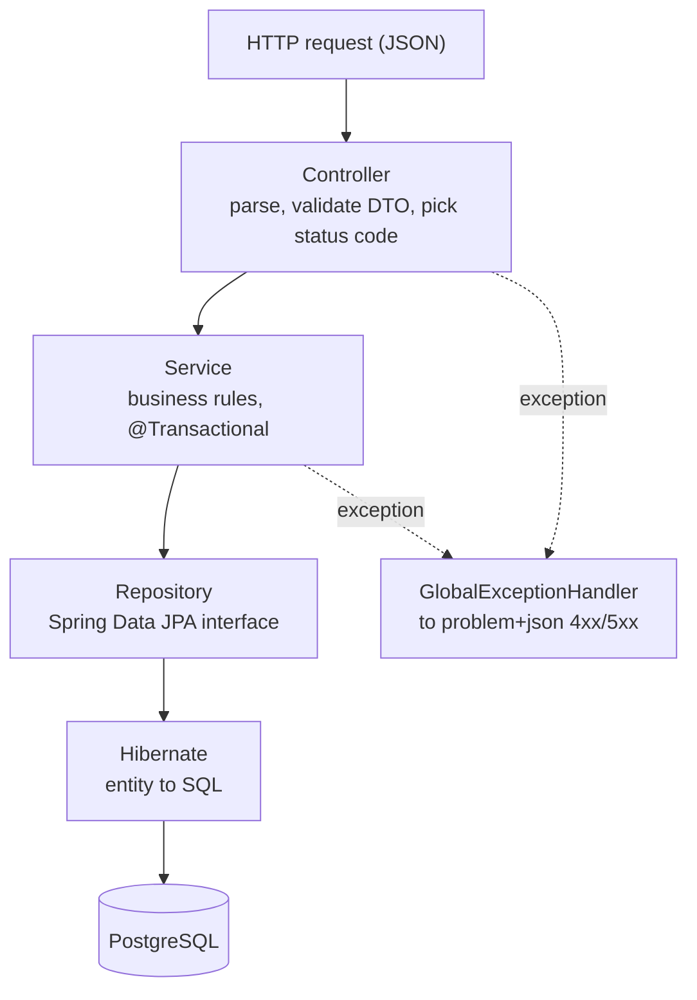
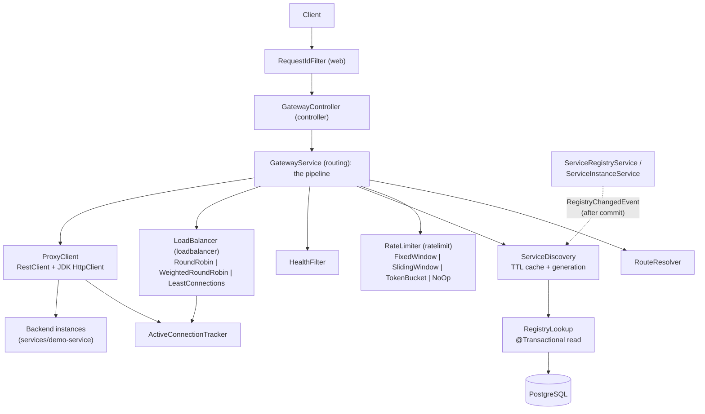

# Architecture

This document tracks the target architecture and what is implemented so far. Anything not marked
**built** is planned, not done.

## Target architecture (end of Phase 4)

Two kinds of traffic go through the backend:

- **Control plane**: `/api/services`, `/api/service-instances`, `/api/health`. The dashboard uses these to
  manage *what* the gateway routes to. **Built in Phase 1.**
- **Data plane**: client requests the gateway forwards to backend services, e.g.
  `/gateway/orders/orders/123` → `GET /orders/123` on an `orders-service` instance. **Built in Phase 2.**

## Phase 1: built

Inside the backend, each request passes through the layers top to bottom:

| Layer | Package | Responsibility | Must not |
|---|---|---|---|
| Controller | `controller` | HTTP: paths, `@Valid`, status codes, `Location` header | contain business rules or touch repositories |
| DTO | `dto` | Shape of JSON in and out; validation annotations | be JPA entities |
| Service | `service` | Business rules, transactions, entity to DTO mapping | know about HTTP |
| Repository | `repository` | Data access queries | contain business rules |
| Entity | `entity` | Mapping of Java objects to tables | be returned directly from controllers |
| Exception | `exception` | Domain exceptions and their HTTP mapping | leak stack traces or SQL to clients |
| Config | `config` | Bean definitions (e.g. `Clock`) | |

Why the layers matter in *this* project: the Phase 2 status endpoint and the Phase 3 health checker
both change instance status through `ServiceInstanceService.updateStatus`, which also publishes the
event that refreshes the gateway's discovery cache. The gateway reads the registry through its own
read-only `RegistryLookup` (repositories directly, no DTO mapping), because it runs on every request.

## Phase 2: built

| Package | Responsibility | Depends on |
|---|---|---|
| `controller` | `GatewayController`: servlet request ↔ `GatewayRequest`/`GatewayResponse` | `routing`, `web` |
| `routing` | Pipeline, route parsing, discovery + cache, health filter, HTTP forwarding, access log | `ratelimit`, `loadbalancer`, `repository`, `exception`, `web` |
| `ratelimit` | `RateLimiter` interface, three algorithms, key resolution, eviction | `config` |
| `loadbalancer` | `LoadBalancingStrategy` interface, three algorithms, `BackendInstance`, connection counts | `entity` (enums) |
| `web` | Request id (MDC), client IP resolution | `config` |
| `exception` | `GatewayException` hierarchy; each subclass carries its HTTP status | `ratelimit` (decision for headers) |

Design rules:
- **Algorithms don't know about HTTP or Spring.** The rate limiters and load balancers are plain classes
  with a `Clock` or tracker passed in, so they are unit-tested with `new`, a fake clock and no Spring context.
- **No database transaction spans a backend call.** Discovery finishes (or hits the cache) before
  `ProxyClient` sends anything.
- **Package dependencies are acyclic.** `BackendInstance` lives in `loadbalancer` so that
  `routing → loadbalancer` is one-way.

Still planned: circuit breaker and retry engine (Phase 3) between the load balancer and the proxy,
Redis-backed rate-limit state, automatic health checks that update instance status, persisted request
logs, and metrics.

## Repository layout

| Path | Purpose | Phase |
|---|---|---|
| `backend/` | Spring Boot app: control-plane API now, gateway data plane from Phase 2 | 1 |
| `frontend/` | React + TypeScript dashboard (Vite) | 1 |
| `database/` | Schema documentation and ER diagram (migrations live in the backend) | 1 |
| `docs/` | Architecture and per-phase learning guides | 1 |
| `services/` | Demo backend services with failure-injection switches | 2 |
| `scripts/` | Start/stop/register the demo services | 2 |
| `monitoring/` | Prometheus and Grafana configuration | 3 |
| `docker/` | Dockerfiles and container configuration | 4 |
| `tests/` | Load tests against the running stack (`LoadTest.java` in Phase 2; k6 and failure scripts in Phase 4) | 2, 4 |
| `docs/results/` | Raw output of every measurement quoted in the docs | 2 |
| `docker-compose.yml` | Local infrastructure (Postgres now; full stack in Phase 4) | 1 |
