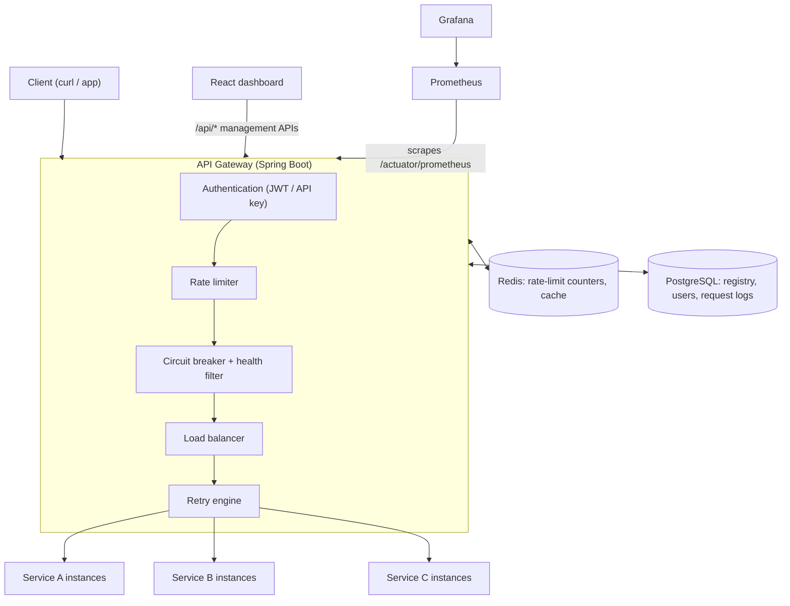
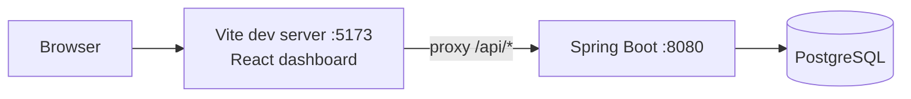
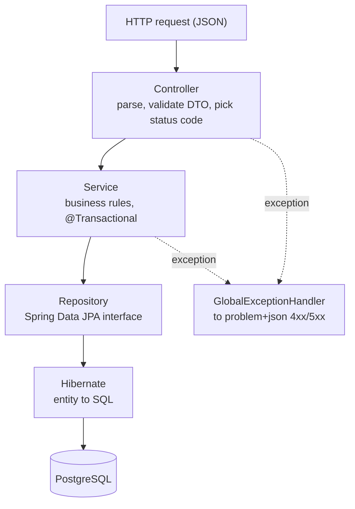

# Architecture

This document tracks the target architecture and what is implemented so far. Anything not marked
**built** is planned, not done.

## Target architecture (end of Phase 4)

Two kinds of traffic go through the backend:

- **Control plane**: `/api/services`, `/api/service-instances`, `/api/health`. The dashboard uses these to
  manage *what* the gateway routes to. **Built in Phase 1.**
- **Data plane**: client requests the gateway forwards to backend services, e.g. `/gateway/orders/123`
  → an `orders-service` instance. **Phase 2.**

## Phase 1: built

Inside the backend, each request passes through the layers top to bottom:

| Layer | Package | Responsibility | Must not |
|---|---|---|---|
| Controller | `controller` | HTTP: paths, `@Valid`, status codes, `Location` header | contain business rules or touch repositories |
| DTO | `dto` | Shape of JSON in and out; validation annotations | be JPA entities |
| Service | `service` | Business rules, transactions, entity to DTO mapping | know about HTTP |
| Repository | `repository` | Data access queries | contain business rules |
| Entity | `entity` | Mapping of Java objects to tables | be returned directly from controllers |
| Exception | `exception` | Domain exceptions and their HTTP mapping | leak stack traces or SQL to clients |
| Config | `config` | Bean definitions (e.g. `Clock`) | |

Why the layers matter in *this* project: in Phase 2 the gateway's proxy code will reuse
`ServiceInstanceService` to find instances without going through HTTP, and in Phase 3 the health checker
will update instance status through the same service. Keeping the rules in the service layer lets
controllers, the gateway and background jobs share them.

## Repository layout

| Path | Purpose | Phase |
|---|---|---|
| `backend/` | Spring Boot app: control-plane API now, gateway data plane from Phase 2 | 1 |
| `frontend/` | React + TypeScript dashboard (Vite) | 1 |
| `database/` | Schema documentation and ER diagram (migrations live in the backend) | 1 |
| `docs/` | Architecture and per-phase learning guides | 1 |
| `services/` | Demo backend services with failure-injection switches | 2 |
| `monitoring/` | Prometheus and Grafana configuration | 3 |
| `docker/` | Dockerfiles and container configuration | 4 |
| `tests/` | Load and failure tests against the running stack | 4 |
| `docker-compose.yml` | Local infrastructure (Postgres now; full stack in Phase 4) | 1 |
