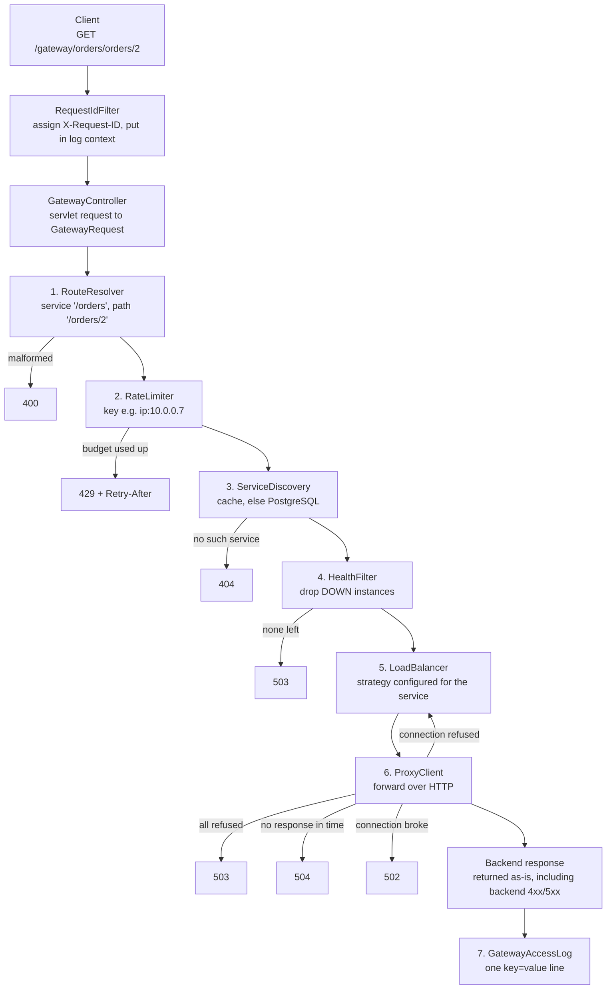

# Phase 2 guide: intelligent traffic management

Phase 1 built a **registry**: a database of services and instances. Phase 2 turns it into a working
**API gateway**. A client request enters at `/gateway/...`. The gateway rate-limits it, finds the
target service, drops unusable instances, picks one with a load-balancing algorithm, forwards the
HTTP request, and returns the response.

Every number in this guide was measured. The raw outputs are in [`results/phase-2`](results/phase-2).

## Contents

1. [What an API gateway is](#1-what-an-api-gateway-is)
2. [Why gateways are needed](#2-why-api-gateways-are-needed)
3. [Service discovery (and caching it)](#3-service-discovery)
4. [Rate limiting](#4-rate-limiting)
5. [Fixed window](#5-fixed-window)
6. [Sliding window](#6-sliding-window)
7. [Token bucket](#7-token-bucket)
8. [Load balancing](#8-load-balancing)
9. [Round robin](#9-round-robin)
10. [Weighted round robin](#10-weighted-round-robin)
11. [Least connections](#11-least-connections)
12. [HTTP proxying](#12-http-proxying)
13. [Gateway error codes](#13-gateway-error-codes)
14. [Request IDs and structured logging](#14-request-ids-and-structured-logging)
15. [Concurrency](#15-concurrency)
16. [Race conditions found in this project](#16-race-conditions-found-in-this-project)
17. [Testing](#17-testing)
18. [Measured results](#18-measured-results)
19. [Bugs found and fixed](#19-bugs-found-and-fixed-in-phase-2)
20. [Strict code review](#20-strict-code-review)
21. [Interview questions](#21-interview-questions)

---

## The request flow at a glance



Code map:

| Step | Class | Package |
|---|---|---|
| Request ID | `RequestIdFilter` | `web` |
| Entry point | `GatewayController` | `controller` |
| Pipeline | `GatewayService` | `routing` |
| 1 | `RouteResolver` | `routing` |
| 2 | `RateLimiter` + `RateLimitKeyResolver` | `ratelimit` |
| 3 | `ServiceDiscovery` → `RegistryLookup` | `routing` |
| 4 | `HealthFilter` | `routing` |
| 5 | `LoadBalancer` → `LoadBalancingStrategy` | `loadbalancer` |
| 6 | `ProxyClient` + `ActiveConnectionTracker` | `routing`, `loadbalancer` |
| Errors | `GatewayException` subclasses → `GlobalExceptionHandler` | `exception` |

---

## 1. What an API gateway is

**WHAT.** A server that sits between clients and a set of backend services. Clients talk only to the
gateway. The gateway decides where each request goes, and it enforces rules (limits, auth, timeouts)
in one place.

**WHY.** Without it, every client must know every service's address, and every service must
reimplement rate limiting, authentication and logging.

**REAL-WORLD EXAMPLE.** A food-delivery app calls `api.example.com/orders/...` and
`api.example.com/payments/...`. Behind that single hostname, a gateway (AWS API Gateway, Kong, NGINX,
Envoy, Spring Cloud Gateway) routes to dozens of services with hundreds of instances.

**HOW IT WORKS HERE.** `GET /gateway/orders/orders/2`:
1. `/gateway` is the gateway's own prefix.
2. `/orders` is the service's **base path**, registered in Phase 1. It selects `orders-service`.
3. `/orders/2` is what gets requested from the chosen instance: `http://localhost:9002/orders/2`.

**DATA STRUCTURE / ALGORITHM.** A pipeline: an ordered chain of steps, each able to stop the request
with an error. Implemented as plain method calls in `GatewayService.handle`, so the order is readable
top to bottom.

**TIME / SPACE.** Per request: O(1) rate-limit check, O(1) cache lookup (a map), O(n) filter and
selection over n instances of the service. Space is dominated by buffered bodies (see §12) and
rate-limit state (§4).

**IMPLEMENTATION.** [`GatewayService`](../backend/src/main/java/com/smartapi/gateway/routing/GatewayService.java).
Why build it instead of using Spring Cloud Gateway? The goal is to understand and defend each step.
A library would hide exactly the parts an interviewer asks about.

**FAILURE CASES.** The gateway is a **single point of failure**: if it is down, nothing works. In
production you run several gateway instances behind a network load balancer. That's why
in-memory rate-limit state is a problem (§4, Phase 3).

**INTERVIEW QUESTIONS.** What is the difference between an API gateway, a reverse proxy and a load
balancer? (A reverse proxy forwards requests; a load balancer is a reverse proxy that spreads them;
a gateway adds API-level concerns such as auth, rate limits and routing by path.) Isn't the gateway
a bottleneck? (Yes, so it must be stateless and horizontally scalable.)

---

## 2. Why API gateways are needed

| Problem without a gateway | What the gateway does |
|---|---|
| Clients hard-code instance addresses | Clients know one URL; routing is data (the registry) |
| One abusive client can overload a service | Rate limiting before the request reaches a backend |
| A dead instance keeps getting traffic | Health filter plus failover to another instance |
| A slow backend holds client connections forever | Timeouts with a clear 504 |
| A failure spanning 3 services is impossible to trace | One request ID in every log line, forwarded to backends |
| Each service implements auth and logging differently | Cross-cutting concerns in one place |

**Trade-off:** an extra network hop (measured: §18) and one more component to operate.

---

## 3. Service discovery

**WHAT.** Answering "which instances of service X exist right now, and at what addresses?"

**WHY.** Instances come and go (deploys, autoscaling, crashes). Addresses must not be hard-coded.

**REAL-WORLD EXAMPLE.** Kubernetes Services/DNS, Consul, Netflix Eureka. Here, the Phase 1 PostgreSQL
registry is the source of truth.

**HOW IT WORKS.** `ServiceDiscovery.find("/orders")` returns the service and **all** its registered
instances. It does **not** decide which instances are usable; that is `HealthFilter`'s job.

**Why discovery and health filtering are separate:** they change for different reasons and at
different speeds. Discovery answers "what exists?" and changes when someone registers or removes an
instance. Health answers "what works right now?" and changes every few seconds (Phase 3 will update it
automatically). Separate classes can be tested separately. It also lets us swap the source of
either (e.g. discovery from Kubernetes, health from active probes) without touching the other.

**DATA STRUCTURE.** A cache: `ConcurrentHashMap<basePath, Entry(service, expiresAt, generation)>`.

**ALGORITHM (added after profiling, see §18).**
```
find(basePath):
    gen = generation.get()                                   # read BEFORE loading
    entry = cache.get(basePath)
    if entry exists and entry.generation == gen and now < entry.expiresAt:
        return entry.service                                 # hit: no database, no transaction
    loaded = registryLookup.load(basePath)                   # 2 SQL queries, read-only transaction
    cache.put(basePath, Entry(loaded, now + TTL, gen))
    return loaded

on RegistryChangedEvent (after the transaction commits):
    generation.incrementAndGet()                             # every existing entry is now stale
    cache.clear()
```

**TIME / SPACE.** Hit O(1). Miss: 2 indexed queries. Space O(R) for R routes.

**IMPLEMENTATION.** [`ServiceDiscovery`](../backend/src/main/java/com/smartapi/gateway/routing/ServiceDiscovery.java)
(the cache), [`RegistryLookup`](../backend/src/main/java/com/smartapi/gateway/routing/RegistryLookup.java)
(the `@Transactional` database read). Four design points:

- **Two beans, not one.** `@Transactional` works through a Spring proxy. If the cache and the
  `@Transactional` method were in one class, either every call would open a transaction, borrowing a
  DB connection even on a cache hit, or an internal `this.load()` call would bypass the proxy and get
  no transaction at all.
- **The DB transaction ends before the backend call.** Holding a pooled connection during a slow
  remote call lets a slow backend exhaust the pool and take the management API down with it.
- **Invalidation after commit.** Clearing the cache before commit would let a concurrent request
  re-cache the old data.
- **The generation counter** closes the remaining race (§16).

**FAILURE CASES.**
- Staleness across gateway instances. A change made through gateway A is seen by gateway B only after
  B's entry expires (TTL 5 s). That's **eventual consistency, bounded by the TTL**. Phase 3 can
  broadcast invalidations via Redis.
- Registry edited directly in SQL, bypassing the API: no event fires, so the change is picked up
  after the TTL.
- Cache stampede on expiry: concurrent misses each query the DB once. That's bounded and cheap here,
  so we accept it rather than hold a lock during a DB call.
- **Negative caching:** unknown routes are cached too, so a flood of 404s can't become a flood of
  queries.

**INTERVIEW QUESTIONS.** Client-side vs server-side discovery? How long can your gateway route to an
instance after it was deleted? (Same instance: 0. Other gateway instances: up to the TTL.) Why not
simply cache forever?

---

## 4. Rate limiting

**WHAT.** Capping how many requests a *key* (user, IP, endpoint) may make per unit of time. Excess
requests get **429 Too Many Requests**.

**WHY.** It protects backends from overload (accidental or malicious), enforces fair use between
clients, and caps costs.

**REAL-WORLD EXAMPLE.** The GitHub API allows 5,000 requests/hour per token and returns
`X-RateLimit-Remaining`. Login endpoints allow a few attempts per minute to slow down password
guessing.

**HOW IT WORKS HERE.** One interface, three algorithms, chosen by configuration:

```java
public interface RateLimiter {
    RateLimitDecision tryAcquire(String key);   // allowed? remaining? retry after?
    default void evictExpired() {}               // free memory for idle keys
}
```

`GatewayConfig.rateLimiter()` is the **only** place that knows the concrete class:

```yaml
gateway.rate-limit:
  enabled: true
  algorithm: TOKEN_BUCKET       # FIXED_WINDOW | SLIDING_WINDOW | TOKEN_BUCKET
  limit: 100
  window: 1m
  key-by: IP                    # any combination of IP, USER, ENDPOINT
```

**Why an interface (OOP).** `GatewayService` depends on the abstraction `RateLimiter`, not on
`TokenBucketRateLimiter`. This is the **Dependency Inversion Principle**. Swapping algorithms is a
config change; adding a fourth algorithm touches no existing class (**Open/Closed**). Unit tests
construct each implementation with `new`, without Spring. When disabled, a `NoOpRateLimiter` is
injected (the **Null Object pattern**), so the gateway has no `if (enabled)` branches.

**Where in the pipeline:** step 2, **before** service discovery. A rejected request costs one map
lookup (measured: 0.18 ms average inside the gateway, §18) instead of cache or database work, so a
flood of requests cannot become a flood of queries. Consequence (tested): requests to non-existent
routes also consume budget.

**Rate-limit dimensions (`RateLimitKeyResolver`):**

| key-by | Key | Effect |
|---|---|---|
| `IP` | `ip:10.0.0.7` | Each client address has its own budget. Users behind one NAT share it. |
| `USER` | `user:alice` (no header → `user:anonymous@10.0.0.7`) | User A and user B never share a bucket |
| `ENDPOINT` | `endpoint:GET /orders` | One budget for **everyone** on that route. Protects the backend. |
| `USER,ENDPOINT` | `user:alice\|endpoint:GET /orders` | Each user gets a budget per endpoint |

The endpoint key uses the *service route*, not the full path. Otherwise `/orders/1`, `/orders/2`, … would
each get a fresh bucket: a bypass, and unbounded memory.

**Security: trusting client identity.**
- **IP.** We use the TCP peer address (`getRemoteAddr()`), which a client cannot forge.
  `X-Forwarded-For` is just a header: a client can send `X-Forwarded-For: 1.2.3.4`, change it on
  every request, and get a fresh budget each time. It is trusted only with
  `trust-forwarded-for: true`, which you set only when a proxy you control sits in front. Even then
  we take the **rightmost** entry (added by our proxy); everything to its left came from the client.
- **USER.** Until Phase 4 the user comes from the unverified `X-User-Id` header. With `key-by: USER`
  an attacker can rotate that header to bypass the limit. That's why the default is `IP`. Phase 4
  derives the user from a verified JWT.

**Response headers.** Allowed: `X-RateLimit-Limit`, `X-RateLimit-Remaining`. Rejected: `429` plus
`Retry-After: <seconds>`, rounded **up**, so a well-behaved client never retries too early.

**Memory.** Every key costs memory. `RateLimiterMaintenance` calls `evictExpired()` every 60 s to drop
keys whose state no longer matters. Without it, every IP that ever sent one request would stay in
memory forever.

**FAILURE CASES.** State is in the gateway's memory. With 3 gateway instances behind a load balancer,
a client gets up to 3× the limit, and a restart resets all budgets. **Phase 3 moves this state to
Redis** so all gateway instances share it.

---

## 5. Fixed window

**WHAT.** Time is cut into aligned windows (12:00:00–12:00:59, 12:01:00–…). Each key may make
`limit` requests per window, and the counter resets when a new window starts.

**Walkthrough: 100 requests/minute** (from `FixedWindowRateLimiterTest.walksThroughRequests1To101InOneWindow`):

| Request | Time | Counter after | Decision | Remaining |
|---|---|---|---|---|
| 1 | 12:00:00 | 1 | allowed (new window created) | 99 |
| 50 | 12:00:00 | 50 | allowed | 50 |
| 99 | 12:00:00 | 99 | allowed | 1 |
| 100 | 12:00:00 | 100 | allowed (the last one) | 0 |
| 101 | 12:00:20 | 100 (unchanged) | **rejected**, 429, `Retry-After: 40` (window ends 12:01:00) | 0 |
| 102 | 12:01:00 | 1 | allowed (new window) | 99 |

**DATA STRUCTURE.** `ConcurrentHashMap<String, Window(startMillis, count)>`. The `Window` record is
immutable, so a new one replaces the old.

**ALGORITHM.**
```
windowStart = now - (now mod windowLength)
compute(key):                                  # atomic per key
    if no window or window.start != windowStart: return Window(windowStart, 1)   -> allowed
    if window.count < limit:                     return Window(windowStart, count+1) -> allowed
    else:                                        keep window                      -> rejected
```

**TIME** O(1). **SPACE** O(K) for K active keys: one counter each.

**ADVANTAGES.** Simplest, cheapest, easy to explain. It maps directly to a Redis
`INCR` + `EXPIRE` (Phase 3).

**DISADVANTAGES: the boundary burst.** 100 requests at 12:00:59.9 and 100 more at 12:01:00.0 are all
allowed: **200 requests in 100 ms** under a "100 per minute" limit. The test
`allowsTwiceTheLimitAcrossAWindowBoundary` proves it. Aligned windows also make every client's budget
reset at the same instant (synchronised bursts).

**IMPLEMENTATION.** [`FixedWindowRateLimiter`](../backend/src/main/java/com/smartapi/gateway/ratelimit/FixedWindowRateLimiter.java).
Rejected requests do not change state, so hammering while blocked doesn't eat into the next window (tested).

**INTERVIEW QUESTIONS.** Show the boundary problem with numbers. How would you implement this in
Redis? (`INCR key` + `EXPIRE key 60` on first increment, done atomically in a Lua script or
`MULTI`.)

---

## 6. Sliding window

**WHAT.** A sliding window *log*: remember the timestamp of every allowed request. A request is
allowed if fewer than `limit` timestamps are younger than `window`. There are no boundaries, so no
double burst.

**WHY a queue works.** Timestamps arrive in increasing order. Appending the newest to the **tail**
keeps the queue sorted, so the **oldest** is always at the **head**. To expire entries we look only
at the head and pop while it is older than `now - window`. We never scan the middle.

**Walkthrough: limit 100/minute** (from `aSlotFreesExactlyWhenTheOldestRequestLeavesTheWindow`):

| Time | Event | Queue (oldest → newest) | Decision |
|---|---|---|---|
| 0 s | request | [0] | allowed (99 left) |
| 30 s | 99 requests | [0, 30, 30, …] (100 entries) | allowed |
| 59.999 s | request | head 0 is still inside (0 > −0.001) | **rejected**, retry in 1 ms |
| 60.000 s | request | pop 0 (0 ≤ 0), push 60 | allowed |
| 60.000 s | request | 100 entries, head 30 | **rejected**, retry in 30 s |

**DATA STRUCTURE.** `ConcurrentHashMap<String, ArrayDeque<Long>>`. `ArrayDeque` is a circular array
with O(1) add at the tail and remove at the head.

**ALGORITHM.**
```
compute(key):                                      # atomic per key
    while head exists and head <= now - window: pop head
    if size < limit: push now at tail    -> allowed, remaining = limit - size
    else:                                -> rejected, retryAfter = head + window - now
```

**TIME** amortised O(1): each timestamp is pushed once and popped once. **SPACE** O(limit) per key,
O(K × limit) total. A 10,000/hour limit stores up to 10,000 longs per key.

**ADVANTAGES.** Exact. No boundary burst: the same traffic that fixed window lets through at double
rate is correctly limited (`doesNotAllowTheBoundaryBurstThatFixedWindowAllows`).

**DISADVANTAGES.** Memory grows with the limit. The common production compromise is the **sliding
window counter**: keep counters for the current and previous fixed windows and estimate
`prev × (overlap fraction) + current`. That is O(1) memory, approximate, and not implemented here.

**Thread safety.** `ArrayDeque` is **not** thread-safe. It is only touched inside
`ConcurrentHashMap.compute()` for its key, which runs atomically per key, so no two threads touch
one deque at the same time. No `synchronized` is needed.

**IMPLEMENTATION.** [`SlidingWindowRateLimiter`](../backend/src/main/java/com/smartapi/gateway/ratelimit/SlidingWindowRateLimiter.java).

**INTERVIEW QUESTIONS.** Why a deque and not a list? Memory for 1 M users at 1,000/hour? (Up to 1 G
timestamps, about 8 GB of longs before overhead: too much, so use the counter approximation.) Redis
version? (A sorted set per key: `ZREMRANGEBYSCORE`, `ZCARD`, `ZADD` in a Lua script.)

---

## 7. Token bucket

**WHAT.** Each key has a bucket that holds up to **capacity** tokens. Tokens are added at **refill
rate**. A request **costs** 1 token; if the bucket has less than 1, the request is rejected.

**Walkthrough: capacity 100, refill 10 tokens/second** (from `TokenBucketRateLimiterTest`):

| Time | Tokens before | Event | Tokens after | Decision |
|---|---|---|---|---|
| 0 | 100 (new buckets start full) | 100 requests | 0 | all allowed: **burst** |
| 0 | 0 | request 101 | 0 | **rejected**, retry after 1 / 10 = **100 ms** |
| 99 ms | 0.99 | request | 0.99 | rejected (not a whole token) |
| 100 ms | 1.0 | request | 0 | allowed |
| +1 s | 10 | 20 requests | 0 | 10 allowed, 10 rejected |
| +1 h | min(100, 36 000) = 100 | 500 requests | 0 | 100 allowed: never more than capacity |

**When the bucket is empty**, requests are rejected until enough time passes for one token to
accumulate. Under sustained overload, clients get exactly the refill rate
(`sustainedRateEqualsRefillRate`: 10 s × 10/s = 100 allowed out of 500).

**Lazy refill (the key idea).** No background thread adds tokens. On each request:
`tokens = min(capacity, tokens + elapsed × rate)`. That's two numbers per key, and the work happens
only when a request arrives.

**DATA STRUCTURE.** `ConcurrentHashMap<String, Bucket(double tokens, long lastRefillMillis)>`.

**ALGORITHM.**
```
compute(key):
    tokens = bucket missing ? capacity : min(capacity, bucket.tokens + (now - last) × rate)
    if tokens >= 1: tokens -= 1                  -> allowed
    else: retryAfter = (1 - tokens) / rate       -> rejected
    store Bucket(tokens, now)
```

**TIME** O(1). **SPACE** O(K): two numbers per key, independent of the limit.

**ADVANTAGES.** Allows **bursts** up to capacity while enforcing the long-run average. Real traffic
is bursty (a page load fires 10 API calls at once), so this is usually the friendliest algorithm.
It's also cheap. Used by AWS API Gateway and many others.

**DISADVANTAGES.** Two parameters to tune. A full bucket permits a burst of `capacity` requests at
once; the backend must survive that.

**Eviction is lossless.** A bucket that has refilled to capacity is identical to a brand-new bucket,
so deleting it changes nothing. `evictExpired` removes exactly those.

**Config mapping.** `limit: 100, window: 1m` → capacity 100, refill 100/60 = 1.67 tokens/s. Measured
(§18): 1000 requests in 1.98 s gave **103 allowed** = 100 burst + 1.98 s × 1.67/s ≈ 3.3 refilled.

**IMPLEMENTATION.** [`TokenBucketRateLimiter`](../backend/src/main/java/com/smartapi/gateway/ratelimit/TokenBucketRateLimiter.java).
Guards against the clock going backwards: `max(0, now - last)`.

### Comparison

| | Fixed window | Sliding window log | Token bucket |
|---|---|---|---|
| Data per key | 1 counter + window start | up to `limit` timestamps | 2 numbers |
| Time per request | O(1) | amortised O(1) | O(1) |
| Space | O(K) | **O(K × limit)** | O(K) |
| Boundary burst | **yes, up to 2 × limit** | no | no, but allows a burst of `capacity` by design |
| Bursts | at window start | none beyond limit | up to capacity, then smooth |
| Accuracy | approximate | exact | exact average rate |
| Default here | | | **yes** |

**Why token bucket is the default:** constant memory, tolerant of normal bursty clients, and an exact
long-term rate. Sliding window is used in Demo 3 because its "5 in any 10 s" behaviour is the easiest
to demonstrate.

**INTERVIEW QUESTIONS.** Why store `double` tokens? (A fractional refill of 0.4 tokens must not be
lost.) Why is lazy refill better than a scheduler thread per bucket? How is token bucket different
from leaky bucket? (A leaky bucket queues requests and drains them at a constant rate: it smooths
output, never bursts, and adds latency.)

---

## 8. Load balancing

**WHAT.** Choosing which instance of a service handles a request.

**WHY.** To use every instance, avoid overloading one, and route around slow ones.

**REAL-WORLD EXAMPLE.** NGINX `upstream` blocks (round robin by default, `weight=`, `least_conn`),
AWS ALB (round robin, least outstanding requests), Envoy.

**HOW IT WORKS: the strategy pattern.**

```java
public interface LoadBalancingStrategy {
    LoadBalancingStrategyType type();                                  // which enum value I implement
    BackendInstance choose(long serviceId, List<BackendInstance> candidates);
}
```

Three `@Component` implementations. `LoadBalancer` receives all of them from Spring
(`List<LoadBalancingStrategy>`), indexes them in an `EnumMap` by `type()`, and **fails at startup** if
any enum value has no implementation. The gateway calls
`loadBalancer.choose(service.strategy(), …)`, and **polymorphism** runs the right algorithm. Each
service picks its strategy in the registry (`services.load_balancing_strategy`, Phase 1).

SOLID in this design:
- **S**: each strategy does one thing.
- **O**: a new algorithm is a new class, with no edits to existing ones.
- **L**: any strategy can replace another.
- **I**: the interface is one method.
- **D**: the gateway depends on the interface.

`BackendInstance` is an immutable record rather than the JPA entity. Routing code can't trigger lazy
loading, and tests build instances with `new`.

---

## 9. Round robin

**ALGORITHM.** A per-service counter; request *n* goes to `candidates[n mod size]`: A, B, C, A, B, C.

**DATA STRUCTURE.** `ConcurrentHashMap<serviceId, AtomicInteger>`.
**TIME** O(1). **SPACE** O(S) for S services.

**Concurrency.** `getAndIncrement()` is one atomic compare-and-swap, so every concurrent caller gets
a **distinct ticket**. Measured: 300 concurrent requests through the real gateway over 3 instances
gave **exactly 100/100/100** (`concurrentRequestsAreAllServedAndConnectionCountsReturnToZero`).
`Math.floorMod` rather than `%`: after 2³¹ requests the counter overflows to negative, and
`negative % n` is a negative index.

**FAILURE CASES.** Ignores weights and speed: a slow instance gets the same share (measured in §18).

---

## 10. Weighted round robin

**WHAT.** Instances get traffic in proportion to their weight. Weight 3 means 3× as much as weight 1
(e.g. a bigger machine).

**Naive vs smooth.** Naive WRR expands the list: `[A, A, A, B]` → **A A A B**. That sends bursts
to A. We implement **smooth WRR** (the NGINX algorithm), which interleaves: **A A B A**.

**ALGORITHM.** Each instance has a `current` weight, starting at 0. For every pick:
1. `current[i] += weight[i]` for every instance;
2. pick the instance with the highest `current`;
3. `current[picked] -= totalWeight`.

**Trace for A = 3, B = 1** (total 4). This is exactly what
`weights3And1GiveASmoothSequence` asserts:

| Pick | After step 1 (A, B) | Chosen | After step 3 (A, B) |
|---|---|---|---|
| 1 | (3, 1) | A | (−1, 1) |
| 2 | (2, 2) tie, first wins | A | (−2, 2) |
| 3 | (1, 3) | B | (1, −1) |
| 4 | (4, 0) | A | (0, 0) ← back to start |

**Fairness guarantee:** over any `totalWeight` consecutive picks with an unchanged candidate set, each
instance is picked exactly `weight` times (tested for 50 consecutive cycles of 3/2/1). Measured
through the real gateway: 60 requests → **30/20/10**; 600 → **300/200/100**; first picks
`9001 9003 9002 9001 9001 9002 …` (interleaved, not bursty).

**DATA STRUCTURE.** Per service, a `HashMap<instanceId, currentWeight>`.
**TIME** O(n) per pick. **SPACE** O(n) per service.

**Concurrency: why a lock here and not an atomic.** A pick reads and writes **several** numbers that
must change together. No single atomic variable can do that, so each service's map is guarded by
`synchronized (map)`. It's a *per-service* lock, so services never block each other. The critical
section is a short loop with no I/O. Measured: 6000 concurrent picks from 50 threads gave exactly
3000/2000/1000.

**FAILURE CASES.** When an instance leaves (DOWN, or refused during failover) its state is removed.
When it returns, it starts from 0: a small, temporary deviation from the ideal sequence.

---

## 11. Least connections

**WHAT.** Send the request to the instance with the fewest **in-flight** requests from this gateway.

**WHY.** It adapts to speed without configuration. A slow instance holds its requests longer, so its
count stays high and it receives less new traffic.

**Active connection counter.** `ActiveConnectionTracker` keeps
`ConcurrentHashMap<instanceId, AtomicInteger>`:
- **increment** (`acquire`) just before `ProxyClient` sends the request;
- **decrement** (`release`) in a **`finally`** block, so it happens on success, 500, timeout and
  exception alike. Forget the `finally` and every failure leaks a count; the instance then looks
  permanently busy and least-connections stops choosing it.

**ALGORITHM.**
```
start = rotation.getAndIncrement() mod n          # rotating start
for i in 0..n-1: candidate = candidates[(start + i) mod n]
                 pick it if its active count is strictly lower than the best so far
```

**Why the rotating start.** Under light traffic every count is 0. If ties went to the first
candidate, **all** sequential traffic would hit one instance. Rotation spreads ties round-robin:
measured sequential distribution was **200/200/200**.

**TIME** O(n). **SPACE** O(n).

**Race condition, accepted on purpose.** Two threads can read the counts (0, 0, 0) at the same moment
and both pick A before either increments. Preventing it requires one lock around "read all counts +
pick + increment", which would **serialise every request through the gateway**. The cost of the race
is a slightly uneven pick. The counters themselves stay exact (atomic): measured, 1000 concurrent
acquire/release pairs ended at exactly 0 with no negative value ever observed.

**Measured (§18):** with instance 9003 slowed to 100 ms and 20 concurrent clients, least connections
sent it **63 of 600** requests. Round robin sent 200 and weighted round robin sent 100, the latter only
because a human configured weight 1.

**FAILURE CASES.** Counts only *this* gateway's connections: with several gateways, each sees part of
the picture. Ignores weights (weighted least connections = `active / weight`, not implemented).

### Load-balancer comparison

| | Round robin | Weighted RR (smooth) | Least connections |
|---|---|---|---|
| Uses | position only | configured weights | live in-flight counts |
| Time per pick | O(1) | O(n) | O(n) |
| State | 1 atomic counter/service | current weight per instance | 1 atomic counter per instance |
| Thread safety | `AtomicInteger` (lock-free) | per-service `synchronized` | `AtomicInteger` counters; benign pick race |
| Handles different machine sizes | no | yes (if weights are right) | partly |
| Handles a suddenly slow instance | no (measured 200/600) | no (measured 100/600, from weight) | **yes (measured 63/600)** |

---

## 12. HTTP proxying

**WHAT.** Receiving a request, sending an equivalent request to another server, and relaying the
response.

**HTTP client choice: Spring `RestClient` on the JDK `HttpClient`.**
- `RestClient` (Spring 6.1+) is **synchronous**, which matches Spring MVC's thread-per-request
  model. Each request is handled by one Tomcat thread that simply waits for the backend.
- `WebClient` is reactive. It needs the Reactor library and a different programming model, and only
  pays off when the whole stack is non-blocking. That's not worth it for a learning project.
- The JDK `HttpClient` underneath keeps a **pool of keep-alive connections** per host, so repeated
  requests reuse TCP connections.

**Configuration** (`GatewayConfig`):

| Setting | Value | Why |
|---|---|---|
| `connectTimeout` | 1 s | Time to open a TCP connection. Refused connections fail immediately; unreachable hosts fail here. |
| `responseTimeout` (`setReadTimeout`) | 5 s | Time to wait for the response. Exceeding it gives 504. |
| HTTP version | 1.1 | Plain-HTTP backends; avoids an `h2c` upgrade attempt |
| Redirects | NEVER | A proxy passes a 3xx to the client instead of following it |

**How a request is forwarded (`ProxyClient.forward`):**
1. Build the target URI: `http://host:port` + downstream path + raw query string.
2. Copy headers **except hop-by-hop headers** (`Connection`, `Keep-Alive`, `Transfer-Encoding`,
   `Upgrade`, `TE`, `Trailer`, `Proxy-*`) and `Host`/`Content-Length`. Those describe a single
   connection, not the message (RFC 9110 §7.6.1), and the client recomputes them.
3. Add `X-Request-ID`, `X-Forwarded-For` (client IP appended), `X-Forwarded-Host`, `X-Forwarded-Proto`.
4. Send the body, if any, and use `exchange()`. Unlike `retrieve()`, it does **not** throw on 4xx/5xx,
   so we can relay the backend's error response unchanged.
5. Copy the response status, headers (minus hop-by-hop) and body back.

**Classifying failures** by walking the exception's cause chain:

| Cause | Meaning | Gateway action |
|---|---|---|
| `ConnectException`, `HttpConnectTimeoutException`, unknown host | the request never left the gateway | **try another instance** (safe even for POST); all failed → 503 |
| `HttpTimeoutException` | request sent, no response in time | **504**, no automatic retry (the backend may have acted on it) |
| anything else (reset, protocol error) | exchange broke | **502** |

**When the target service is unavailable (measured):** with 9003 killed but still registered, all 60
requests succeeded. The 11 that picked 9003 were refused and failed over. Once 9003 was marked DOWN,
0 attempts reached it and average latency fell from 11.6 ms to 8.5 ms. With every process dead: 503
in 9 ms.

**Failover is not the Phase 3 retry engine.** It only covers "could not connect", which is always
safe. Retrying after a timeout or a 503 *response*, with backoff and jitter and only for idempotent
requests, is Phase 3.

**FAILURE CASES.** Bodies are fully buffered in memory in both directions, with no size limit yet
(Phase 4). A streaming proxy would copy in chunks. Every waiting request holds a Tomcat thread (200 by
default), so many slow backends could exhaust the pool. Java 21 virtual threads are the upgrade path.

---

## 13. Gateway error codes

A gateway must tell the client **whose fault** a failure is and **whether retrying may help**. All
gateway failures are `GatewayException` subclasses carrying their own status. One handler in
`GlobalExceptionHandler` renders them as RFC 9457 problem+json with a `requestId` property.

| Code | Meaning | When the gateway returns it | Retry? |
|---|---|---|---|
| **400** Bad Request | The client's request is malformed | `/gateway/` with no service, `..` path segments (also `%2e%2e`), invalid `X-User-Id` | no, fix the request |
| **404** Not Found | Nothing handles this path | No registered service has this base path. A backend's own 404 is passed through unchanged. | no |
| **429** Too Many Requests | The client exceeded its rate limit | Rate limiter rejected it; `Retry-After` says when | after `Retry-After` |
| **500** Internal Server Error | Something crashed | Passed through when a **backend** returns it. The gateway itself returns 500 only for its own bugs. | maybe |
| **502** Bad Gateway | The gateway reached the backend but got an invalid or broken response | connection reset mid-response, protocol error | maybe |
| **503** Service Unavailable | No usable backend right now | service has 0 instances, all instances DOWN, or every connection refused | yes, later |
| **504** Gateway Timeout | The backend accepted the request but didn't answer in time | response timeout exceeded (measured: 504 after 5.009 s) | careful: it may have been processed |

**Why a backend 500 is not converted to 502.** The backend *did* produce a valid HTTP response;
the client should see it (and its body) exactly. 502/503/504 are reserved for "the gateway could not
get a proper response at all". Measured: with 9002 in ERROR mode, 20 of 60 requests returned 500 (its
exact 2/6 weighted share), each with 9002's own body.

**502 vs 503 vs 504, in one sentence each.**
- **502**: I talked to the backend and what came back was broken.
- **503**: I had no backend I could talk to.
- **504**: I talked to the backend and it never answered.

---

## 14. Request IDs and structured logging

**WHAT.** A unique id per request, carried in the `X-Request-ID` header, included in every log line,
forwarded to the backend, and returned to the client.

**WHY.** In a distributed system one user action touches several processes. Without a shared id, you
cannot connect the gateway's log line to the backend's log line to the user's complaint. It's the
simplest form of **distributed tracing**. Phase 3 and later: OpenTelemetry trace/span ids.

**HOW (`RequestIdFilter`, runs first for every request):**
1. If the client sent a *safe-looking* `X-Request-ID` (8–64 chars of `[A-Za-z0-9._-]`), reuse it so a
   trace can span systems. Otherwise generate a UUID. The restriction prevents **log injection**: an id
   containing a newline could forge log lines.
2. Put it in SLF4J's **MDC** (a per-thread map). The log pattern `%X{requestId}` adds it to every line
   written by that request's thread.
3. Set the response header; `ProxyClient` forwards it; problem+json errors include it.
4. `MDC.remove()` in `finally`: Tomcat **reuses threads**, and without it the next request on this
   thread would log the wrong id.

Measured (demo 1): the client sent `X-Request-ID: demo-trace-0001`; the backend's JSON echoed
`"requestId":"demo-trace-0001"`; the response header and the gateway log line carried the same id.

**Structured access log.** Exactly **one line per gateway request**, in `key=value` form, written in
`finally` so failures are logged too:

```
requestId=demo-trace-0001 method=GET path=/gateway/orders/orders/2 client=0:0:0:0:0:0:0:1 user=-
service=orders-service instance=localhost:9001 attempts=1 status=200 latencyMs=102 rateLimit=DISABLED
remaining=- error=-
```

Why one line: it's small, greppable (`grep status=5`), and trivially parsed by log tools. Latency uses
`System.nanoTime()` (monotonic), not the wall clock, which can jump. Status ≥ 500 is logged at WARN.

**FAILURE CASES.** A client can reuse one id for many requests (trace confusion, but harmless).
Requests rejected by `GatewayController` before the pipeline (invalid `X-User-Id`) produce no access
line (known gap).

---

## 15. Concurrency

The gateway is a set of **singleton beans** shared by up to 200 Tomcat threads. Any mutable field is
shared state.

**Why `counter++` on an `int` is unsafe.** It is three steps: *read* the value, *add* 1, *write* it
back. Two threads can both read 41 and both write 42: one increment is **lost**. On top of that,
without synchronisation the JIT may keep the value in a register and write it back much later.
Measured (`docs/results/phase-2/LostUpdate.java`, 8 threads × 1,000,000 increments, 3 runs):

| Counter | Expected | Actual (3 runs) | Time |
|---|---|---|---|
| plain `int` `++` | 8,000,000 | 1,042,630 / 1,043,875 / 2,666,292 (**up to 87% lost**) | 58–70 ms |
| `AtomicInteger.incrementAndGet()` | 8,000,000 | 8,000,000 every run | 132–150 ms |
| `synchronized (lock) { n++; }` | 8,000,000 | 8,000,000 every run | 524–640 ms |

(`volatile int` would *not* fix it: volatile gives visibility, not atomicity of read-modify-write.)

**Which tool, and where it's used in this project:**

| Tool | What it guarantees | Use when | Here |
|---|---|---|---|
| `AtomicInteger` / `AtomicLong` | Lock-free atomic update of **one** variable (CAS) | a single counter or sequence | round-robin tickets, active connections, cache generation, least-connections rotation |
| `LongAdder` | Like `AtomicLong`, faster under heavy contention (striped cells), but reads are slower | counters written by many threads and rarely read | test-side counters |
| `ConcurrentHashMap` | Thread-safe map; `compute`/`computeIfAbsent`/`computeIfPresent` are **atomic per key** | per-key state | all rate-limiter state, per-service LB state, discovery cache |
| `synchronized` | Mutual exclusion plus visibility; simple; released automatically | several variables must change together, short critical section | smooth WRR (per-service lock) |
| `ReentrantLock` | Like `synchronized` plus tryLock, timeouts, fairness, multiple conditions | you need those features | not needed (no case needed tryLock or timeouts) |
| `volatile` | Visibility of the latest write; no atomic read-modify-write | one writer, many readers, independent value | demo-service `ChaosState` (an immutable settings object swapped atomically) |

**Not added blindly:** there is **no** global lock in the request path. Every lock or atomic is
scoped to one key, service or instance, so unrelated requests never wait for each other. The
least-connections pick race is **accepted** (§11) because the alternative would serialise the gateway.

**Why `ConcurrentHashMap.compute` is enough for the rate limiters.** Check-then-act ("read count, if
under limit, write count+1") must be atomic. `compute(key, fn)` runs `fn` while holding a lock on
that key's bin, so two threads for the same key run one after the other. Different keys run in
parallel. Rules: keep the lambda short, never do I/O inside it, and never touch other keys of the
same map from inside it.

**Deadlock.** It requires two threads each holding a lock the other wants. Our code never holds two
locks at once (each `synchronized` block and each `compute` touches one object), so a lock-ordering
deadlock is impossible by construction.

---

## 16. Race conditions found in this project

| Race | Where | Resolution |
|---|---|---|
| Lost update on counters | any `int++` shared by threads | `AtomicInteger`, or `compute()` per key |
| Two threads both pass "count < limit" | rate limiters | check and update inside one `ConcurrentHashMap.compute` |
| Two threads pick the same least-loaded instance | `LeastConnectionsStrategy` | **accepted**; counters stay exact |
| Inconsistent WRR state (several numbers) | `WeightedRoundRobinStrategy` | per-service `synchronized` |
| Leaked connection counts on errors | `ProxyClient` | `release` in `finally` (tested after failures and 300 concurrent requests) |
| **Stale cache after invalidation** (found in review) | `ServiceDiscovery` | generation counter (below) |
| Two requests register the same name (Phase 1) | registry | DB unique constraint → 409 |

**The stale-cache race in detail.** Request A misses the cache and starts reading the registry. An
admin marks instance 9003 DOWN; the transaction commits; the cache is cleared. *Then* A finishes and
stores what it read, which is the old data with 9003 still routable. Clearing alone would let that
entry live for a full TTL (5 s) with traffic still going to the DOWN instance. Fix: read a
**generation** number before loading, tag the entry with it, and have invalidation increment the
generation. The stale entry carries an old generation and is ignored. The test
`resultLoadedWhileAnInvalidationHappensIsNotServedAfterwards` reproduces the exact interleaving
deterministically, by triggering the invalidation from inside the mocked database call.

---

## 17. Testing

**Time must be testable.** Every rate limiter takes a `java.time.Clock` (the bean from Phase 1's
`TimeConfig`). Tests use `MutableClock` and call `clock.advance(Duration.ofSeconds(59))`. The test
runs in microseconds, does exactly the same thing on every run, and cannot flake on a slow CI
machine. `Thread.sleep()` tests are slow, and they are **wrong under load**: a sleep of 1 s can take
1.3 s, which silently changes what is being tested. No test in this project calls `Thread.sleep`
(the stub backend sleeps to *simulate* a slow server, which is the thing under test).

**Concurrency tests without timing assumptions.** Time is frozen during the rate-limiter concurrency
test, so the correct answer is *exact* (exactly 100 of 1000 allowed), not "approximately". A
`CountDownLatch` releases all threads at once to maximise contention. `Future.get()` rethrows worker
exceptions, so a crash in a thread fails the test instead of being swallowed.

**Test inventory (all passing):**

| Suite | Tests | What it proves |
|---|---|---|
| `FixedWindowRateLimiterTest` | 7 | requests 1/50/99/100/101, reset, boundary burst, key isolation, eviction |
| `SlidingWindowRateLimiterTest` | 4 | exact slot freeing, no boundary burst, eviction |
| `TokenBucketRateLimiterTest` | 6 | burst, refill, cap, sustained rate, config mapping, lossless eviction |
| `RateLimiterConcurrencyTest` | 6 | 1000 requests / 50 threads → exactly 100, for all 3 algorithms; 10 keys independent |
| `RateLimitKeyResolverTest` | 5 | IP / USER / ENDPOINT / combined keys, anonymous fallback |
| `RoundRobinStrategyTest` | 4 | order, per-service counters, shrinking candidate list |
| `WeightedRoundRobinStrategyTest` | 5 | `AABAAABA`, NGINX reference sequence, exact per-cycle counts |
| `LeastConnectionsStrategyTest` | 4 | fewest wins, ties rotate, slow instance starved |
| `LoadBalancerTest` | 3 | dispatch by type, fail-fast on missing strategy |
| `LoadBalancerConcurrencyTest` | 3 | RR 1000/1000/1000 and WRR 3000/2000/1000 under 50 threads; tracker back to 0 |
| `RouteResolverTest` | 13 | path splitting, `..` / `%2e%2e` / bad encoding rejected |
| `HealthFilterTest` | 1 | only DOWN excluded |
| `ServiceDiscoveryTest` | 5 | TTL, negative caching, invalidation, race fix, TTL 0 |
| `GatewayIntegrationTest` | 16 | real HTTP gateway + PostgreSQL + stub backends: routing, request id, POST body, backend 500, 404, 400, 503 ×3, DOWN filtering, failover, 504, RR and WRR distribution, 300 concurrent requests |
| `GatewayRateLimitIntegrationTest` | 3 | 5/10 s: 6th request gets 429 + `Retry-After`; per-user budgets; limit applied before lookup |
| Phase 1 suites (+1 PATCH test) | 23 | unchanged behaviour |
| **Backend total** | **108** | `cd backend && ./mvnw verify` |
| demo-service | 7 | instance identity, request-id echo, chaos modes, chaos blocked via proxy |

The integration tests talk to the gateway over **real HTTP on a random port**, and the gateway talks
to **real HTTP stub servers** (`StubBackend`, the JDK's built-in `HttpServer`) that can be healthy,
return 500, be slow, or be absent (a closed port gives a real "connection refused").

---

## 18. Measured results

**Environment:** Intel i5-1035G1 (4 cores / 8 threads), 7.6 GB RAM. The gateway, 5 demo JVMs,
PostgreSQL and the load generator all shared this laptop, so single runs varied by up to ~30%. Load
generator: `tests/load/LoadTest.java`, closed loop. Raw outputs: [`results/phase-2`](results/phase-2).

### Load-balancing distributions (demo 2 and 5)

Three instances with weights 3/2/1, 600 requests each:

| Strategy | Sequential, all equal | 20 concurrent, 9003 slowed to 100 ms | Avg latency (slow case) |
|---|---|---|---|
| Round robin | 200 / 200 / 200 | 200 / 200 / 200 | 80.2 ms |
| Weighted round robin | 300 / 200 / 100 | 300 / 200 / 100 | 67.9 ms |
| Least connections | 200 / 200 / 200 | **283 / 254 / 63** | 73.9 ms |

Least connections reduced the slow instance's share from 200 to 63 **without being told anything**.
WRR did better on latency here only because its configured weight happened to already give 9003 the
smallest share.

### Finding and fixing the gateway's bottleneck

The first measurement (1000 requests, concurrency 20) showed **~355 req/s through the gateway against
~1236 req/s direct** to one backend. Rather than guess, the gateway was profiled with **Java Flight
Recorder**:

| Where CPU samples fell | Before cache | After cache |
|---|---|---|
| `ServiceDiscovery` (transaction + Hibernate + SQL) | **65.1%** | **1.3%** |
| JDK HttpClient (the actual proxying) | 7.6% | 19.8% |

Fix: the discovery cache (§3). Same jar, same session, cache off vs on (3000 requests, concurrency
20, after warmup, 2 runs each; CPU from `/proc/<pid>/stat`):

| | Throughput | Avg latency | Gateway CPU per request |
|---|---|---|---|
| Cache off | 351.8 / 396.0 req/s | 56.7 / 50.4 ms | 12.42 / 10.79 ms |
| Cache on | **574.3 / 638.8 req/s** | **34.7 / 31.2 ms** | **6.47 / 5.89 ms** |

### 100 / 500 / 1000 requests (concurrency 20, after warmup, cache on)

| Requests | Success | Failed | Throughput | Avg latency | p95 | p99 |
|---|---|---|---|---|---|---|
| 100 | 100 | 0 | 196.7 req/s | 95.7 ms | 218.9 ms | 223.9 ms |
| 500 | 500 | 0 | 309.8 req/s | 63.3 ms | 98.4 ms | 270.2 ms |
| 1000 | 1000 | 0 | 361.9 req/s | 54.8 ms | 103.8 ms | 267.4 ms |
| direct to one backend, 1000 | 1000 | 0 | 1084.8 req/s | 18.2 ms | 28.4 ms | 188.6 ms |

Small runs have lower throughput because the fixed start-up cost of the run (first connections)
weighs more. The gateway costs an extra HTTP hop and about 6 ms of CPU per request on this machine.
**These are laptop numbers for relative comparison, not a capacity claim.**

### Rate limiting under load

Default config (token bucket, 100/minute per IP), 1000 requests at concurrency 20: **103 allowed**
(100 burst + ~3 refilled in 1.98 s), **897 rejected with 429**. Rejections cost **0.18 ms** average
inside the gateway and never reached a backend.

### Failure handling on real processes (demo 4)

| Scenario | Measured |
|---|---|
| 9003 killed, still registered | 60/60 succeeded; 11 connection refusals failed over |
| 9003 marked DOWN | 60/60 succeeded; 0 attempts to 9003; avg 11.6 → 8.5 ms |
| 9002 returns 500 | 40 × 200, 20 × 500 (passed through) |
| 9001 takes 6 s (timeout 5 s) | 504 after 5.009 s; the next request got 200 in 6 ms from another instance |
| all instances DOWN | 503 "All 3 instances … are DOWN" |
| all processes dead | 503 "Could not connect … (3 attempted)" in 9 ms |

---

## 19. Bugs found and fixed in Phase 2

1. **The gateway spent 65% of its CPU re-reading the registry** (found with JFR). Fixed with a TTL
   cache with commit-time invalidation. Measured: CPU per request roughly halved, throughput about +60%.
2. **Stale-cache race** (found in code review): a load that overlapped an invalidation could cache
   old data for a full TTL. Fixed with a generation counter; deterministic regression test.
3. **Chaos endpoints reachable through the gateway** (found in code review):
   `POST /gateway/orders/_chaos?mode=ERROR` would let any client break a backend. The demo service
   now refuses chaos calls that carry `X-Forwarded-For`; tested.
4. **Load-tool miscount:** `LoadTest` counted the `"instance"` field of 429 problem+json bodies as
   a backend. Fixed by counting only 2xx responses. The affected raw output is annotated.
5. **Own tooling mistake:** `pkill -f <pattern>` killed the shell running it, because the command line
   contained the pattern. Processes are now stopped by PID file or listening port.

---

## 20. Strict code review

Severity: **High** = incorrect or exploitable in realistic use; **Medium** = limits scale or hides
problems; **Low** = polish.

| # | Problem | Why it matters | Sev. | Fix | Trade-off |
|---|---|---|---|---|---|
| 1 | Management API has no authentication. Anyone can register `host=169.254.169.254` | The gateway would proxy to internal addresses (**SSRF**) | High | Phase 4: JWT + ADMIN role; also deny private/link-local ranges for instances | Complexity; local demos need a token |
| 2 | `X-User-Id` is trusted | With `key-by: USER`, rotating the header bypasses the limit | High (only with USER) | Phase 4: identity from a verified JWT. Default is `IP` meanwhile. | none |
| 3 | Rate-limit state is per gateway process | N gateways allow N × limit; restarts reset budgets | Medium | Phase 3: Redis with atomic Lua scripts | network hop per request; Redis becomes a dependency |
| 4 | Bodies fully buffered, no size limit | A 1 GB upload or response is held in memory | Medium | Phase 4: request-size limit; later, streaming copy | streaming complicates error handling after headers are sent |
| 5 | Thread-per-request; a slow backend holds a Tomcat thread | 200 slow requests exhaust the pool | Medium | Java 21 virtual threads (`spring.threads.virtual.enabled`), or a circuit breaker (Phase 3) | pinning inside `synchronized` on Java 21 (short here) |
| 6 | Response timeout covers waiting for the response; a backend that sends headers then trickles the body was not tested | Possible hang while reading a slow body | Medium | Add a test with a trickling stub; enforce a total deadline | none |
| 7 | Health status is manual | A crashed instance stays UNKNOWN; each request that picks it pays a failed connect | Medium | Phase 3: active health checks + passive ejection | probe traffic |
| 8 | Cross-gateway cache staleness up to TTL | A DOWN mark is seen by other gateways after ≤ 5 s | Low | Phase 3: invalidation via Redis pub/sub | more moving parts |
| 9 | Least-connections pick race | Slightly uneven picks under bursts | Low (accepted) | Power-of-two-choices would reduce herding cheaply | none needed now |
| 10 | Failover changes WRR state (instance removed, then re-added from 0) | Small temporary deviation from exact weights | Low | Keep state for temporarily excluded instances | more state |
| 11 | `ActiveConnectionTracker` never forgets deleted instances | A few bytes per deleted instance | Low | Remove on `RegistryChangedEvent` for deletes | none |
| 12 | Invalid `X-User-Id` rejected in the controller, before the access log | That 400 has no access line | Low | Move validation into the pipeline | none |
| 13 | Token bucket uses the wall clock | An NTP step forward adds tokens (capped at capacity) | Low | Inject a monotonic ticker | tests need a second fake |
| 14 | `503` responses carry no `Retry-After` | Clients guess when to retry | Low | Add a short `Retry-After` | none |

**Things checked and found fine.** No global lock on the request path. Every connection count is
released in `finally`. DB transactions never span a backend call. No package cycles (after moving
`BackendInstance` into `loadbalancer`). Status codes match §13 in integration tests.

---

## 21. Interview questions

Only about what is implemented. Format: **Q** question · *Testing* what the interviewer checks ·
**A** ideal answer · *Follow-up* · *Mistake* common wrong answer.

### Java and OOP

**Q1. Why is `RateLimiter` an interface, and how does the gateway get an implementation?**
*Testing:* abstraction, DI. **A:** The gateway needs "may this key proceed?", not an algorithm.
`GatewayConfig` has one `@Bean` factory method that reads the config and returns
`FixedWindow…`/`SlidingWindow…`/`TokenBucket…`/`NoOp…`. Spring injects it wherever `RateLimiter` is
required. Switching algorithms is a config change, and each implementation is unit-tested with `new`.
*Follow-up:* where else did you use this? (`LoadBalancingStrategy`.) *Mistake:* "for multiple
inheritance". That's not the point here.

**Q2. How does `LoadBalancer` choose the implementation at runtime?**
*Testing:* polymorphism, Spring collection injection. **A:** Spring injects
`List<LoadBalancingStrategy>` (all three beans). The constructor builds an
`EnumMap<LoadBalancingStrategyType, Strategy>` from each bean's `type()` and throws at startup if one
is missing. `choose()` looks up the service's configured type and calls the interface method: dynamic
dispatch. *Follow-up:* why `EnumMap`? (An array indexed by ordinal: fast and compact.) *Mistake:* a
`switch` in the gateway, which breaks Open/Closed.

**Q3. Where is the Null Object pattern used and why?** **A:** `NoOpRateLimiter` when rate limiting
is disabled: the pipeline code stays identical, with no `if (enabled)` branches.

### Collections and concurrency

**Q4. Why is `count++` unsafe and what did you use instead?** *Testing:* atomicity. **A:**
Read-modify-write in 3 steps; concurrent threads lose updates. Measured: 8 threads × 1 M increments
lost up to 87%. For single counters we used `AtomicInteger` (CAS); for per-key check-then-act we used
`ConcurrentHashMap.compute`. *Follow-up:* does `volatile` fix it? (No: visibility, not atomicity.)
*Mistake:* "make the method `synchronized`". That works but serialises all keys through one lock.

**Q5. `ConcurrentHashMap.compute` vs `get` + `put`?** **A:** `get` then `put` is two operations: two
threads can both read count 99 and both write 100, allowing 101 requests. `compute` runs the whole
update atomically per key (the bin is locked), and different keys proceed in parallel.
*Follow-up:* what must you never do inside the lambda? (Slow work or I/O, or modify other keys of the
same map.) *Mistake:* "`ConcurrentHashMap` makes everything thread-safe". Compound operations still
need `compute`/`merge`.

**Q6. Why is `ArrayDeque` safe inside the sliding-window limiter although it isn't thread-safe?**
**A:** It's only accessed inside `compute()` for its own key, so access is serialised per key.
*Mistake:* switching to `ConcurrentLinkedDeque`. The deque ops would be safe individually, but
"evict, check size, add" as a group still wouldn't be atomic.

**Q7. When did you choose `synchronized` over an atomic?** **A:** Smooth WRR updates several current
weights that must change together. A single atomic can't cover them, so a per-service
`synchronized` block with a short, I/O-free critical section. *Follow-up:* why not `ReentrantLock`?
(No need for tryLock, timeouts or fairness.)

**Q8. Your least-connections has a race. Why didn't you fix it?** **A:** Two threads can pick the
same least-loaded instance before either increments. Fixing it needs a lock around read-all + pick +
increment, which serialises every request. The race only causes a slightly uneven pick; the counters
stay exact. That's a deliberate trade-off. *Mistake:* claiming the algorithm is race-free.

**Q9. How do you know the connection counter never leaks?** **A:** `release` is in `finally`. Tests
assert that all counts are exactly 0 after 300 concurrent gateway requests, after failures, and after
1000 concurrent acquire/release pairs, with no negative value ever observed.

### DSA

**Q10. Walk through fixed window for 100/min at requests 1, 50, 99, 100, 101.** **A:** Counter
1 → 50 → 99 → 100 (remaining 99, 50, 1, 0); request 101 in the same window is rejected with
`Retry-After` = time to the window end. *Follow-up:* the boundary problem. (200 requests in 100 ms
across 12:00:59.9–12:01:00.0.)

**Q11. Why does a queue of timestamps implement a sliding window, and what's the complexity?** **A:**
Timestamps arrive in order, so the oldest is always at the head. Evict from the head while too old,
compare the size with the limit, push at the tail. Amortised O(1) time, O(limit) space per key.
*Follow-up:* reduce memory (the sliding window counter approximation). *Mistake:* scanning the whole
list each time (O(limit)).

**Q12. Token bucket: capacity 100, refill 10/s. What happens at request 101 and when does the next
succeed?** **A:** The burst of 100 empties the bucket; request 101 is rejected with retry after
1/10 s = 100 ms; after 100 ms one token has accumulated. Long-run rate is 10/s. *Follow-up:* why no
background refill thread? (Lazy refill from elapsed time is O(1) and needs no scheduler.)

**Q13. Trace smooth weighted round robin for weights 3 and 1.** **A:** Current weights (A, B): pick
A (3,1)→(−1,1); pick A (2,2)→(−2,2); pick B (1,3)→(1,−1); pick A (4,0)→(0,0). Sequence AABA,
repeating. *Follow-up:* why not AAAB? (It sends bursts to A.)

**Q14. Complexity of each load balancer?** **A:** RR O(1); WRR and LC O(n) per pick for n instances,
with n small (single digits to hundreds).

### Computer networks and HTTP

**Q15. 502 vs 503 vs 504.** **A:** 502: reached the backend, got a broken or invalid response.
503: had no usable backend (none registered, all DOWN, all refused). 504: the backend accepted the
request and didn't answer within the response timeout. *Mistake:* returning 500 for all of them.

**Q16. A backend returns 500. What does your gateway return and why?** **A:** 500 with the backend's
body, unchanged. It *is* a valid response. Gateway-generated codes are for when no proper response
was obtained.

**Q17. Why is failing over after "connection refused" safe but not after a timeout?** **A:** Refused
means the request never reached the backend, so trying another instance can't duplicate work, even
for POST. After a timeout the backend may have processed it; retrying a payment could charge twice.
That's idempotency, handled by the Phase 3 retry engine.

**Q18. What are hop-by-hop headers and why remove them?** **A:** `Connection`, `Keep-Alive`,
`Transfer-Encoding`, `Upgrade`, `TE`, `Trailer`, `Proxy-*`. They describe one TCP connection, not the
message, so forwarding them could corrupt the next connection (e.g. a chunked-encoding header on a
buffered body).

**Q19. Connect timeout vs response timeout?** **A:** Connect: time to establish TCP (1 s). Response:
time waiting for the backend to answer (5 s → 504). Measured: 504 after 5.009 s.

**Q20. Why not trust `X-Forwarded-For`?** **A:** Any client can set it and rotate it to evade per-IP
limits. Use the socket address unless a trusted proxy sits in front; then take the rightmost entry.

### System design

**Q21. Your gateway runs as 3 instances. What breaks?** **A:** Rate limits are per-instance (up to 3×
the limit, reset on restart) and least-connections sees only its own connections. The discovery cache
is only eventually consistent (≤ TTL). Fix: shared state in Redis (Phase 3), and cache invalidation
broadcast.

**Q22. Why rate-limit before looking up the service?** **A:** A rejected request then costs a map
lookup, not a cache or DB query, so a flood can't become database load. Measured: 0.18 ms per rejection.

**Q23. Service discovery vs health filtering: why separate?** **A:** Different questions ("what
exists" vs "what works now"), different rates of change, different sources, independently testable.

**Q24. How did you find the gateway's bottleneck?** *Testing:* measure, don't guess. **A:** Load test
showed ~3× lower throughput than direct. JFR CPU sampling attributed 65% to per-request registry
queries. Added a TTL cache with commit-time invalidation and a generation counter. CPU per request
went ~11.6 → ~6.2 ms and throughput rose ~60%. *Follow-up:* the invalidation race.

### Spring Boot

**Q25. Why `RestClient` and not `WebClient`?** **A:** Spring MVC is thread-per-request; a synchronous
client matches it and is easier to reason about. `WebClient` pays off only in a fully reactive
stack. The JDK HttpClient underneath pools connections. *Follow-up:* how would you handle 10,000
concurrent slow requests? (Virtual threads, or go reactive.)

**Q26. How are the gateway settings loaded and validated?** **A:** A `@ConfigurationProperties`
record (`GatewayProperties`) with `@DefaultValue`s and `@Validated` constraints (`@Min(1)` on the
limit…). A bad value fails at startup, not at the first request.

**Q27. Why did you split `ServiceDiscovery` and `RegistryLookup`?** **A:** `@Transactional` is applied
by a proxy. Self-invocation bypasses it, and a transaction around the cache check would borrow a DB
connection even on cache hits.

**Q28. How do you test time-dependent code without `Thread.sleep`?** **A:** Inject `Clock`; tests use
a `MutableClock` and advance it. That makes them deterministic, instant, and exact at boundaries
(59.999 s vs 60.000 s).

**Q29. How do the gateway integration tests work?** **A:** `@SpringBootTest(webEnvironment =
RANDOM_PORT)` with embedded PostgreSQL. Real HTTP calls to the gateway, which forwards to real JDK
`HttpServer` stubs that can be healthy, erroring, slow, or absent (a closed port gives a real refusal).
