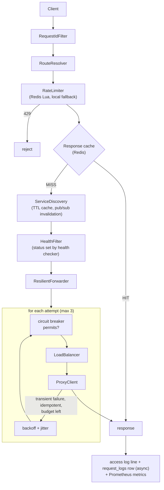
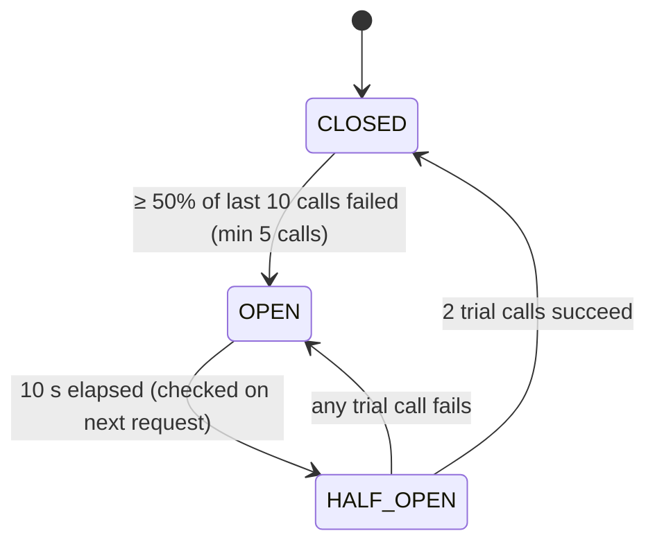

# Phase 3 guide: distributed system features and monitoring

Phase 2 produced a working gateway: route, rate-limit, load-balance, proxy. Phase 3 makes it survive
failure and makes it observable, and it makes the parts that must be shared between several gateway
processes actually shared:

| Concern | Phase 2 | Phase 3 |
|---|---|---|
| A backend keeps failing | every request still tries it | **circuit breaker** stops calling it, then probes recovery |
| Transient errors | only "connection refused" failover | **retry engine**: backoff, jitter, idempotency rules, retry budget |
| Rate limits with N gateways | each gateway has its own buckets (N × limit) | **Redis** Lua scripts: one shared budget; local fallback |
| Registry changes with N gateways | other gateways stale for up to 5 s | **Redis pub/sub** invalidation |
| Instance health | set by hand (`PATCH`) | **automatic probes**, HEALTHY / DEGRADED / DOWN, leader-elected |
| What happened to request X? | one log line | **`request_logs` rows**, searchable, plus traffic statistics |
| Is the system healthy right now? | nothing | **Prometheus metrics + Grafana dashboard** |
| Dashboard | registry page | **8 pages** fed by real APIs |

Every number here was measured; raw output is in [`results/phase-3`](results/phase-3).

## Contents

1. [Cascading failures and the circuit breaker](#1-cascading-failures-and-the-circuit-breaker)
2. [Retry engine](#2-retry-engine)
3. [Why Redis](#3-why-redis-distributed-state)
4. [Distributed rate limiting with Lua](#4-distributed-rate-limiting-with-lua)
5. [When Redis is down](#5-when-redis-is-down)
6. [Response cache](#6-shared-response-cache)
7. [Cache invalidation across gateways](#7-cache-invalidation-across-gateways-pubsub)
8. [Automatic health monitoring and leader election](#8-automatic-health-monitoring-and-leader-election)
9. [Request logging and distributed tracing](#9-request-logging-and-distributed-tracing)
10. [Concurrency toolbox used in this phase](#10-concurrency-toolbox-used-in-this-phase)
11. [Prometheus metrics](#11-prometheus-metrics)
12. [Grafana](#12-grafana)
13. [React dashboard](#13-react-dashboard)
14. [Testing](#14-testing)
15. [Measured results](#15-measured-results)
16. [Bugs found while building Phase 3](#16-bugs-found-while-building-phase-3)
17. [Strict code review](#17-strict-code-review)
18. [Interview questions](#18-interview-questions)

## The request path now

---

## 1. Cascading failures and the circuit breaker

**WHAT.** A per-backend state machine that stops sending traffic to a backend that keeps failing,
waits, then lets a few trial requests through to see whether it has recovered.

**WHY: cascading failure.** Suppose `payments` becomes slow (5 s timeouts). Every gateway request to
it holds a gateway thread for 5 s. Threads run out, so requests to healthy `orders` start queueing too.
Clients retry, which adds load. One slow service has taken down everything that shares the gateway. A
circuit breaker cuts the chain: after a few failures it **fails fast** (immediate 503) instead of
waiting, so threads are released and the struggling service gets breathing room.

**REAL-WORLD EXAMPLE.** Netflix Hystrix (retired), Resilience4j, Envoy "outlier detection", Istio.

**HOW IT WORKS.** States and transitions ([`CircuitBreaker`](../backend/src/main/java/com/smartapi/gateway/resilience/CircuitBreaker.java)):

- *Failure* = refused connection, connect timeout, response timeout, 502, or a backend response with
  status 500/502/503/504. A 4xx is a *success* for the breaker: the backend is responsive and the
  client made a mistake.
- One breaker per backend **address** (`host:port`), not per registry row: if a process is down, every
  service that routes to it should see it.
- `isCallPermitted()` (no side effects) filters load-balancer candidates;
  `tryAcquirePermission()` (may reserve a half-open slot) is called only for the chosen instance.
  Otherwise, merely *considering* an instance would use up its trial slots.

**DATA STRUCTURE.** A **ring buffer** (circular `boolean[]`) of the last N outcomes plus a running
failure count. Recording overwrites the oldest slot and, if that slot held a failure, decrements the
count.

**ALGORITHM / COMPLEXITY.** O(1) per recorded call; O(N) memory per breaker. The failure rate is
`failed / buffered`, where `buffered = min(calls, N)`.

**CONCURRENCY.** All state is guarded by the breaker's own monitor (`synchronized` methods). One
breaker per backend, so requests to different backends never contend. Critical sections are a few
field updates with no I/O. Tested: 1000 concurrent failures open the circuit **exactly once**; 1000
concurrent callers in HALF_OPEN get **exactly** the permitted number of trial slots.

**IMPLEMENTATION.**
[`CircuitBreakerRegistry`](../backend/src/main/java/com/smartapi/gateway/resilience/CircuitBreakerRegistry.java)
(one per address, recent-transition history, listeners for metrics);
[`ResilientForwarder`](../backend/src/main/java/com/smartapi/gateway/routing/ResilientForwarder.java) (integration);
`GET /api/circuit-breakers`. When every routable instance is open, the client gets **503 with
`Retry-After`** = time until the first circuit allows a trial.

**FAILURE CASES.**
- Breaker state is **per gateway process** (like Hystrix and Resilience4j). Each gateway learns from
  its own calls. Sharing it through Redis would put a network call in front of every request.
- A breaker with too small a window flaps; too large, and it reacts slowly. `minimumCalls` stops
  "1 failure out of 1 call = 100%" from opening it right after startup.
- "Alive but broken": the demo's `/health` endpoint still answers while business endpoints return
  500. **Health checks can't see this; the breaker can.** Measured: that's exactly what happened in
  the failure timeline (§15).

**INTERVIEW QUESTIONS.** Why is a 4xx not a failure? What's the difference between a circuit breaker
and a health check? What does HALF_OPEN protect against? (A thundering herd on a just-recovered
backend.)

---

## 2. Retry engine

**WHAT.** Automatically resending a failed request, but only when it is likely to help and safe to do.

**WHY.** Many failures are **transient**: a restart, a dropped connection, momentary overload. One
retry turns a user-visible error into a success. But retries can also do harm:

1. **Duplicate side effects.** Retrying a `POST /payments` after a timeout may charge twice, because
   the first attempt may have succeeded and only the response was lost.
2. **Retry storms.** When a service is overloaded and every client retries 3 times, its load
   triples at the worst possible moment. Synchronised retries arrive in waves.

**HOW IT WORKS** ([`RetryDecider`](../backend/src/main/java/com/smartapi/gateway/resilience/RetryDecider.java)):

| Failure | Transient? | Retried when |
|---|---|---|
| connection refused / connect timeout | yes | **always**: the backend never saw the request |
| response timeout, 502, 503, 504 | yes | only if **idempotent** (GET, HEAD, OPTIONS, PUT, DELETE) or the request carries `Idempotency-Key` |
| 500 | no (usually a bug: *permanent*) | never |
| 4xx | no (the request is wrong) | never |

**Backoff and jitter** ([`RetryPolicy`](../backend/src/main/java/com/smartapi/gateway/resilience/RetryPolicy.java)):
the n-th retry waits `100 ms × 2^(n-1)`, capped at 1 s, then multiplied by a random factor in
[0.8, 1.2]: **100 ms → 200 ms → 400 ms**, each ±20%. Exponential backoff gives the backend time to
recover; jitter de-synchronises clients. Tested: 100 random draws for retry 3 all fall in 320–480 ms
and take more than 50 distinct values.

**Retry budget** ([`RetryBudget`](../backend/src/main/java/com/smartapi/gateway/resilience/RetryBudget.java)):
every client request deposits 0.2 tokens, every retry withdraws 1, capped at 20 saved tokens. So
however many requests fail, retries add at most about 20% load. Tested: a simulated outage of 1000
failing requests produced **exactly 200 retries**, not 1000–2000.

**DATA STRUCTURE / ALGORITHM.** The budget is an `AtomicLong` of thousandths of a token, updated with
a **compare-and-set loop**: read, compute, `compareAndSet(old, new)`, and on failure re-read and retry.
No locks, no blocking. Tested: 1000 concurrent withdrawals from a budget of 50 were granted exactly 50.

**Where retries go.** The forwarder prefers an instance this request hasn't tried yet. With a single
instance it retries the same one (after the backoff). Every attempt goes through the circuit breaker.
The response carries `X-Retry-Count`, and the request log records every failed attempt, e.g.
`TIMEOUT@localhost:9001,RETRYABLE_STATUS@localhost:9002`.

**COMPLEXITY.** O(1) per decision. Worst-case added latency per request =
`maxAttempts × responseTimeout + sum of backoffs` (3 × 5 s + ~0.3 s by default). That is a real cost,
listed in the review.

**FAILURE CASES.** Retry sleeps block the request thread. An `Idempotency-Key` is a promise the
*backend* must keep (by de-duplicating); the gateway doesn't enforce it. A retry advances the
round-robin counter, which shifts distribution (found while testing, §16).

**INTERVIEW QUESTIONS.** Why not retry 500? What is idempotency and why does PUT qualify but POST
doesn't? What's a retry storm and name two defences? (Backoff with jitter; a retry budget; circuit
breakers.) Full jitter vs ±20%? (Full jitter, `random(0, exp)`, spreads load best; ±20% keeps the
100/200/400 shape recognisable, which is a teaching choice.)

---

## 3. Why Redis (distributed state)

**WHAT.** An in-memory data store shared by all gateway processes.

**WHY: the multi-gateway problem.** Phase 2 kept rate-limit buckets in a `ConcurrentHashMap` *inside
each gateway*. With gateways A and B behind a load balancer, a client whose requests alternate between
them has two independent buckets. **Measured with two real gateway processes** (limit 30 per 10 s per
user):

| State store | 60 requests alternating A/B | 1000 concurrent requests (500 to each gateway) |
|---|---|---|
| in-process (`LOCAL`) | **60** allowed | 30 + 30 = **60** allowed |
| **Redis** | **30** allowed | 5 + 25 = **30** allowed |

Also, restarting a gateway resets in-process buckets; Redis keeps them.

**What Redis stores here** (and nothing else):

| Key | Type | TTL | Purpose |
|---|---|---|---|
| `rl:fixed_window:<key>:<windowStart>` | string counter | window | fixed-window rate limit |
| `rl:sliding_window:<key>` | sorted set (score = timestamp) | window | sliding-window log |
| `rl:token_bucket:<key>` | hash {tokens, ts} | time to refill | token bucket |
| `rc:<path>?<query>` | string (JSON) | backend's `max-age` | response cache |
| `gateway:leader:health-checker` | string (gateway id) | 3 × check interval | leader lease |
| channel `gateway:registry-changes` | pub/sub | n/a | cache invalidation |

The source of truth (registry, request logs) stays in PostgreSQL. Redis holds only data that is
**derived, temporary or reconstructible**, so losing Redis loses nothing permanent.

---

## 4. Distributed rate limiting with Lua

**WHAT.** The three Phase 2 algorithms, re-implemented as Redis Lua scripts
([`resources/redis/*.lua`](../backend/src/main/resources/redis)) called by
[`RedisRateLimiter`](../backend/src/main/java/com/smartapi/gateway/ratelimit/RedisRateLimiter.java).

**WHY LUA.** "Read count → compare with limit → write count+1" as three separate Redis commands has
the same lost-update race as `count++` in Java, just across machines: gateways A and B both read 29,
both write 30, and 31 requests get through. Redis executes a Lua script **atomically**: it is
single-threaded and runs one script to completion before anything else. **The script is the critical
section.** (Alternatives: `MULTI`/`WATCH` optimistic transactions, which retry on conflict; or
`INCR`, which is atomic but can't express the sliding window or token bucket.)

**The scripts, briefly.**
- *Fixed window:* `INCR` a per-window key, `PEXPIRE` it on first use. O(1).
- *Sliding window:* sorted set with timestamps as scores: `ZREMRANGEBYSCORE` old entries, `ZCARD`,
  `ZADD` if under the limit. O(log n) per operation; O(limit) memory per key.
- *Token bucket:* hash `{tokens, ts}`, lazy refill, as in Phase 2. Fractional tokens are stored as
  strings, because Lua numbers returned to Redis are truncated to integers.

**Time.** "now" is passed in from the gateway's injectable `Clock`, so the tests are deterministic
(including 1000-thread concurrency tests against real Redis). Trade-off: gateways need roughly
synchronised clocks. NTP keeps them within milliseconds, far below any rate-limit window. The
alternative, `redis.call('TIME')`, removes skew but can't be controlled in tests.

**COMPLEXITY.** One network round-trip per request (sub-millisecond on a LAN). Keys expire by TTL,
so there's no eviction job.

**Tests** (real Redis 8.1; Testcontainers in CI): all 3 algorithms allow exactly the limit, window
reset, sliding eviction, fractional refill; two limiters sharing Redis allow 100 where two local ones
allow 200; **1000 concurrent requests across two limiters allow exactly 100, for every algorithm.**

---

## 5. When Redis is down

**Decision:** Redis is an optimisation, never a hard dependency. A Redis outage must not become a
gateway outage.

- [`RedisGuard`](../backend/src/main/java/com/smartapi/gateway/redis/RedisGuard.java) wraps every Redis
  call **in our own `CircuitBreaker`** (reuse). After 3 failures it skips Redis for 5 s, so requests
  don't each pay a connection timeout (also capped at 250 ms by config), then a trial call detects
  recovery.
- Rate limiting: [`FallbackRateLimiter`](../backend/src/main/java/com/smartapi/gateway/ratelimit/FallbackRateLimiter.java)
  uses the in-process limiter meanwhile ("fail soft"). The three options:

| Option | Redis outage means… |
|---|---|
| fail closed (reject) | every request rejected: Redis outage = total outage |
| fail open (allow all) | no protection at all |
| **fail soft (local limits)** | each gateway limits its own traffic: N gateways allow ≤ N × limit |

- Cache: a Redis error is a cache miss. Leader lock: every gateway checks health (duplicate probes are
  harmless). Pub/sub: gateways fall back to the discovery TTL.
- `/api/health` reports `DEGRADED` (HTTP 200) when only Redis is down, and `DOWN` (503) only when the
  database is down.
- Tested: the gateway **starts and routes with Redis unreachable** (every non-Redis integration test
  class runs that way), and the fallback limiter keeps limiting (5 of 10 allowed; Redis tried 3
  times, then skipped 7 times).

---

## 6. Shared response cache

**WHAT.** GET responses that the backend marks cacheable are stored in Redis and served to later
requests without calling the backend.

**WHY.** Repeated reads of rarely-changing data (menus, catalogues) cost backend work and latency.

**RULES.** A *shared* cache serves one copy to everyone, so it must never store personal data
([`ResponseCachePolicy`](../backend/src/main/java/com/smartapi/gateway/cache/ResponseCachePolicy.java)):
- request: `GET`, no `Authorization`, no `Cookie`;
- response: `200` with `Cache-Control` `max-age`/`s-maxage` > 0 (s-maxage wins, since it's for shared
  caches); not `private`, `no-store` or `no-cache`; no `Set-Cookie`; no `Vary` (other than
  `Accept-Encoding`); body ≤ 256 KB;
- TTL = the backend's max-age, capped at 5 min. **The backend decides freshness** (HTTP semantics,
  RFC 9111); the gateway never guesses a TTL.

The demo `restaurant-service` sends `Cache-Control: max-age=30, public`; `orders` sends nothing, so it
is never cached. Responses carry `X-Cache: HIT|MISS` and, on hits, `Age`.

**Where in the pipeline.** After rate limiting (cached responses still count against limits), before
discovery (a hit costs no discovery and no backend call).

**FAILURE CASES.** Stale reads for up to max-age after the data changes. That's the contract the
backend chose. No stampede protection: many simultaneous misses for the same key each call the
backend once.

**Measured.** The Phase 3 traffic run showed a 17.6–45.5% cache hit ratio in Grafana (it depends on the
traffic mix; only restaurant GETs are cacheable). A controlled with/without-cache load comparison is
Phase 4.

---

## 7. Cache invalidation across gateways (pub/sub)

**The problem.** Phase 2's discovery cache is cleared *locally* when this gateway commits a registry
change. Gateway B keeps routing on stale data for up to its TTL, for example to an instance just marked
DOWN.

**The fix.** [`RegistryChangeBroadcaster`](../backend/src/main/java/com/smartapi/gateway/redis/RegistryChangeBroadcaster.java)
publishes each committed change on the Redis channel `gateway:registry-changes`. Every gateway clears
its cache on receipt, ignoring its own messages (it already cleared locally).

**"Push for speed, TTL for correctness."** Redis pub/sub is fire-and-forget: a gateway disconnected at
that moment misses the message forever. So the TTL stays as the guarantee, and the broadcast only
shortens the usual case. Tested: after a row is changed in the database and a message is published, the
gateway (whose TTL was 10 minutes) routes on the new data within the test's 2-second polling window.

**Startup.** The subscription is started in the background, not with the Spring context. Found by the
tests: subscribing at startup made the whole gateway **fail to start when Redis was down** (§16).

---

## 8. Automatic health monitoring and leader election

**WHAT.** Every 5 s, `GET <instance><service.healthCheckPath>` (default `/health`) on every instance,
in parallel, and derive HEALTHY / DEGRADED / DOWN.

**RULES** ([`HealthEvaluator`](../backend/src/main/java/com/smartapi/gateway/health/HealthEvaluator.java), pure and unit-tested):

| Observation | Result |
|---|---|
| probe OK and fast (≤ 500 ms) | HEALTHY |
| probe OK but slow, **2 in a row** | DEGRADED (still routable) |
| probe failed | DEGRADED, then **DOWN after 3 consecutive failures** (no traffic) |
| DOWN instance answers | stays DOWN until **2 consecutive** successes |

These thresholds are **hysteresis**: one lost probe doesn't pull an instance, one lucky probe doesn't
restore a crashing one, and one slow probe doesn't flip the status. The last rule was added after
Grafana showed flapping on a loaded laptop (§16).

**Tracked per instance:** status, last probe latency, consecutive failures, availability %
(successful / total probes), uptime (since it last became routable), last heartbeat (persisted in
`service_instances.last_heartbeat_at`), last error, plus circuit state and active connections from
the other components. `GET /api/health/instances` joins them all.

**Thread pool.** Probes run on a **fixed pool of 8 daemon threads** (`Executors.newFixedThreadPool`):
bounded concurrency however many instances exist, with threads reused every cycle. Each probe has its
own HTTP timeout plus a `Future.get(timeout)` backstop, so one hung backend delays nobody. The cycle
itself is scheduled with Spring's `TaskScheduler` and wrapped in try/catch, because an uncaught
exception would silently cancel a scheduled task forever.

**Writes.** Status changes go through `ServiceInstanceService.updateStatus`, which publishes the
registry event, so every gateway's routing reacts immediately. Heartbeats are one batched
`UPDATE … WHERE id IN (…)` per cycle.

**Leader election** ([`LeaderLock`](../backend/src/main/java/com/smartapi/gateway/redis/LeaderLock.java)):
with N gateways, N× probes and N× writes would be wasteful. Each cycle a gateway runs one Lua script:
*if the lease is mine, extend it; if it's free, `SET key myId PX ttl`; otherwise I'm not leader.* If
the leader dies, the key expires (TTL = 3 intervals) and another takes over. Measured with two gateway
processes: exactly one held the lease. If Redis is down, every gateway probes. Caveat: a lease is not
safe for work that must *never* run twice (a paused leader may still act after its lease expired).
That requires fencing tokens; health checks tolerate duplicates.

**Passive vs active health.** The circuit breaker is *passive* (it learns from real traffic); probes
are *active*. Measured timeline (§15): a backend returning 500 on business endpoints was caught only
by the breaker; a crashed process was caught by both.

---

## 9. Request logging and distributed tracing

**WHAT.** Every gateway request becomes a `request_logs` row: request id, time, client (`X-User-Id`),
client IP, method, path, service, instance, status, latency, retry count, failure reason (every failed
attempt). Queried via `/api/request-logs` (filters, pagination, lookup by request id),
`/api/traffic/summary` (per-minute counts, p50/p95/p99 via `percentile_cont`, per service) and
`/api/traffic/failures`.

**Producer/consumer design** ([`RequestLogWriter`](../backend/src/main/java/com/smartapi/gateway/logging/RequestLogWriter.java)):
request threads call `queue.offer()` on a bounded `ArrayBlockingQueue(10 000)`. It **never blocks**,
and returns false when full. One writer thread blocks in `poll()`, then `drainTo()`s up to 500 more
and writes them in one transaction as a JDBC batch. That batching is possible because Phase 1 gave
`request_logs` a pooled sequence instead of IDENTITY. Queue full or database down: rows are dropped and
counted (`gateway_request_log_dropped_total`). A request is never slowed down to save a log row, and a
bounded queue can't exhaust memory. Tested: the full queue drops in < 50 ms without waiting; a database
failure drops one batch and the writer survives; 1000 concurrent producers lose nothing.

**Retention.** An hourly job deletes rows older than 7 days (idempotent, so every gateway may run it).

**Distributed tracing, basic concepts.** The `X-Request-ID` is a *trace id*: generated (or accepted)
at the edge, logged in every line, forwarded to the backend (the demo services echo it), returned to
the client, and stored in `request_logs`. Full tracing (OpenTelemetry) adds *spans*: one per hop with
parent/child links and timings, so you can see that a 2 s request spent 1.9 s in the payments
database. Each retry attempt would be its own span. Not implemented; listed in future work.

**Stats across gateways.** Statistics come from the shared table, so they cover all gateways. Prometheus
metrics are per gateway process and real-time. The dashboard uses the first; monitoring uses the second.

---

## 10. Concurrency toolbox used in this phase

| Tool | Where | Why this tool |
|---|---|---|
| `synchronized` (per-object monitor) | `CircuitBreaker`, `InstanceHealth`, `HealthCheckService.runChecks` | several fields change together; short, I/O-free critical sections; one lock per breaker/instance |
| `AtomicLong` + CAS loop | `RetryBudget`, cache generation | lock-free counter with a bounded update rule |
| `AtomicLong`/`AtomicInteger` counters | request-log written/dropped, Redis failures | single independent counters |
| `ConcurrentHashMap` (`compute`, `computeIfAbsent`) | breaker registry, health records, rate limiters | per-key atomic updates, no global lock |
| `ArrayBlockingQueue` (`offer`/`poll`/`drainTo`) | request-log pipeline | bounded producer/consumer with non-blocking producers |
| `ExecutorService` (fixed pool) + `Future.get(timeout)` | health probes; concurrency tests | bounded parallelism, reused threads, timeouts |
| `CountDownLatch` | tests | release 50 threads at once for maximum contention |
| `volatile` | leader flag, `StubBackend` mode, demo `ChaosState` | one writer, many readers, no compound updates |
| Redis Lua script | distributed rate limits, leader lease | atomicity **across processes** |
| `CopyOnWriteArrayList` | breaker listeners | read on every transition, written once at startup |

**Why not one big lock?** A global lock around routing would make the gateway single-threaded. Every
lock here is scoped to one backend, one instance or one key, so unrelated requests never wait.

**Deadlock.** Impossible by construction: no code path holds two locks at once. Breaker listeners run
inside the breaker's lock, so they must not call back into it; the registry's listener takes only its
own separate history lock, always in the same order.

---

## 11. Prometheus metrics

Exposed at `/actuator/prometheus` via Micrometer
([`GatewayMetrics`](../backend/src/main/java/com/smartapi/gateway/metrics/GatewayMetrics.java)):

| Requirement | Metric / PromQL |
|---|---|
| requests/sec | `sum by (service)(rate(gateway_requests_seconds_count[1m]))` |
| average latency | `rate(…_sum[1m]) / rate(…_count[1m])` |
| p95 / p99 | `histogram_quantile(0.95, sum by (le)(rate(gateway_requests_seconds_bucket[1m])))` |
| error rate | 5xx rate / total rate |
| active connections | `gateway_instance_active_connections{service,upstream}` |
| rate-limit violations | `gateway_rate_limit_rejections_total` |
| retry count | `gateway_retries_total{service,reason}` |
| circuit-breaker openings | `gateway_circuit_breaker_transitions_total{to="OPEN"}`; state gauge 0/1/2 |
| service uptime | `gateway_instance_uptime_seconds`, `gateway_instance_up` (1 / 0.5 / 0) |
| extra | cache hit/miss, Redis available/failures/skipped, local-fallback decisions, retry-budget tokens, request-log written/dropped/queued |

**Design points.**
- **Label cardinality:** every label value creates a time series. `service` is a registered name or
  `unresolved`, never the raw path, so random URLs can't create unbounded series. The latency
  histogram has **9 fixed buckets** (10 ms … 5 s) instead of Micrometer's ~70 default buckets.
- Percentiles are computed in Prometheus from buckets, so they're estimates within bucket resolution
  and they aggregate correctly across gateways (client-side percentiles can't be averaged).
- The backend label is `upstream`, not `instance` (bug, §16).

---

## 12. Grafana

`monitoring/grafana/dashboards/gateway.json` (16 panels, generated from a readable list in
`generate_dashboard.py`) is **provisioned** at startup together with the Prometheus datasource: no
manual setup. Every panel query was executed against a live Prometheus 3.15 (all 19 queries returned
data), and the dashboard was rendered in Grafana 13.2 with real traffic
([screenshot](images/phase3-grafana.png)).

---

## 13. React dashboard

Pages (all real API data, polled every 2–5 s): **Overview** (KPIs, requests/min),
**Services** (Phase 2 registry page, moved), **Service health**, **Traffic** (requests and latency per
minute, per-service table), **Rate limiting** (effective settings, 429s/min, recent rejections),
**Failures** (grouped reasons, recent 5xx), **Circuit breakers** (states, transition history),
**Request logs** (filters, pagination, lookup by request id). Charts are a ~100-line SVG component;
the only new dependency is `react-router-dom`. Screenshots: `docs/images/phase3-*.png`.

---

## 14. Testing

**Backend: 170 tests, 0 failures, 0 skipped** (`cd backend && ./mvnw verify`, with Redis provided as
described below), plus 9 demo-service tests.

New in Phase 3:

| Suite | Tests | Proves |
|---|---|---|
| `CircuitBreakerTest` | 9 | every transition, exact threshold, window sliding, peek vs acquire, late results ignored |
| `CircuitBreakerConcurrencyTest` | 2 | 1000 concurrent failures open once; half-open admits exactly N |
| `RetryPolicyTest` / `RetryBudgetTest` / `RetryDeciderTest` | 4 / 3 / 4 | backoff and jitter bounds; 200 retries per 1000 failures; CAS under contention; transient vs permanent, idempotency |
| `ResilienceIntegrationTest` | 6 | real HTTP: circuit opens and traffic moves; OPEN → HALF_OPEN → CLOSED via a controllable clock; failed trial reopens; 503 retried on another instance; POST retried only with Idempotency-Key; backoff timing |
| `RedisRateLimiterTest` | 11 | all algorithms in real Redis; two gateways share one budget; 1000 concurrent across two limiters; fallback |
| `RedisGatewayIntegrationTest` | 4 | Redis rate-limit keys; cache HIT/MISS/TTL/bypass; pub/sub invalidation |
| `ResponseCachePolicyTest` | 3 | the caching rules |
| `LeaderLockTest` | 2 | one leader; takeover after lease expiry; no-Redis fallback |
| `HealthEvaluatorTest` / `HealthCheckIntegrationTest` | 5 / 3 | hysteresis paths; real probes → HEALTHY/DEGRADED/DOWN, recovery, heartbeats, custom health path |
| `RequestLogWriterTest` / `RequestLogIntegrationTest` | 3 / 1 | drop without blocking, survive DB failure, 1000 producers; persisted rows match responses, stats, filters |
| `MetricsIntegrationTest` | 1 | the Prometheus scrape contains the expected series and labels |

**Redis in tests** ([`RedisTestSupport`](../backend/src/test/java/com/smartapi/gateway/support/RedisTestSupport.java)):
`TEST_REDIS_URL` if set; otherwise a **Testcontainers** `redis:7-alpine` when Docker is available (CI);
otherwise a local `redis-server` binary (`REDIS_SERVER_BIN` or PATH); otherwise the Redis tests are
**skipped and reported as skipped**. On the development machine (no Docker) they ran against a local
Redis 8.1 binary, 0 skipped. Testcontainers itself was not executed locally, because Docker isn't installed.

**Controllable time in integration tests.** `ResilienceIntegrationTest` replaces the application
`Clock` bean with a `MutableClock`, so "wait 10 s for the circuit to half-open" is
`clock.advance(10 s)`.

---

## 15. Measured results

Laptop: Intel i5-1035G1, 4 cores / 8 threads, 7.6 GB RAM, shared by the gateway, 5 demo JVMs,
PostgreSQL, Redis, Prometheus, Grafana, a browser and the load generator. These are behavioural
measurements, not capacity claims.

**Failure timeline** ([raw](results/phase-3/failure-timeline.txt)): background traffic on
`orders-service`; instance 9002 fails in two different ways.

| t | Event | Circuit (9002) | Health (9002) |
|---|---|---|---|
| 16 s | returns HTTP 500 (its `/health` still OK) | CLOSED → **OPEN** by 24 s | HEALTHY (probes can't see it) |
| 44 s | recovers | → **CLOSED** by 46 s (half-open trials succeeded) | HEALTHY |
| 62 s | process killed | → **OPEN** by 70 s | **DEGRADED** (66 s) → **DOWN** (76 s) |
| 96 s | restarted | → **CLOSED** at 104 s | → **HEALTHY** at 102 s (2 good probes) |

It took 8 s for the circuit to open after the first 500s because the background traffic was mostly
rate-limited (default 100/min per IP, all workers on one IP), so 9002 received few requests. That's
rate limiting working as configured; later demos raise the limit.

**Two gateways, shared vs local rate limits** ([raw](results/phase-3/two-gateways-rate-limit.txt)): see §3.

**Host-contention episode, observed not staged.** During one traffic run, `payments` (single instance)
and `orders:9001` had several 5 s timeouts. The gateway returned 504s, retried idempotent requests,
opened 9101's circuit and then **failed fast** (52 × 503 with Retry-After) instead of making each client
wait 5 s. The health checker independently recorded missed probes (availability 86.2% on 9001).
Measured directly afterwards, 300 requests to 9101 had max latency 229 ms, and the stalls didn't
reproduce in isolation. The most likely cause is the laptop being saturated (load average 5–7, 186 MB
free RAM) during that burst.

---

## 16. Bugs found while building Phase 3

1. **The gateway could not start without Redis** (found by the integration tests). The pub/sub
   listener container subscribed synchronously at startup and threw. Fixed: the subscription is
   started in the background and retried every 5 s.
2. **Wrong metric label** (found in the first Grafana screenshot). The backend label was called
   `instance`, which Prometheus reserves for the scrape target, so every series showed
   `localhost:8080`. Renamed to `upstream`, with a regression assertion.
3. **Health-status flapping** (found in Grafana). Single slow probes flipped HEALTHY↔DEGRADED; each
   flip is a DB write, a cache invalidation and a Redis broadcast. Now 2 consecutive slow probes are
   required.
4. **Misleading charts**. Minutes without traffic were missing from the per-minute query, so charts
   drew 03:55 and 04:02 as neighbours. Fixed in SQL with `generate_series`. Lines now also break at
   minutes without latency data.
5. **Test assumptions, not code bugs.** These are worth knowing because they reveal real behaviour:
   - Round-robin position is per service *id*, and ids are reused after `TRUNCATE`.
   - A retry calls the load balancer again, so it **advances the round-robin counter**.
   - Under full-suite load, a 500 ms timeout legitimately triggers retries that shift an "exact"
     distribution.
   - A recovered instance's uptime starts at the *second* good probe (hysteresis).
   - Spring Boot tests disable metrics exporters unless `@AutoConfigureObservability` is used.
6. **Commit hygiene.** Two Redis commits were re-split so that each compiles on its own (checked with a
   worktree build of each).

---

## 17. Strict code review

| # | Problem | Why it matters | Sev. | Fix | Trade-off |
|---|---|---|---|---|---|
| 1 | Management APIs (registry, `/api/health/instances/check`, logs) have **no authentication** | anyone can register a backend the gateway will proxy to (SSRF), or read logs containing client ids | **High** | Phase 4: JWT + roles; deny private/link-local ranges for registered hosts | needs a login flow |
| 2 | `X-User-Id` is unverified, and now also stored in logs and used as a Redis key | spoofing both evades per-user limits and pollutes logs | High (with `key-by: USER`) | Phase 4: identity from a verified JWT | none |
| 3 | Retries block the request thread (sleep) | worst case adds `3 × timeout + backoff` per request and holds a Tomcat thread | Medium | Java 21 virtual threads; or a per-request deadline that retries can't exceed | complexity |
| 4 | Circuit breakers and connection counts are per gateway | a failing backend must be detected separately by each gateway | Low (standard) | acceptable; outlier data could be shared via Redis | adds a network hop per request |
| 5 | Response cache has no stampede protection | N concurrent misses = N backend calls | Low | single-flight per key (a local lock or a Redis `SET NX` "being fetched" marker) | latency for waiters |
| 6 | Leader lease without fencing | a paused leader may probe after losing the lease | Low (probes are idempotent) | fencing tokens if the work ever becomes non-idempotent | more state |
| 7 | Request log rows are dropped when the queue is full | incomplete history during overload | Low (counted, visible in Grafana) | larger queue, or ship logs to a log pipeline (Kafka/Loki) | memory / infrastructure |
| 8 | Traffic stats run percentile queries over `request_logs` on every dashboard poll | cost grows with traffic × window | Medium at scale | pre-aggregate per minute, or use Prometheus for dashboards | more moving parts |
| 9 | Cache hits and pre-routing rejections have no service id in logs | the dashboard shows "—" for them | Low | carry the service id in the cache entry | a slightly bigger entry |
| 10 | Health probe URL is built from registry data | combined with #1, probes can be aimed anywhere | High until #1 | same as #1 | — |

**Checked and found fine.** No global lock on the request path. Every circuit permit ends in
success/failure (including unexpected exceptions). The request-log exception is guarded in `finally`
so it can't mask the real outcome. Scheduled jobs catch exceptions. Probe threads are daemons and
shut down. Redis keys all have TTLs. No DB transaction spans a backend call. Metrics labels are
bounded.

---

## 18. Interview questions

Format: **Q** · *testing* · **A** · *follow-up* · *common mistake*.

**Q1. What is a cascading failure and how does your circuit breaker prevent it?** *Resilience
fundamentals.* **A:** A slow dependency holds threads until the caller runs out and fails too. After
≥50% failures in the last 10 calls the breaker opens and requests fail fast with 503 + Retry-After,
releasing threads; after 10 s, 2 trial calls decide whether to close. *Follow-up:* why HALF_OPEN and
not straight to CLOSED? (So a recovered backend isn't flooded by all queued traffic at once.)
*Mistake:* describing a health check.

**Q2. Why does a 4xx count as success for the breaker?** **A:** The backend responded correctly; the
client was wrong. Counting 4xx would let bad clients open circuits on healthy backends.

**Q3. Implement the failure-rate window. Complexity?** *DSA.* **A:** A ring buffer of booleans plus a
running failure count; overwrite the oldest slot, adjust the count. O(1) time, O(N) space.
*Follow-up:* time-based window instead? (Buckets per second, summed; also O(1).)

**Q4. Which failures do you retry, and why not 500?** **A:** Connection failures always; timeouts,
502/503/504 only for idempotent methods or with Idempotency-Key; never 4xx or 500 (usually
deterministic bugs). *Mistake:* "retry everything 3 times".

**Q5. What is idempotency? Is DELETE idempotent? Is POST?** **A:** Same effect however many times it's
applied. DELETE yes (the second call deletes nothing). POST no. An Idempotency-Key lets the backend
de-duplicate a POST.

**Q6. What is a retry storm and how did you prevent one?** **A:** Synchronised retries multiply load
on a struggling service. Defences: exponential backoff with jitter; a retry budget (≤ ~20% extra,
measured 200 retries per 1000 failing requests); circuit breakers stop retries against open backends.

**Q7. How does your retry budget stay correct under concurrency without locks?** *Concurrency.* **A:**
`AtomicLong` with a CAS loop: read, compute, `compareAndSet`; if another thread won, re-read. Tested
with 1000 concurrent withdrawals. *Follow-up:* ABA problem? (Not an issue for a counter where only the
value matters.)

**Q8. Why can't you keep rate limits in a HashMap with multiple gateways?** **A:** Each gateway has its
own buckets. Measured: 60 of 60 allowed with LOCAL vs 30 of 60 with Redis for a 30-request limit
across two gateways.

**Q9. Why a Lua script instead of GET then SET?** *Distributed atomicity.* **A:** GET/compare/SET from
two gateways interleaves (lost update). Redis runs a script atomically, so the script is the critical
section. *Follow-up:* WATCH/MULTI? (Optimistic; retries on conflict; more round-trips.) Redis Cluster?
(Each script touches one key, so it works with sharding.)

**Q10. What happens when Redis goes down?** **A:** RedisGuard (our circuit breaker around Redis) stops
calling it after 3 failures; limits fall back to local (fail soft); cache is skipped; health is
DEGRADED (200). Trade-off: up to N × limit with N gateways during the outage.

**Q11. Fail open, fail closed, fail soft: when would you choose fail closed?** **A:** When exceeding
the limit is worse than an outage (e.g. a paid third-party API with hard quotas or cost limits).

**Q12. How do you make sure a shared cache never leaks one user's data to another?** **A:** Only
anonymous GETs; only responses the backend marks public with max-age/s-maxage; never with Set-Cookie,
private, no-store or Vary. *Mistake:* caching by URL alone.

**Q13. Cache invalidation across gateways: how, and what if a message is lost?** **A:** Redis pub/sub
broadcast after commit; lost messages are covered by the TTL. "Push for speed, expiry for correctness."
*Follow-up:* Redis Streams or Kafka for durable delivery.

**Q14. Why do you need hysteresis in health checks?** **A:** Without it, noise flips status: each flip
costs writes and cache invalidations and moves traffic. We found flapping in Grafana and added "2 slow
probes before DEGRADED".

**Q15. Why a fixed thread pool for probes? What happens with 500 instances?** *OS/concurrency.* **A:**
It bounds concurrent sockets and threads and reuses threads. 500 instances with 8 threads and 2 s
timeouts could take up to ~125 s per cycle in the worst case. Fix: more threads, an async HTTP client, or
spreading probes over the interval.

**Q16. How does leader election work, and what can go wrong?** **A:** `SET NX PX` lease, renewed by a
Lua compare-and-extend; expires if the leader dies. A paused leader may act after expiry, so non-
idempotent work needs fencing tokens. Health probes are idempotent, so duplicates are harmless.

**Q17. How do you log every request without slowing requests down?** **A:** A bounded
`ArrayBlockingQueue`: non-blocking `offer()` from request threads; one writer does `poll` + `drainTo`
and JDBC batch inserts. Full queue → drop and count. *Follow-up:* why batch inserts work here
(pooled sequence, not IDENTITY).

**Q18. How do you compute p95 latency, and why not average it across gateways?** **A:** Prometheus
histogram buckets + `histogram_quantile`, which aggregate across instances. Averaging each gateway's
p95 is mathematically wrong. The dashboard's p95 comes from `percentile_cont` over request logs.

**Q19. What is label cardinality and how did you control it?** **A:** Each distinct label combination is
a separate time series. Service labels are registered names or `unresolved`, never raw paths; the
histogram has 9 buckets. *Mistake:* labelling by user id or URL.

**Q20. What's the difference between logs, metrics and traces?** **A:** Logs: individual events
(`request_logs`). Metrics: cheap aggregates for trends and alerts (Prometheus). Traces: one request's
path across services with timings (request id now; OpenTelemetry spans are future work).

**Q21. How did you test circuit-breaker timing without waiting 10 seconds?** **A:** The Clock bean is
replaced by a MutableClock in the integration test, so `advance(10 s)` is instant and exact.

**Q22. Tell me about a bug you found in Phase 3.** **A:** The gateway failed to start when Redis was
down (a synchronous pub/sub subscription at startup). Found by tests that run without Redis; fixed
with a background subscriber. Or: the Prometheus `instance` label collision, found from a screenshot.
