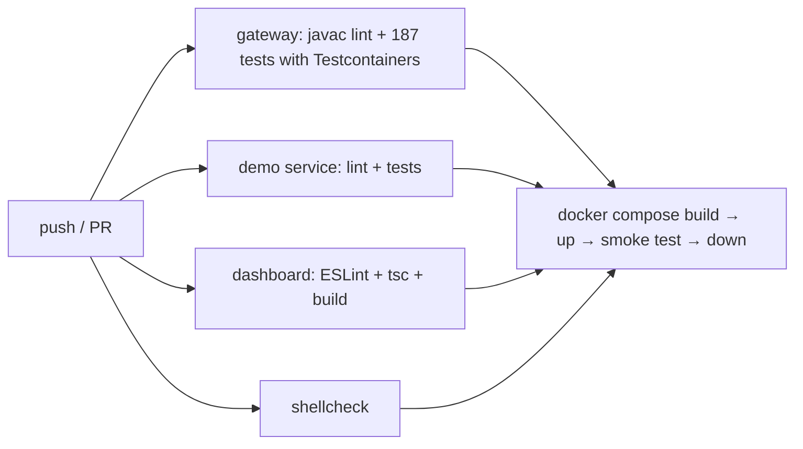

# Phase 4 guide: productionisation, testing and interview preparation

Phase 4 turns a working system into one that is secured, packaged, continuously verified and
measured:

| Area | Result |
|---|---|
| Security | JWT authentication, roles, BCrypt, login brute-force limit, CORS, security headers, size limits, SSRF guard; identity for rate limits comes from the verified token |
| Failure simulation | Admin API, dashboard controls and a scripted demo of the full failure lifecycle |
| Testing | 187 backend + 10 demo-service tests; Testcontainers for PostgreSQL/Redis in CI; database-outage test; 11 security tests |
| Static checks | javac `-Xlint:all -Werror` (both Java builds), ESLint, `tsc --strict`, shellcheck, actionlint |
| Docker | Multi-stage non-root images; 12-container Compose stack; `.dockerignore`s |
| CI/CD | GitHub Actions: lint → tests → images → full-stack smoke test |
| Performance | Load suite at 100–5000 concurrent users, and OFF-vs-ON for rate limiting, caching and circuit breaking |

Raw outputs: [`results/phase-4`](results/phase-4).

---

## 1. Authentication with JWT

**WHAT.** A JSON Web Token is `base64(header).base64(claims).signature`. The server signs
`{"sub":"alice","role":"USER","iss":"smart-api-gateway","exp":…}` with a secret (HMAC-SHA256).
Anyone can *read* the claims, but nobody can *change* them without the secret, because the signature
would no longer match.

**WHY.** It's stateless: any gateway process verifies a token with the shared secret, without a
session store or a database lookup. Measured side effect: during the database-outage test, tokens
kept working.

**HOW** ([`security/`](../backend/src/main/java/com/smartapi/gateway/security)):
- `POST /api/auth/login` checks the BCrypt hash, then `JwtService` issues a 1-hour token.
- Spring Security's resource server verifies every `Authorization: Bearer …`: signature, `exp`
  (against the injected `Clock`, the same one used to issue tokens) and issuer. The `role` claim
  becomes `ROLE_ADMIN` / `ROLE_USER`.
- Two filter chains. On `/gateway/**` a token is optional (anonymous clients are limited per IP) but
  must be valid if present. On `/api/**`, GETs need any user and every change needs ADMIN.
- **Identity for rate limiting** is the token subject; the Phase 2 `X-User-Id` header is ignored
  unless explicitly trusted (tests/demos).

**Why use a library for the crypto** when everything else is hand-written? The algorithms in this
project are about data structures and concurrency. Cryptography is where hand-written code fails in
subtle ways (timing, encoding, algorithm confusion). Nimbus JOSE is audited and widely used.

**FAILURE CASES / tests** (`SecurityIntegrationTest`):
- A token whose payload was edited to `"role":"ADMIN"` keeps the old signature, so it's rejected (401).
- An expired token is rejected with "Access token expired". The clock is advanced 2 h in the test.
- A garbage token on `/gateway/**` gets 401, and never reaches a backend.

**Trade-offs.** A token can't be revoked before it expires (keep it short; add a denylist if
needed). HS256 means every verifier could also mint tokens; at scale, use RS256 with a JWKS endpoint
and key rotation.

## 2. Passwords, brute force and account enumeration

- **BCrypt:** salted and deliberately slow, so a stolen hash table is expensive to crack. Passwords
  must be **12–72** characters, because BCrypt ignores everything after 72 bytes.
- **No username enumeration:** unknown user and wrong password return the same message, and the
  unknown-user path still runs a BCrypt comparison against a dummy hash, so the timing is similar.
- **Brute force:** 10 login attempts per minute per IP, using the Phase 2 `FixedWindowRateLimiter`.
- **Bootstrap admin** from `ADMIN_USERNAME` / `ADMIN_PASSWORD`. The code contains no default password.

## 3. Web security controls

| Control | Why |
|---|---|
| **CORS** allow-list (the dashboard origin only) | Stops other websites' JavaScript from reading API responses with a user's token |
| **CSRF disabled** | CSRF abuses cookies that browsers attach automatically; Bearer headers are never attached automatically |
| `X-Content-Type-Options`, `X-Frame-Options: DENY`, CSP `default-src 'none'`, `Referrer-Policy` | Defence in depth for a JSON API |
| No `Cache-Control` injected on `/gateway/**` | The backend owns caching semantics of its responses (tested: `max-age=60` passes through unchanged) |
| **413** for request bodies > 1 MiB; **502** for backend responses > 10 MiB | Bodies are buffered in memory, so they must be bounded |
| **SSRF guard** | Registering `169.254.169.254` (the cloud metadata service) is rejected |
| `/actuator/prometheus` public | Needed by the scraper; must be network-restricted in production (not in a public DMZ) |

## 4. Failure simulation

`POST /api/simulations {"instanceId", "scenario"}` (ADMIN only; can be disabled) calls the demo
instance's `/_chaos` directly. The demo service refuses chaos calls that arrive through a proxy
(`X-Forwarded-For` present), so clients can't break backends via `/gateway/**`.

| Scenario | Demo service behaviour | Expected gateway reaction |
|---|---|---|
| `ERROR` | 500 on business endpoints; `/health` OK | circuit OPEN; health stays HEALTHY ("alive but broken") |
| `SLOW` | +1.5 s, `/health` too | health DEGRADED after 2 slow probes |
| `TIMEOUT` | +8 s (> 5 s gateway timeout) | 504s, GET retries, circuit OPEN |
| `UNAVAILABLE` | 503 everywhere, `/health` too | HEALTHY → DEGRADED → DOWN, circuit OPEN |
| `RECOVER` | normal | DOWN → HEALTHY after 2 good probes; HALF_OPEN → CLOSED after 2 trial calls |

Measured run ([raw](results/phase-4/failure-simulation.txt)): UNAVAILABLE at t = 10 s → circuit
OPEN by 12 s, DEGRADED at 14 s, DOWN at 24 s; RECOVER at 44 s → HEALTHY and circuit CLOSED at 54 s.
Why the circuit stays OPEN until health recovers: a DOWN instance receives no traffic, so there are no
trial calls. Once the health checker restores it, real requests become the trial calls.

## 5. Testing strategy (final)

| Level | What it proves | Tools |
|---|---|---|
| Unit | algorithms and rules, with time controlled by `MutableClock` | JUnit 5, AssertJ, Mockito |
| Concurrency | exact counts under 50 threads × 1000 operations; no leaks; no double-granted permits | `ExecutorService`, `CountDownLatch` |
| Web slice | status codes, validation, security on controllers | `@WebMvcTest`, `@WithMockUser` |
| Integration | the real app over real HTTP, real PostgreSQL + Redis, real HTTP stub backends | `@SpringBootTest(RANDOM_PORT)`, Testcontainers / embedded binaries |
| Failure | database stops, Redis unreachable, timeouts, refused connections, oversized/malformed input | as above |
| Security | 401/403, forged/expired tokens, BCrypt at rest, CORS, headers, 413, brute force, SSRF | as above |
| System | full Docker stack starts and works | `scripts/ci-smoke-test.sh` in CI |
| Load | throughput/latency/CPU/memory; feature on vs off | `tests/load/perf-suite.sh` |

**Testcontainers vs fallbacks.** In CI (Docker available), integration tests start `postgres:17-alpine`
and `redis:7-alpine` containers. On the development machine (no Docker) the same tests use embedded
PostgreSQL 17 binaries and a local `redis-server`. So the tests themselves were run; the
*Testcontainers path* runs only in CI.

**Test-design lessons from this phase** (each was a failing test that pointed at a design fact, not a
flaky test to silence):
- JUnit creates a test instance per method, so logging in per test hit the login rate limit. The
  token is now cached per gateway.
- A token issued with a test clock was rejected because the decoder used the system clock. That was
  a production inconsistency, fixed by making the decoder use the injected `Clock`.
- Tests that share per-IP limits interfered; advancing the controllable clock starts fresh windows.
- Redis pub/sub drops messages sent before the subscriber connects; the test now waits for the
  subscription, and production relies on the TTL.

## 6. Static checks

- **javac `-Xlint:all -Werror`** on both Java builds. The only findings were a raw generic type
  (fixed with a typed helper and a documented unchecked cast) and an unused try-with-resources
  variable.
- **ESLint** (TypeScript + Rules of Hooks) and **`tsc --strict`** for the dashboard.
- **shellcheck** for every script. It found a real bug: an unquoted array expansion in
  `stop-demo-services.sh` that only worked by accident of word splitting.
- **actionlint** validated the CI workflow.

## 7. Docker and container networking

See [docker/README.md](../docker/README.md). Key points for an interview:
- **Multi-stage builds:** compile in a JDK/Node stage, ship only a JRE/nginx and the artifact.
  Dependency layers are copied first so code changes rebuild fast. `.dockerignore` keeps
  `node_modules` (129 MB) and `target` (75 MB) out of the build context.
- **Non-root users**; the heap is sized from the container limit (`MaxRAMPercentage`).
- **Networking:** one bridge network with DNS by service name (`postgres`, `redis`, `gateway`,
  `orders-1`…). Only the dashboard, gateway, Prometheus and Grafana ports are published.
- **Startup order:** `depends_on: condition: service_healthy`; a one-shot `demo-setup` container
  registers the demo backends as ADMIN.
- A security review of the Compose file removed `X-Forwarded-For` trust: port 8080 is published, so
  clients could have forged it to escape per-IP limits.
- **Honest status:** the development machine has no Docker. The stack is built and smoke-tested in CI.

## 8. CI/CD

Throwaway secrets are generated per run with `openssl rand`, never stored. On failure, test reports
and container logs are uploaded or printed. There's no deployment stage: the project is run locally
or with Compose, and adding one wouldn't prove anything more.

## 9. Performance testing

**What was measured and how.** `tests/load/perf-suite.sh` restarts the gateway with each scenario's
configuration and drives it with `LoadTest.java` (closed loop; each user on a virtual thread). For each
run it records throughput, latency percentiles, status codes, the backend split, the gateway's CPU
seconds (`/proc/<pid>/stat` utime+stime) and its peak RSS (sampled every 0.5 s). Results and tables:
README §20; raw: [results/phase-4/performance.txt](results/phase-4/performance.txt).

**Reading the results.**
- *Scale (100 → 5000 users):* throughput rose from 660 to about 1 145 req/s and then flattened, while
  latency grew with concurrency. That's queueing in a CPU-bound gateway (about 4 of 8 hardware threads,
  shared with everything else). There were 0 errors at every level, including 25 000 requests at
  5 000 users. This is a saturation curve, not a failure curve.
- *Rate limiting:* the backends received 115 of 5 000 requests, exactly the token bucket's budget,
  at no throughput cost.
- *Cache:* +66% throughput, −37% p95, about −33% gateway CPU per request for cacheable GETs.
- *Circuit breaker:* with one backend timing out, throughput 48.5 → 195 req/s, 504s 30 → 0, p95
  5.1 s → 0.38 s.

**What the load tests found** (the real value of load testing):
1. **Token-bucket double refill under load.** The first rate-limiting run allowed 415 requests
   instead of ~116. Metrics ruled out my first hypothesis (0 Redis failures, 0 fallbacks). Cause:
   threads read the clock *before* their atomic update, so updates can arrive out of timestamp
   order, and storing an older "now" moved the refill point backwards, crediting the same interval
   twice. The fix: the refill timestamp never moves backwards, in Java and in Lua. Deterministic
   regression tests (clock moved backwards) fail on the old code with exactly 6 instead of 3.
   Frozen-clock concurrency tests could never have found this; only moving time plus contention did.
2. **An unfair comparison.** One run compared a warmed-up gateway with a freshly restarted one. Both
   B runs now start from a restart.
3. **The load generator was the bottleneck** at 5000 users (two platform threads per user hit the OS
   thread limit). It was rewritten with virtual threads plus a hard deadline.

**Limits of these numbers.** One machine for everything; single runs varied by up to about 30% in
earlier phases; no Docker; no network between client and gateway; no multi-host tests.

## 10. Bugs found in Phase 4

1. **JWT validated against a different clock than it was issued with.** Found by a test with a
   controllable clock; production fix.
2. **Single-thread Spring scheduler:** a slow health-check cycle delayed metrics refresh, the Redis
   subscription retry and log retention. The pool was raised to 4.
3. **X-Forwarded-For trust in docker-compose** would have let clients forge their IP. Removed.
4. **Registration script POSTed every instance twice.** Caught on review before it ran.
5. **Load generator hit the OS thread limit at 5000 users** (two platform threads per user) and
   hung. Rewritten on virtual threads with a hard deadline.
6. **A running gateway broke after its jar was rebuilt underneath it.** Lazy class loading failed.
   The gateway is now always run from an immutable copy (or an image).
7. **Missing `.dockerignore`** would have sent ~200 MB of build context on every image build.
8. **shellcheck** found an unquoted array expansion; **javac lint** found a raw type.

## 10b. Strict code review (Phase 4 additions)

| # | Problem | Why it matters | Sev. | Fix | Trade-off |
|---|---|---|---|---|---|
| 1 | Tokens can't be revoked before expiry | a stolen token works for up to 1 h | Medium | shorter TTL + refresh tokens, or a denylist in Redis | more state / a lookup per request |
| 2 | HS256 shared secret, no rotation | any verifier could mint tokens; rotation needs a redeploy | Medium | RS256 + JWKS + key ids | key management |
| 3 | Token in `sessionStorage` | readable by injected scripts (XSS) | Medium | HttpOnly cookie **plus** CSRF protection; a strict CSP on the dashboard | CSRF complexity |
| 4 | SSRF guard checks literal hosts only | a DNS name that resolves to 169.254.x.x passes | Medium | resolve and check at connect time; egress firewall | more code / infrastructure |
| 5 | `/actuator/prometheus` unauthenticated | exposes internal metrics | Low (if network-restricted) | separate management port, not published | one more port |
| 6 | Docker stack not run on the dev machine | only CI verifies the images | Process | run the CI workflow, or install Docker locally | — |

## 11. Interview preparation

[interview-guide.md](interview-guide.md): 30-second / 1 / 2 / 5-minute explanations, 45 questions
with testing intent, strong answer, follow-up and common mistake, 10 trap questions, resume bullets.
