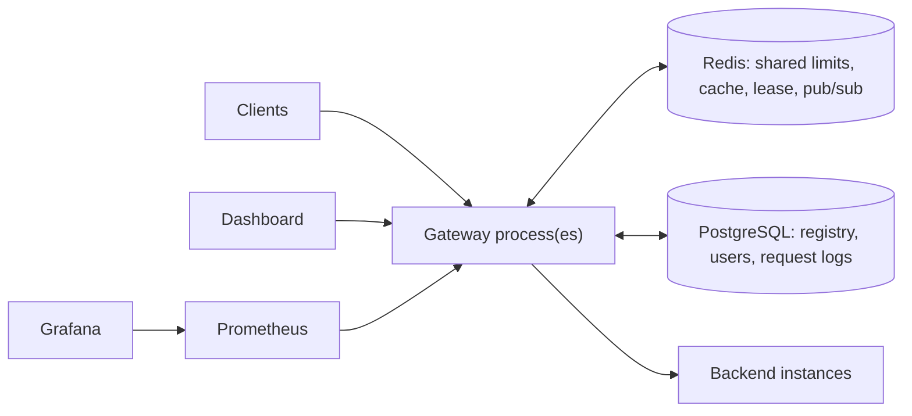

# System design: how this would scale

This document separates two things that are easy to blur in an interview:

- **Implemented now**: what this repository actually does and has been tested to do.
- **Future production scale**: what would change for real traffic, and why. None of it is
  implemented; it's the reasoning an interviewer is looking for.

---

## 1. The system today

| Property | Implemented now |
|---|---|
| Gateway statelessness | Request handling keeps no session state; any gateway process can serve any request. Tested with **two gateway processes** sharing Redis and PostgreSQL. |
| Shared state | Rate-limit budgets, response cache, health-check leader lease and invalidation messages in **one Redis**; registry, users, request logs in **one PostgreSQL**. |
| Per-process state (by design) | Circuit breakers, active-connection counts, discovery cache, Prometheus counters. |
| Failure of Redis | Gateway keeps working: local rate limits, no cache, `DEGRADED` health (tested). |
| Failure of PostgreSQL | Management API 503; proxying continues for routes already in the discovery cache (tested). |
| Deployment | Docker Compose on one host (CI smoke test); no orchestration. |

---

## 2. Horizontal scaling

**Now.** The gateway can already run as N identical processes. What made that true:

- rate limits in Redis (Lua scripts), not in memory;
- registry-cache invalidation broadcast through Redis;
- one health checker at a time (Redis lease);
- JWTs are verified locally with a shared secret, so there's no session store.

**At scale.** Put the gateway processes behind an L4/L7 load balancer (a cloud LB, NGINX, Envoy) and
autoscale on CPU or requests/s. The gateway is CPU-bound in our measurements, so CPU is the right
signal. Keep instances small and numerous: losing one loses little. Move the retry sleep off request
threads (Java 21 virtual threads or a non-blocking client), because at high concurrency blocked
threads, not CPU, become the ceiling.

## 3. Distributed Redis

**Now.** A single Redis. Every rate-limit script touches exactly **one key**, which is deliberate: it
is what makes the scripts compatible with sharding.

**At scale.**
- **Redis Cluster** shards keys across nodes by hash slot. Single-key scripts work unchanged;
  multi-key scripts would need hash tags (`{user:alice}`) to land on one shard.
- **Replication + failover** (Sentinel or a managed service) for availability. Replication is
  asynchronous, so a failover can lose the last few increments. For rate limits that means briefly
  allowing a little extra traffic, which is acceptable. For money it would not be.
- **Hot keys:** an `ENDPOINT`-keyed limit is one key for everyone, so one shard takes all that
  traffic. Mitigations: local pre-aggregation (each gateway takes a batch of tokens at a time), or
  splitting the key into N sub-buckets.
- The local-fallback design already covers a Redis outage.

## 4. Database replication and sharding

**Now.** One PostgreSQL. Reads (registry lookups) are cached in the gateway; writes are small
(registry changes) except `request_logs`, which is written in batches.

**At scale.**
- **Read replicas** for the dashboard and statistics queries. They're read-only and can tolerate a
  second of lag. The registry stays on the primary (it's small and rarely written).
- `request_logs` is the growth problem. First step: **time-based partitioning** (one partition per
  day) so retention is `DROP PARTITION` instead of a big `DELETE`. Next: move logs out of the OLTP
  database entirely, into a log pipeline (Kafka → ClickHouse / Elasticsearch / Loki), which is built for
  append-heavy, time-ordered analytics.
- **Sharding** (splitting rows across databases by key) isn't needed for the registry (tiny). It
  would apply to logs by time or tenant, and in practice a columnar store solves that first.
- The dashboard's percentile queries over raw logs should become **pre-aggregated per-minute rollups**.

## 5. Message queues / Kafka

**Now.** No message queue. The request-log pipeline is an in-process bounded queue that drops rows
when full. Registry invalidation uses Redis pub/sub (fire-and-forget).

**At scale.**
- Publish request events to **Kafka**. It's durable, replayable, and consumers (log storage,
  analytics, billing, anomaly detection) scale independently. The gateway's hot path does only an
  async `send`; losing the database no longer loses logs.
- Use a **durable stream** (Kafka topic or Redis Streams) for registry changes if missed
  invalidations ever matter more than the TTL safety net.

## 6. Service discovery

**Now.** A registry in PostgreSQL, populated through the admin API; instance health from active
probes plus the circuit breaker (passive).

**At scale.** Instances come and go automatically (autoscaling, deploys), so manual registration
doesn't fit. Use **Kubernetes Services/EndpointSlices** (the platform knows which pods are ready) or
Consul/Eureka, where instances register themselves and send heartbeats. The gateway's
`ServiceDiscovery` interface would read from that source instead of PostgreSQL; the load balancer,
health filter and circuit breaker are unchanged.

## 7. Consistency and the CAP theorem

**CAP:** when a network partition happens, a distributed system must choose between
**Consistency** (every read sees the latest write) and **Availability** (every request gets an answer).
The choices made in this project:

| Data | Choice | Why |
|---|---|---|
| Rate-limit budgets | **Availability.** If Redis is unreachable, limit locally (N gateways may allow up to N × limit). | Rejecting all traffic because the limiter's store is down would turn a Redis outage into a total outage. |
| Discovery cache | **Availability with bounded staleness.** Serve cached routes; invalidate by broadcast; TTL guarantees convergence within 5 s. | Routing must continue during a database outage. |
| Circuit-breaker state | **Local**, not shared. | Fastest reaction and no network hop per request; each gateway converges from its own traffic. |
| Registry writes, users | **Consistency.** Single PostgreSQL primary, unique constraints, transactions. | Duplicate service names or users must be impossible. |

**Eventual consistency** here is precise: a registry change made through gateway A is visible to
gateway B immediately if the pub/sub message arrives, and within one discovery TTL (5 s) if it doesn't.

## 8. Kubernetes

**Now.** Docker Compose (one host) with health checks and restart policies.

**At scale.** Gateway as a Deployment with a HorizontalPodAutoscaler. Liveness probe
`/actuator/health/liveness`; readiness `/actuator/health/readiness`, which should be *false* until the
registry has been loaded. Secrets (`JWT_SECRET`, DB credentials) from Kubernetes Secrets or a vault,
never in images. Redis and PostgreSQL as managed services, not pods. Demo backends as Deployments
behind Services, which replaces our registry for them (§6). A PodDisruptionBudget keeps enough
gateways up during node maintenance.

## 9. Observability

**Now.**
- **Metrics:** Prometheus + Grafana, RPS, p95/p99 via histograms, errors, 429s, retries, circuit
  transitions, per-backend health.
- **Logs:** one structured line per request plus `request_logs` rows, all carrying `X-Request-ID`.
- **Correlation:** the request id is forwarded to backends and returned to clients.

**At scale.**
- **Distributed tracing** with OpenTelemetry: a span per hop, parent/child links, and timing per
  retry attempt. Export to Jaeger/Tempo, and sample (e.g. keep all errors plus 1% of successes).
- **Structured JSON logs** shipped to a central store (Loki/Elasticsearch), searchable by request id.
- **Alerts** on SLOs, e.g. "p99 > 500 ms for 5 min" or "error budget burn rate", instead of on raw
  CPU. Prometheus/Alertmanager rules on the existing metrics.
- **Remote-write** Prometheus to long-term storage (Thanos/Mimir) for multi-week trends.

## 10. What would change first, in order

1. Virtual threads (or a non-blocking HTTP client) for the proxy and the retry backoff.
2. Kafka for request events; request logs out of PostgreSQL.
3. Kubernetes-based discovery and readiness-aware health.
4. Redis with replication/failover; hot-key strategy for endpoint limits.
5. OpenTelemetry tracing and SLO alerts.
6. mTLS between gateway and backends; secrets from a vault; rotating JWT keys (a JWKS with
   asymmetric keys instead of one shared HMAC secret, so backends can verify tokens without being
   able to mint them).
